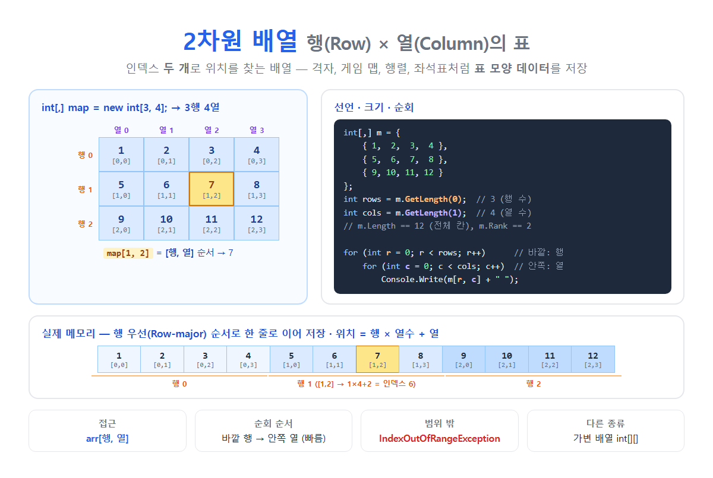

# [2차원 배열](../KeywordsList.md)

</img>

| 항목 | 내용 |
| --- | --- |
| 정의 | 행과 열로 이루어진 표 모양의 배열 |
| 선언 | `타입[,] 이름 = new 타입[행수, 열수];` |
| 접근 | `arr[행, 열]` (둘 다 0부터) |
| 행 수 / 열 수 | `GetLength(0)` / `GetLength(1)` |
| `Length` | 전체 칸 수 (행 × 열) |
| `Rank` | 차원 수 (2) |
| 메모리 | 행 우선(Row-major)으로 연속 저장, 위치 = `r × 열수 + c` |
| 순회 | 이중 for문 (바깥 행 → 안쪽 열), `foreach`는 행 순서로 모든 칸 |
| 기본값 | `0`, `false`, `null` |
| 범위 밖 | `IndexOutOfRangeException` |
| 대표 용도 | 게임 맵, 보드 게임, 행렬, 이미지 픽셀, 좌석표, BFS/DFS 격자 |

## 정의

- 행(Row)과 열(Column)로 이루어진 표 모양의 배열
- 1차원 배열이 인덱스 하나(arr[i])로 위치를 찾는다면, 2차원 배열은 인덱스 두 개(arr[행, 열])로 위치를 찾음.

```csharp
int[,] map = new int[3, 4];   // 3행 4열 = 12칸
map[1, 2] = 7;                // 1행 2열에 7 저장 (0부터 셈)

        열0  열1  열2  열3
행0  [  1    2    3    4  ]
행1  [  5    6   (7)   8  ]   ← map[1, 2]
행2  [  9   10   11   12  ]
```

- C#에는 2차원 배열이 두 종류
    - 다차원 배열 int[,]: 반듯한 직사각형입니다. 보통 “2차원 배열”이라고 하면 이것을 가리킴
    - 가변 배열 int[][]: 배열의 배열이라서 행마다 길이가 다를 수 있음

## 특징

- `[행, 열]` 순서로 접근. 첫 번째 인덱스가 세로 위치(행), 두 번째 인덱스가 가로 위치(열).
- 모든 행의 길이가 같음. 3×4로 만들면 반드시 12칸.
- 크기가 고정됨. 만든 후에는 행이나 열을 추가할 수 없음.
- 메모리에는 한 줄로 이어서 저장됨. 이 방식을 행 우선(Row-major) 순서라고 함.
    - 행 0의 모든 칸 → 행 1의 모든 칸 → ... 순서로 연속 저장됨.
    - `[r, c]`의 실제 위치는 **`r × 열수 + c`**입니다. 예: `[1, 2]` → `1 × 4 + 2 = 6`번 위치
- 참조 형식. `System.Array`를 상속하며 힙에 저장됨.
- 기본값으로 자동 초기화. 숫자는 , `bool`은 `false`, 참조 형식은 `null`

## 기능

#### **크기 구하기**

```csharp
int rows = b.GetLength(0);   // 3  ← 0번째 차원(행) 크기
int cols = b.GetLength(1);   // 4  ← 1번째 차원(열) 크기
int total = b.Length;        // 12 ← 전체 칸 수 (행 수가 아님!)
int rank = b.Rank;           // 2  ← 차원 수
```

#### **이중 for문으로 순회 (가장 기본)**

```csharp
for (int r =0; r < b.GetLength(0); r++)        // 바깥: 행
{
    for (int c =0; c < b.GetLength(1); c++)    // 안쪽: 열
        Console.Write($"{b[r, c],3}");
    Console.WriteLine();
}
// 출력:
//   1  2  3  4
//   5  6  7  8
//   9 10 11 12
```

#### **foreach: 모든 칸을 행 순서대로 하나씩**

```csharp
int sum =0;
foreach (int vin b) sum += v;   // 1, 2, 3, ..., 12 순서로 꺼냄 → sum = 78
```

`foreach`로는 **현재 칸의 행과 열 번호를 알 수 없고, 값을 수정할 수도 없습니다.**

#### **자주 쓰는 연산**

```csharp
// 행별 합계
for (int r =0; r < rows; r++)
{
    int rowSum =0;
    for (int c =0; c < cols; c++) rowSum += b[r, c];
    Console.WriteLine($"{r}행 합:{rowSum}");
}

// 전치 (행과 열 뒤집기): 3×4 → 4×3
int[,] t =new int[cols, rows];
for (int r =0; r < rows; r++)
    for (int c =0; c < cols; c++)
        t[c, r] = b[r, c];

// 최댓값 찾기 (LINQ)
int max = b.Cast<int>().Max();
```

#### **격자에서 상하좌우 이웃 탐색 (게임, 알고리즘 필수)**

```csharp
int[] dr ={ -1, 1, 0, 0 };   // 위, 아래, 왼쪽, 오른쪽
int[] dc ={ 0, 0, -1, 1 };

void VisitNeighbors(int[,] grid, int r, int c)
{
    for (int d =0; d <4; d++)
    {
        int nr = r + dr[d], nc = c + dc[d];
        if (nr <0 || nr >= grid.GetLength(0) || nc <0 || nc >= grid.GetLength(1))
            continue;                        // 범위 체크 필수!
        Console.WriteLine($"이웃: [{nr},{nc}] ={grid[nr, nc]}");
    }
}
```

#### **게임 맵 예시**

```csharp
// 0: 길, 1: 벽, 2: 보물
int[,] map =
{
    { 1, 1, 1, 1, 1 },
    { 1, 0, 0, 2, 1 },
    { 1, 0, 1, 0, 1 },
    { 1, 1, 1, 1, 1 }
};

bool CanMove(int r, int c) => map[r, c] !=1;
```