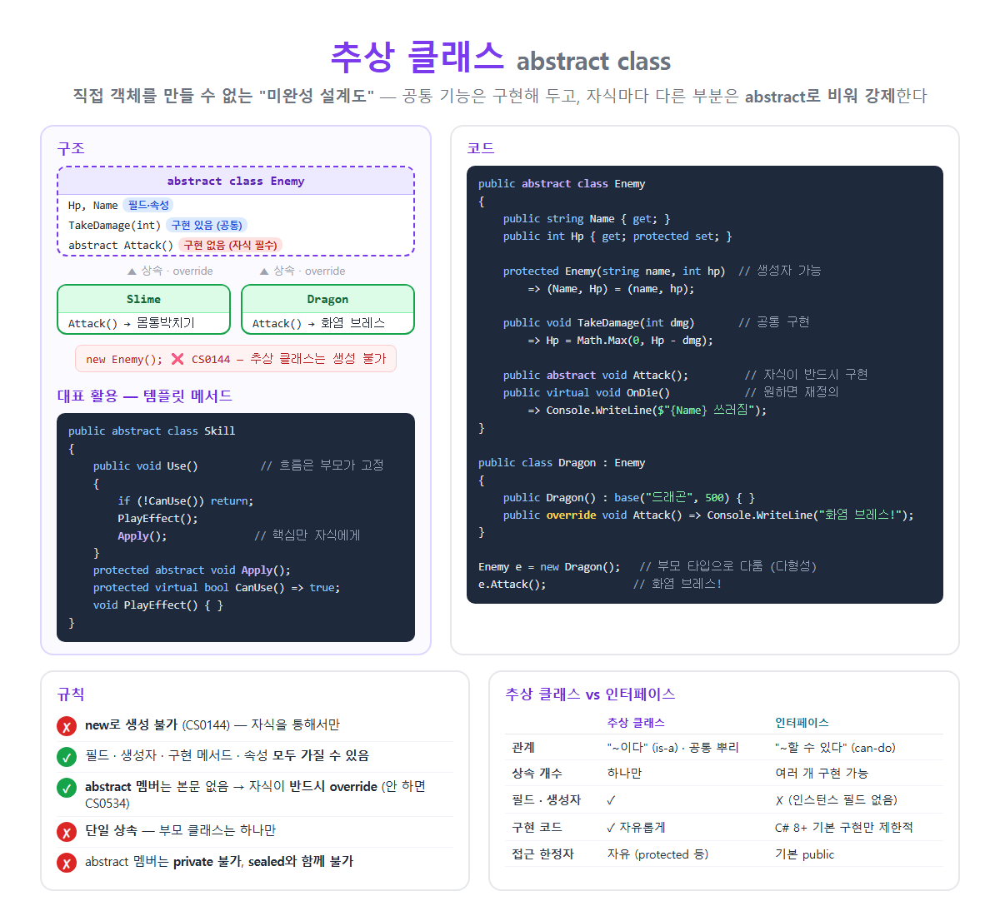

# [Abstract Class](../KeywordsList.md)

</img>

| 항목 | 내용 |
| --- | --- |
| 정의 | `abstract`로 선언한, 직접 생성할 수 없는 기반 클래스 |
| 생성 | ❌ `new` 불가 (CS0144) |
| 가질 수 있는 것 | 필드, 속성, 생성자, 구현 메서드, abstract·virtual 멤버 |
| abstract 멤버 | 본문 없음, 자식이 반드시 `override` (CS0534) |
| 상속 | 단일 상속 |
| 관계 | "~이다" (is-a), 공통 뿌리 |
| 대표 용도 | 공통 기능 + 구현 강제, 템플릿 메서드, 계층 구조의 뿌리 |

## 정의

- abstract 키워드를 붙인 클래스로, 직접 객체를 만들 수 없는 "미완성 설계도”
- 여러 자식 클래스의 공통 기능은 미리 구현
- 자식마다 달라야 하는 부분은 abstract 멤버로 비워 두고 자식이 반드시 구현하게 강제

```csharp
public abstract class Enemy
{
    public string Name { get; }
    public int Hp { get; protected set; }

    protected Enemy(string name, int hp) => (Name, Hp) = (name, hp);   // 생성자 가능

    public void TakeDamage(int dmg) => Hp = Math.Max(0, Hp - dmg);     // 공통 구현
    public abstract void Attack();                                     // 자식이 반드시 구현
    public virtual void OnDie() => Console.WriteLine($"{Name} 쓰러짐"); // 원하면 재정의
}

public class Dragon : Enemy
{
    public Dragon() : base("드래곤", 500) { }
    public override void Attack() => Console.WriteLine("화염 브레스!");
}

Enemy e = new Dragon();    // ✅ 부모 타입으로 다룸 (다형성)
e.Attack();                // 화염 브레스!
var x = new Enemy("?", 1); // ❌ CS0144: 추상 클래스의 인스턴스를 만들 수 없음
```

## 특징

- `new`로 생성할 수 없음. 자식 클래스의 객체를 통해서만 사용.
- 일반 클래스가 가진 것은 모두 가질 수 있음. 필드, 속성, 생성자, 구현된 메서드, static 멤버 모두 가능.
- `abstract` 멤버는 본문이 없음. 자식이 반드시 `override`해야 하며, 안 하면 오류 CS0534. 단, 자식도 추상 클래스라면 미룰 수 있음.
- `abstract` 멤버는 자동으로 virtual이고, `private`일 수 없으며, `sealed`나 `static`과 함께 쓸 수 없음.
- 단일 상속. 부모 클래스는 하나만 둘 수 있음.
- 생성자는 보통 `protected`로 둠. 자식만 호출하기 때문.

## 기능

| 기능 | 설명 |
| --- | --- |
| **공통 코드 재사용** | 모든 자식이 같은 `TakeDamage` 구현을 공유 |
| **구현 강제** | `abstract Attack()`으로 자식이 빠뜨리지 못하게 함 |
| **다형성** | `List<Enemy>`에 여러 적을 담고 `Attack()` 한 줄로 각자 다르게 동작 |
| **잘못된 생성 방지** | 의미 없는 "그냥 Enemy" 객체가 만들어지지 않음 |
| **템플릿 메서드 패턴** | 큰 흐름은 부모가 고정하고, 핵심 단계만 자식이 구현 |

```csharp
public abstract class Skill
{
    public void Use()                 // 흐름 고정
    {
        if (!CanUse()) return;
        PlayEffect();
        Apply();                      // 자식에게 맡김
    }
    protected abstract void Apply();
    protected virtual bool CanUse() => true;
    private void PlayEffect() { }
}
```