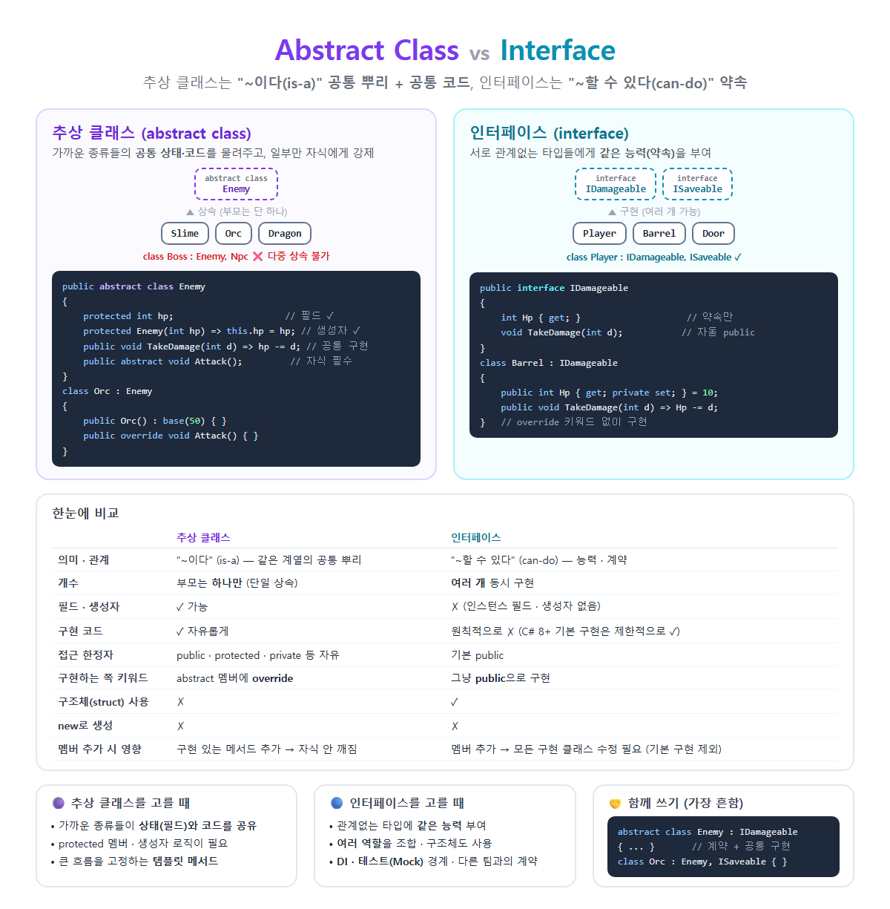

# [Abstract Class vs Interface](../KeywordsList.md)

</img>

| 구분 | 추상 클래스 (abstract class) | 인터페이스 (interface) |
| --- | --- | --- |
| 의미 · 관계 | "~이다" (is-a), 같은 계열의 공통 뿌리 | "~할 수 있다" (can-do), 능력·계약 |
| 키워드 | `abstract class` | `interface` (이름은 `I`로 시작) |
| 개수 | 부모는 하나만 (단일 상속) | 여러 개 동시 구현 |
| `new`로 생성 | ❌ | ❌ |
| 필드 | ✅ | ❌ (인스턴스 필드 없음, static은 가능) |
| 생성자 | ✅ (보통 `protected`) | ❌ |
| 구현 코드 | ✅ 자유롭게 | 원칙적으로 ❌ (C# 8+ 기본 구현은 제한적으로 ✅) |
| 접근 한정자 | `public`, `protected`, `private` 등 자유 | 기본 `public` |
| 구현하는 쪽 키워드 | abstract 멤버에 `override` | 그냥 `public`으로 구현 |
| 구조체(struct) 사용 | ❌ | ✅ |
| 멤버 추가 시 | 구현 있는 메서드 추가 → 자식 안 깨짐 | 구현 클래스 모두 수정 필요 (기본 구현 제외) |
| 다형성 | ✅ 부모 타입으로 다룸 | ✅ 인터페이스 타입으로 다룸 |
| 대표 예 | `Stream`, `DbConnection`, Unity의 `MonoBehaviour`(일반 클래스지만 비슷한 역할) | `IEnumerable<T>`, `IDisposable`, `IComparable<T>` |

## 추상 클래스

- abstract 키워드를 붙인 미완성 기반 클래스
- 공통 필드, 생성자, 구현 메서드를 가지면서, 자식마다 달라야 하는 부분은 abstract 멤버로 비워 구현을 강제

```csharp
public abstract class Enemy
{
    protected int hp;                                      // 필드 ✓
    protected Enemy(int hp) => this.hp = hp;               // 생성자 ✓
    public void TakeDamage(int d) => hp -= d;              // 공통 구현 ✓
    public abstract void Attack();                         // 자식이 반드시 구현
}

public class Orc : Enemy
{
    public Orc() : base(50) { }
    public override void Attack() => Console.WriteLine("도끼 공격");   // override로 구현
}
```

- 쓰임 : Slime, Orc, Dragon처럼 가까운 종류들이 상태와 코드를 공유할 때, 큰 흐름을 고정하는 템플릿 메서드를 만들 때

## 인터페이스

- interface 키워드로 정의하는 약속(계약)
- 무엇을 할 수 있는지(시그니처)만 정하고, 구현은 각 클래스가 함.
- 여러 개를 동시에 구현할 수 있음.

```csharp
public interface IDamageable
{
    int Hp { get; }
    void TakeDamage(int d);                                // 본문 없음, 자동 public
}

public interface ISaveable { string Save(); }

public class Player : IDamageable, ISaveable              // 여러 개 구현
{
    public int Hp { get; private set; } = 100;
    public void TakeDamage(int d) => Hp -= d;              // override 없이 public으로 구현
    public string Save() => $"hp={Hp}";
}

public class Barrel : IDamageable                          // 전혀 다른 계열도 같은 약속
{
    public int Hp { get; private set; } = 10;
    public void TakeDamage(int d) => Hp -= d;
}
```

- 쓰임 : 플레이어, 나무통, 문처럼 관계없는 타입에 같은 능력을 줄 때, DI와 테스트(Mock)의 경계로 쓸 때

## 핵심 차이

#### 1. 개수: 단일 상속 vs 다중 구현

```csharp
class Boss : Enemy, Npc { }                       // ❌ CS1721: 클래스는 하나만 상속 가능
class Boss : Enemy, IDamageable, ISaveable { }    // ✅ 부모 클래스 1개 + 인터페이스 여러 개
```

#### 2. 상태(필드)와 생성자

- 추상 클래스 : 필드, 생성자, `protected` 멤버를 가질 수 있어서 공통 데이터를 직접 관리.
- 인터페이스 : 인스턴스 필드와 생성자가 없습니다. 데이터는 각 구현 클래스가 가짐.

#### 3. 구현하는 쪽의 문법

- 추상 클래스의 abstract 멤버 → 자식에서 `override`
- 인터페이스 멤버 → 그냥 `public`으로 구현 (`override` 없음)

#### 4. 멤버를 추가할 때의 영향 (버전 관리)

- 추상 클래스에 구현이 있는 메서드를 추가하면 자식 클래스들이 깨지지 않음.
- 인터페이스에 멤버를 추가하면 모든 구현 클래스를 수정해야 함. 그래서 C# 8에서 기본 구현(Default Interface Method)이 생겼음.

## 언제 무엇을 쓸까?

| 상황 | 선택 |
| --- | --- |
| 가까운 종류들이 필드와 코드를 공유한다 | 추상 클래스 |
| 생성자 로직이나 `protected` 멤버가 필요하다 | 추상 클래스 |
| 큰 흐름을 고정하고 일부 단계만 바꾸게 하고 싶다 (템플릿 메서드) | 추상 클래스 |
| 관계없는 타입들에 같은 능력을 주고 싶다 | 인터페이스 |
| 한 클래스가 여러 역할을 가져야 한다 | 인터페이스 |
| 구조체도 참여해야 한다 | 인터페이스 |
| DI, 테스트용 Mock, 모듈 간 계약이 필요하다 | 인터페이스 |
| 잘 모르겠다 | 인터페이스로 시작하고, 공통 코드가 생기면 추상 클래스 추가 |