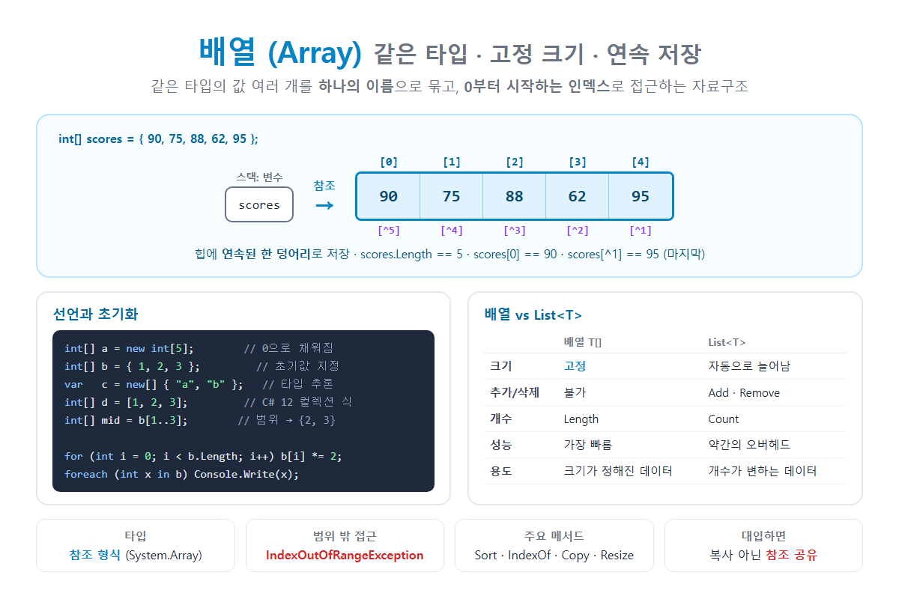

# [배열](../KeywordsList.md)

</img>

| 항목 | 내용 |
| --- | --- |
| 정의 | 같은 타입 값들을 연속된 메모리에 저장하고 인덱스로 접근하는 자료구조 |
| 선언 | `타입[] 이름 = new 타입[크기];` |
| 인덱스 | 0부터 `Length - 1`까지, `^1` = 마지막 |
| 크기 | 고정 (`Length`) |
| 형식 | 참조 형식 (`System.Array`), 힙에 저장 |
| 기본값 | 숫자 `0`, `bool` `false`, 참조 형식 `null` |
| 접근 속도 | O(1) (인덱스 접근) |
| 범위 밖 접근 | `IndexOutOfRangeException` |
| 다차원 | `int[,]` (직사각형), `int[][]` (가변) |
| 주요 메서드 | `Sort`, `Reverse`, `IndexOf`, `Find`, `Copy`, `Resize`, `Fill` |

## 정의

- 같은 타입의 값 여러 개를 하나의 이름으로 묶어서, 연속된 메모리 공간에 저장하는 자료구조
- 각 값을 요소(element)라고 하며, 0부터 시작하는 인덱스(index)로 각 요소에 접근

```csharp
int[] scores ={ 90, 75, 88, 62, 95 };

Console.WriteLine(scores[0]);       // 90  (첫 번째)
Console.WriteLine(scores[4]);       // 95  (다섯 번째)
Console.WriteLine(scores.Length);   // 5   (요소 개수)

scores[1] =80;                     // 두 번째 요소 수정
```

- 변수가 5개라면 `score1`, `score2`, ... 처럼 따로 만들어야 하지만, 배열을 쓰면 **하나의 이름 + 인덱스**로 관리할 수 있음.
- 반복문과 함께 쓰기도 좋음.

## **특징**

- 같은 타입만 담을 수 있음. `int[]`에는 `int`만 들어감.
- 크기가 고정됨. 한 번 만들면 늘리거나 줄일 수 없음.
- 인덱스는 0부터 `Length - 1`까지. 범위를 벗어나면 `IndexOutOfRangeException`이 발생.
- 연속된 메모리에 저장되어서, 인덱스로 접근하는 속도가 O(1)로 매우 빠름.
- 참조 형식. 모든 배열은 `System.Array` 클래스를 상속하며, 힙에 할당됨. 변수에는 배열의 주소(참조)만 저장됨.
- 기본값으로 자동 초기화됨. `new int[5]`는 `0`으로, `new string[3]`은 `null`로, `new bool[2]`는 `false`로 채워짐.

## **선언과 초기화**

```csharp
// 1) 크기만 지정 (기본값으로 채워짐)
int[] a =newint[5];// { 0, 0, 0, 0, 0 }

// 2) 초기값 지정
int[] b =newint[]{1,2,3};
int[] c ={1,2,3};// new int[] 생략 가능

// 3) 타입 추론
var d =new[]{"사과","배"};// string[]

// 4) 컬렉션 식 (C# 12+)
int[] e =[1,2,3];
int[] empty =[];// 빈 배열

// 5) 크기를 실행 중에 결정
int n =int.Parse(Console.ReadLine()!);
int[] f =newint[n];
```

## **기능 (사용법)**

- 요소 접근: 인덱스와 범위 (C# 8+)

```csharp
int[] arr ={10,20,30,40,50};

arr[0]// 10  (앞에서 첫 번째)
arr[^1]// 50  (뒤에서 첫 번째 = 마지막)
arr[^2]// 40  (뒤에서 두 번째)
arr[1..3]// { 20, 30 }      (1번부터 3번 전까지 → 새 배열로 복사)
arr[..2]// { 10, 20 }      (처음부터 2번 전까지)
arr[2..]// { 30, 40, 50 }  (2번부터 끝까지)
```

- 반복

```csharp
for(int i =0; i < arr.Length; i++)// 인덱스가 필요하거나 요소를 수정할 때
    arr[i] *=2;

foreach(int xin arr)// 읽기만 할 때 (요소 수정 불가)
    Console.WriteLine(x);
```

- `Array` 클래스의 주요 메서드

| **메서드** | **기능** | **예** |
| --- | --- | --- |
| `Array.Sort(arr)` | 오름차순 정렬 (원본 변경) | `{3,1,2}` → `{1,2,3}` |
| `Array.Reverse(arr)` | 순서 뒤집기 | `{1,2,3}` → `{3,2,1}` |
| `Array.IndexOf(arr, v)` | 값의 위치 찾기 (없으면 -1) | `IndexOf(arr, 30)` → `2` |
| `Array.Find(arr, 조건)` | 조건에 맞는 첫 요소 | `Find(arr, x => x > 25)` → `30` |
| `Array.Exists(arr, 조건)` | 조건에 맞는 요소가 있는지 | `Exists(arr, x => x > 100)` → `false` |
| `Array.Copy(src, dst, n)` | 다른 배열로 복사 |  |
| `Array.Resize(ref arr, n)` | 새 크기의 배열을 만들어 교체 |  |
| `Array.Fill(arr, v)` | 모든 요소를 v로 채움 |  |
| `Array.Clear(arr)` | 모든 요소를 기본값으로 |  |
| `Array.BinarySearch(arr, v)` | 이진 탐색 (정렬된 배열에서만) |  |
- LINQ도 사용할 수 있습니다 (`using System.Linq;`)

```csharp
arr.Sum();  arr.Max();  arr.Average();
arr.Where(x => x >20).ToArray();
arr.Contains(30);
```