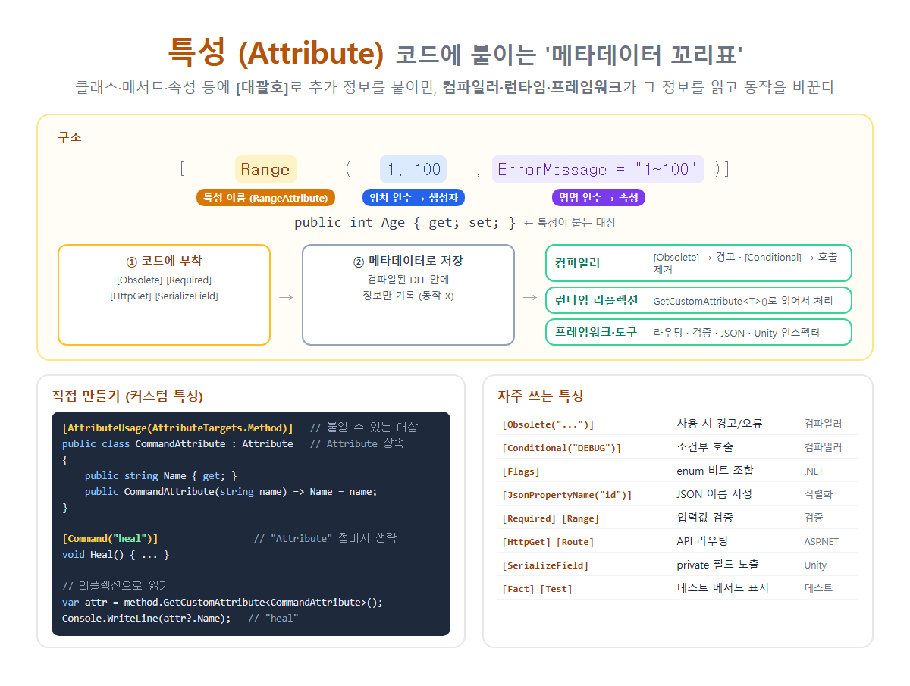

# [속성(Attribute)](../KeywordsList.md)

</img>

| 항목 | 내용 |
| --- | --- |
| 정의 | 코드 요소에 `[ ]`로 붙이는 메타데이터 |
| 부모 클래스 | `System.Attribute` |
| 이름 규칙 | `~Attribute`로 정의, 사용할 때는 접미사 생략 가능 |
| 인수 | 위치 인수(생성자) + 명명 인수(속성) |
| 인수 제약 | 컴파일 타임 상수, `typeof`, `enum`, 이들의 배열 |
| 저장 | 어셈블리 메타데이터 |
| 읽는 주체 | 컴파일러, 리플렉션, 프레임워크, 소스 생성기 |
| 사용 제한 | `[AttributeUsage]`로 대상, 중복, 상속 지정 |
| 대표 용도 | 검증, 직렬화, 라우팅, DB 매핑, 테스트, 에디터 표시, 경고 |
| 장점 | 선언적, 반복 코드 제거, 관심사 분리 |
| 주의 | 리플렉션은 느림, 남용하면 동작이 숨겨짐 |

## 정의

- 클래스, 메서드, 속성, 필드, 매개변수 같은 코드 요소에 [대괄호]로 붙이는 추가 정보(메타데이터)
- 아무 동작도 하지 않는 "꼬리표”
- 컴파일하면 어셈블리(DLL)의 메타데이터에 기록
- 그 정보를 컴파일러, 런타임(리플렉션), 프레임워크가 읽어서 동작을 바꿈

```csharp
public class User
{
    [Required]                                  // 필수 입력
    [Range(1, 120, ErrorMessage = "1~120 사이")] // 값 범위 검증
    public int Age { get; set; }

    [JsonPropertyName("user_name")]             // JSON 키 이름 지정
    public string Name { get; set; } = "";

    [Obsolete("NewMethod를 사용하세요")]          // 사용하면 컴파일 경고
    public void OldMethod() { }
}
```

## 구조

```csharp
[ Range ( 1, 120 , ErrorMessage = "1~120 사이" ) ]
  └이름┘  └위치 인수┘  └──── 명명 인수 ────┘
```

| 구성 | 설명 |
| --- | --- |
| **특성 이름** | 실제 클래스 이름은 `RangeAttribute`. `Attribute` 접미사는 생략 가능 |
| **위치 인수** | 순서대로 생성자에 전달됨. 필수 |
| **명명 인수** | `이름 = 값` 형태로 public 속성이나 필드에 설정. 선택 |
| **여러 개 붙이기** | `[A][B]` 또는 `[A, B]` |
| **대상 지정** | `[assembly: ...]`, `[return: ...]`, `[field: ...]`, `[property: ...]` 등으로 명시 |
- 인수 제약 : 특성 인수는 컴파일할 때 메타데이터에 저장되므로, 컴파일 타임 상수만 쓸 수 있음.
    - 가능 : 숫자, `string`, `bool`, `enum`, `typeof(...)`, 이들의 1차원 배열
    - 불가 : `new List<int>()`, `DateTime.Now`, 메서드 호출 결과

## 특징

- 선언적(Declarative) : "어떻게 할지"를 코드로 쓰는 대신, "무엇인지"를 표시. 예를 들어 검증 로직을 직접 작성하지 않고 `[Required]`만 붙임.
- 메타데이터로 저장됨 : 특성을 붙여도 그 메서드의 실행 코드는 바뀌지 않음. 누군가 읽어야 의미가 생김.
- 읽는 주체가 3개.
    1. 컴파일러 : `[Obsolete]` → 경고, `[Conditional]` → 호출 제거, `[CallerMemberName]` → 값 자동 주입
    2. 런타임 리플렉션 : `GetCustomAttribute<T>()`로 읽어서 처리
    3. 프레임워크·도구 : ASP.NET Core, EF Core, JSON 직렬화기, Unity, 테스트 프레임워크, 소스 생성기
- 모든 특성은 `System.Attribute`를 상속한 클래스

## 기능

| 특성 | 기능 | 사용처 |
| --- | --- | --- |
| `[Obsolete("메시지", true)]` | 더 이상 쓰지 말라는 경고 (두 번째 인수가 true면 오류) | 컴파일러 |
| `[Conditional("DEBUG")]` | 해당 기호가 정의되지 않으면 호출 코드 자체를 제거 | 컴파일러 |
| `[CallerMemberName]` | 호출한 메서드 이름을 자동으로 채움 | 컴파일러 |
| `[NotNullWhen(true)]` | nullable 분석에 힌트 제공 | 컴파일러 |
| `[Flags]` | enum을 비트 플래그로 취급 (`ToString`이 조합 표시) | .NET |
| `[Serializable]` | 직렬화 가능 표시 (구식) | .NET |
| `[JsonPropertyName("id")]`, `[JsonIgnore]` | JSON 이름 지정 / 제외 | System.Text.Json |
| `[Required]`, `[Range]`, `[StringLength]` | 입력값 검증 | DataAnnotations |
| `[HttpGet]`, `[Route("api/users")]`, `[Authorize]` | 라우팅, 권한 | ASP.NET Core |
| `[Key]`, `[Table("Users")]` | DB 매핑 | EF Core |
| `[SerializeField]`, `[Header]`, `[Range]`, `[RequireComponent]` | 인스펙터 노출, 꾸미기 | Unity |
| `[Fact]`, `[Theory]`, `[Test]` | 테스트 메서드 표시 | xUnit, NUnit |
| `[GeneratedRegex("...")]`, `[LibraryImport]` | 컴파일할 때 코드 자동 생성 | 소스 생성기 |