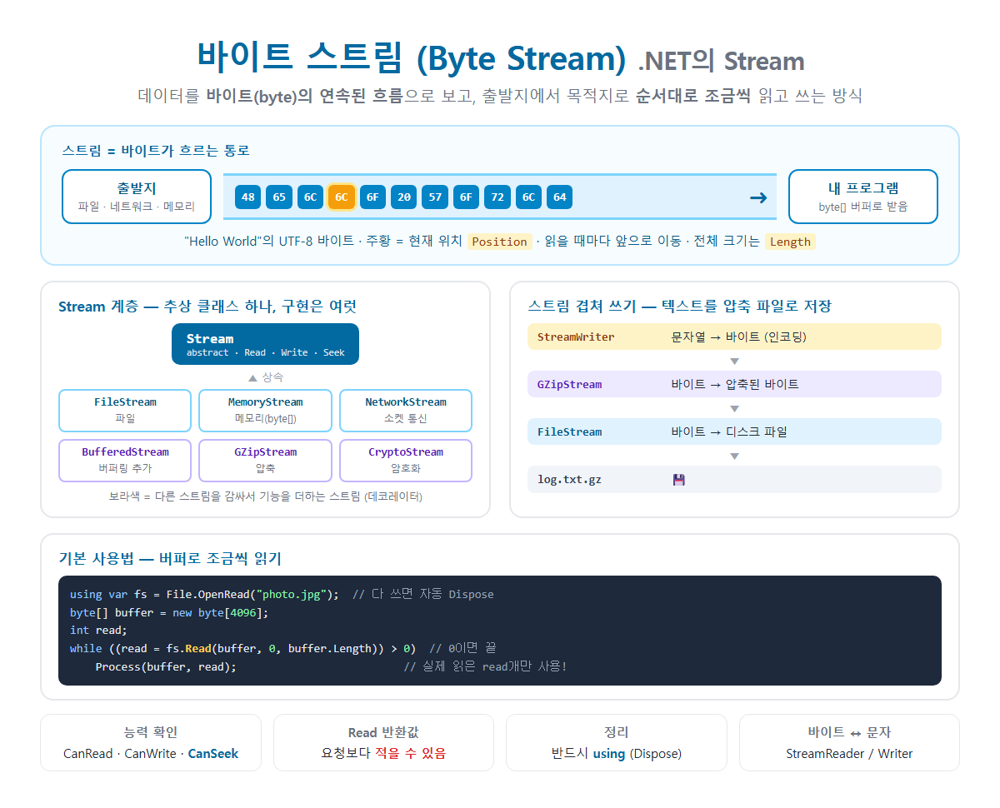

# [ByteStream](../KeywordsList.md)

</img>

| 항목 | 내용 |
| --- | --- |
| 정의 | 데이터를 바이트의 연속된 흐름으로 보고 순차적으로 읽고 쓰는 방식 |
| .NET 클래스 | `System.IO.Stream` (추상 클래스) |
| 주요 구현 | `FileStream`, `MemoryStream`, `NetworkStream` |
| 기능 추가형 | `BufferedStream`, `GZipStream`, `CryptoStream`, `SslStream` (데코레이터) |
| 핵심 메서드 | `Read`, `Write`, `Seek`, `Flush`, `CopyTo`, `Dispose` |
| 비동기 | `ReadAsync`, `WriteAsync`, `CopyToAsync` |
| 핵심 속성 | `CanRead`, `CanWrite`, `CanSeek`, `Position`, `Length` |
| `Read` 반환값 | 실제로 읽은 바이트 수 (요청보다 적을 수 있음), 0이면 끝 |
| 문자열 처리 | `StreamReader` / `StreamWriter` |
| 기본형 처리 | `BinaryReader` / `BinaryWriter` |
| 정리 | 반드시 `using`으로 Dispose |

## 정의

- 데이터를 바이트(byte, 8비트)가 한 줄로 이어진 흐름으로 보고, 출발지에서 목적지로 순서대로 조금씩 읽거나 쓰는 방식
- 출발지와 목적지는 파일, 네트워크, 메모리, 압축 데이터 등 무엇이든 될 수 있음. 그래도 같은 방법(Read/Write)으로 다룸.

## 특징

- 바이트 단위로 다룸. 문자, 숫자, 이미지, 동영상 등 모든 데이터는 결국 바이트이므로 어떤 데이터든 다룰 수 있음.
- 순차적. 앞에서부터 차례로 읽고 씀. 현재 위치(`Position`)가 읽은 만큼 앞으로 이동함.
- 전체를 메모리에 올리지 않아도 됨. 10GB 파일도 4KB씩 나눠서 처리할 수 있어 메모리를 적게 씀.
- 같은 인터페이스로 여러 장치를 다룸. `FileStream`, `MemoryStream`, `NetworkStream`이 모두 `Stream`을 상속하므로, `Stream`을 받는 코드는 어떤 출처든 똑같이 처리(다형성의 좋은 예).
- 스트림마다 지원하는 기능이 다르기 때문에 미리 확인해야 함.

| 속성 | 의미 | 예 |
| --- | --- | --- |
| `CanRead` | 읽기 가능? | 대부분 ✅ |
| `CanWrite` | 쓰기 가능? | 읽기 전용 파일은 ❌ |
| `CanSeek` | 위치 이동 가능? | `FileStream` ✅, `NetworkStream` ❌ |
| `Length` | 전체 길이 | `CanSeek`이 false면 예외 |
| `Position` | 현재 위치 |  |
- 사용 후 반드시 닫아야(Dispose) . 파일 핸들이나 소켓 같은 OS 자원을 쥐고 있기 때문.

## 기능

#### 주요 스트림 클래스

| 클래스 | 출발지 / 목적지 | 용도 |
| --- | --- | --- |
| `FileStream` | 디스크 파일 | 파일 읽기·쓰기 |
| `MemoryStream` | 메모리 (`byte[]`) | 임시 버퍼, 테스트, 직렬화 |
| `NetworkStream` | 네트워크 소켓 | TCP 통신 |
| `BufferedStream` | 다른 스트림 | 버퍼링을 추가해서 작은 읽기·쓰기를 빠르게 |
| `GZipStream`, `BrotliStream` | 다른 스트림 | 압축 / 해제 |
| `CryptoStream` | 다른 스트림 | 암호화 / 복호화 |
| `SslStream` | 다른 스트림 | 보안 통신 (TLS) |
- 다른 스트림을 감싸서 기능을 더하는 구조는 데코레이터 패턴의 대표적인 예

#### 기본: 버퍼로 조금씩 읽기

```csharp
using var fs = File.OpenRead("photo.jpg");     // using → 블록 끝에서 자동 Dispose

byte[] buffer = new byte[4096];                // 4KB씩
int read;
while ((read = fs.Read(buffer, 0, buffer.Length)) > 0)   // 0을 반환하면 스트림 끝
{
    Process(buffer, read);                     // ⚠️ buffer.Length가 아니라 read개만 유효!
}
```

#### 쓰기

```csharp
using var fs = File.Create("data.bin");
byte[] data = { 0x48, 0x65, 0x6C, 0x6C, 0x6F };
fs.Write(data, 0, data.Length);
fs.Flush();                                    // 버퍼에 남은 데이터를 실제로 기록
```

#### 복사: 스트림 → 스트림

```csharp
using var src = File.OpenRead("a.zip");
using var dst = File.Create("b.zip");
src.CopyTo(dst);                               // 내부적으로 버퍼를 써서 조금씩 복사
```

#### **위치 이동 (Seek)**

```csharp
fs.Seek(100, SeekOrigin.Begin);// 처음에서 100바이트 위치로
fs.Position =0;// 맨 앞으로 되돌리기
```

#### **스트림 겹쳐 쓰기: 텍스트를 압축 파일로**

```csharp
usingvar file = File.Create("log.txt.gz");// 바이트 → 디스크
usingvar gzip =newGZipStream(file, CompressionLevel.Optimal);// 바이트 → 압축
usingvar writer =newStreamWriter(gzip, Encoding.UTF8);// 문자열 → 바이트

writer.WriteLine("안녕하세요");// 문자열 → 인코딩 → 압축 → 파일
```

#### **비동기: 파일, 네트워크 I/O는 async로**

```csharp
await using var fs = File.OpenRead("big.mp4");
byte[] buffer = new byte[81920];
int read;
while ((read = await fs.ReadAsync(buffer)) > 0)
    await output.WriteAsync(buffer.AsMemory(0, read));
```