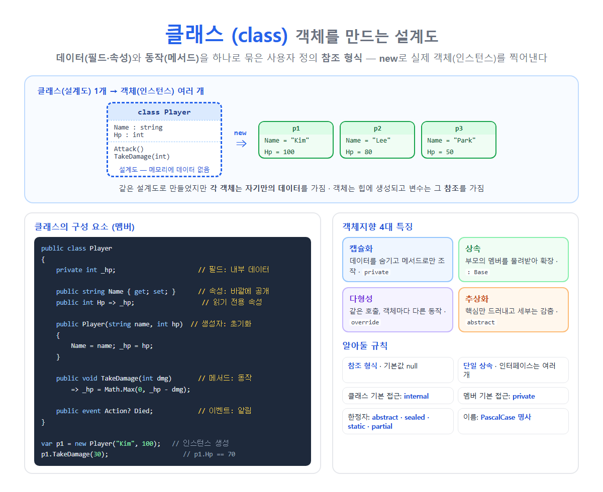

# [클래스](../KeywordsList.md)

</img>

| 항목 | 내용 |
| --- | --- |
| 정의 | 데이터와 동작을 묶은 사용자 정의 참조 형식 (객체의 설계도) |
| 키워드 | `class` |
| 객체 생성 | `new 클래스명(...)` |
| 형식 | 참조 형식 (객체는 힙, 기본값 `null`) |
| 최상위 부모 | `System.Object` |
| 멤버 | 필드, 속성, 메서드, 생성자, 이벤트, 인덱서, 상수, 중첩 타입 |
| 상속 | 단일 상속 + 인터페이스 다중 구현 |
| 기본 접근 | 클래스 `internal`, 멤버 `private` |
| 한정자 | `abstract`, `sealed`, `static`, `partial` |
| OOP 4대 특징 | 캡슐화, 상속, 다형성, 추상화 |
| 이름 규칙 | PascalCase 명사 (`Player`, `OrderService`) |

## 정의

- 데이터(필드, 속성)와 그 데이터를 다루는 동작(메서드)을 하나로 묶은 사용자 정의 참조 형식
- 객체를 만드는 설계도
    - 클래스 자체는 설계도일 뿐
    - `new` 키워드로 실제 객체(인스턴스)를 만들어야 메모리(힙)에 데이터가 생김
    - 같은 클래스로 만든 객체라도 각자 자기만의 데이터를 가짐

```csharp
public class Player
{
    public string Name { get; set; } = "";
    public int Hp { get; set; } = 100;

    public void TakeDamage(int dmg) => Hp = Math.Max(0, Hp - dmg);
}

var p1 = new Player { Name = "Kim" };   // 객체 1
var p2 = new Player { Name = "Lee" };   // 객체 2
p1.TakeDamage(30);
Console.WriteLine(p1.Hp);   // 70
Console.WriteLine(p2.Hp);   // 100 ← 서로 독립된 데이터
```

## 구성요소

| 멤버 | 역할 | 예 |
| --- | --- | --- |
| **필드 (Field)** | 객체 내부의 데이터 저장 (보통 `private`) | `private int _hp;` |
| **속성 (Property)** | 필드를 안전하게 읽고 쓰는 창구 (get/set) | `public int Hp { get; private set; }` |
| **메서드 (Method)** | 동작, 기능 | `public void Attack() { }` |
| **생성자 (Constructor)** | 객체를 만들 때 초기화 | `public Player(string name) { }` |
| **이벤트 (Event)** | 무언가 일어났을 때 알림 | `public event Action? Died;` |
| **인덱서 (Indexer)** | 객체를 배열처럼 `[]`로 접근 | `public Item this[int i] => _items[i];` |
| **상수 / static 멤버** | 객체가 아니라 클래스 자체에 속함 | `public const int MaxHp = 100;` |
| **중첩 타입** | 클래스 안의 클래스, enum 등 | `public enum State { }` |
| **종료자 (Finalizer)** | GC가 회수할 때 정리 (거의 안 씀) | `~Player() { }` |

## 특징

- 참조 형식 : 객체는 힙에 저장되고, 변수에는 참조(주소)가 들어감. 대입하면 같은 객체를 공유.
- 기본값은 `null`
- 단일 상속만 가능 : 부모 클래스는 하나만 둘 수 있고, 인터페이스는 여러 개 구현 가능.
- 모든 클래스는 최종적으로 `System.Object`를 상속. 그래서 `ToString()`, `Equals()`, `GetHashCode()`를 가지고 있음.
- 접근 한정자로 공개 범위를 조절.

| 접근 한정자 | 접근 가능 범위 |
| --- | --- |
| `public` | 어디서든 |
| `private` | 같은 클래스 안에서만 (멤버의 기본값) |
| `protected` | 같은 클래스 + 자식 클래스 |
| `internal` | 같은 어셈블리(프로젝트) 안 (클래스의 기본값) |
| `protected internal` | 같은 어셈블리 **또는** 자식 클래스 |
| `private protected` | 같은 어셈블리 **안의** 자식 클래스 |
- 클래스 한정자

| 한정자 | 의미 |
| --- | --- |
| `abstract` | 직접 `new` 불가, 상속해서 써야 함 (추상 메서드 포함 가능) |
| `sealed` | 상속 금지 |
| `static` | 인스턴스 없이 static 멤버만 (유틸리티) |
| `partial` | 여러 파일에 나눠 정의 (자동 생성 코드와 함께 쓸 때) |

## 기능

#### **캡슐화 (Encapsulation)**

- 데이터를 `private`으로 숨기고, 정해진 메서드나 속성으로만 조작하게 함. 잘못된 값이 들어오는 것을 막음.

```csharp
public class Account
{
    private decimal _balance;                       // 직접 접근 불가
    public decimal Balance => _balance;             // 읽기만 공개

    public void Deposit(decimal amount)
    {
        if (amount <= 0) throw new ArgumentException("금액은 양수여야 합니다");
        _balance += amount;
    }
}
```

#### **상속 (Inheritance)**

- 부모 클래스의 멤버를 물려받아 재사용하고 확장.

```csharp
public class Character
{
    public string Name { get; set; } = "";
    public virtual void Attack() => Console.WriteLine("기본 공격");
}

public class Warrior : Character        // Character를 상속
{
    public override void Attack() => Console.WriteLine("검 휘두르기!");
}
```

#### **다형성 (Polymorphism)**

- 타입의 같은 메서드 호출이 실제 객체에 따라 다르게 동작.

```csharp
List<Character> party = [new Warrior(), new Mage()];
foreach (var c in party) c.Attack();   // 각자 자기 방식으로 공격
```

#### **추상화 (Abstraction)**

- 핵심 기능만 드러내고 복잡한 세부 구현은 감춤. `abstract` 클래스와 인터페이스로 표현.

```csharp
public abstract class Shape
{
    public abstract double Area();        // "넓이를 구할 수 있다"는 약속만
}
```