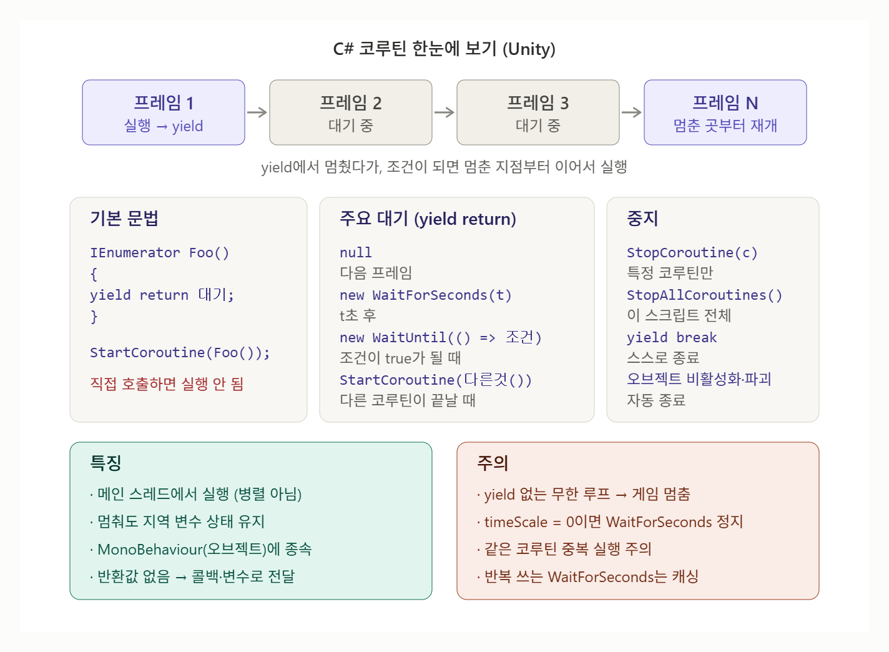

# [CoRoutine](../KeywordsList.md)

</img>

| 항목 | 내용 |
| --- | --- |
| 정의 | 실행을 중간에 멈췄다가 이후 프레임에서 이어서 실행하는 Unity의 함수 |
| 기반 문법 | C# 이터레이터 (`IEnumerator` + `yield return`) |
| 시작 | `StartCoroutine(함수())` — 직접 호출하면 실행 안 됨 |
| 중지 | `StopCoroutine(저장한 Coroutine)`, `StopAllCoroutines()`, `yield break` |
| 자동 중지 | 게임오브젝트 비활성화·파괴 시 (컴포넌트 disable은 해당 안 됨) |
| 대표 대기 | `null`(다음 프레임), `WaitForSeconds`, `WaitForSecondsRealtime`, `WaitUntil` |
| 주 용도 | 시간 지연, 반복 스폰, 페이드·깜빡임 연출, 순차 이벤트 |
| 스레드 | 메인 스레드에서 실행 — 멀티스레드 아님 |
| 주의 | yield 없는 무한루프 금지, timeScale=0이면 WaitForSeconds 멈춤, 중복 실행 주의 |
| 최적화 | 반복 사용하는 `WaitForSeconds`는 캐싱해서 재사용 |

## 정의

- 실행을 중간에 멈췄다가 다음 프레임이나 몇초 뒤에 멈춘 지점부터 이어서 실행할 수 있는 함수

```csharp
using System.Collections;
using UnityEngine;

public class Example : MonoBehaviour
{
    void Start()
    {
        StartCoroutine(CountDown());   // 코루틴 시작
    }

    IEnumerator CountDown()            // 반환형은 IEnumerator
    {
        Debug.Log("3");
        yield return new WaitForSeconds(1f);  // 1초 대기 후 여기서부터 재개
        Debug.Log("2");
        yield return new WaitForSeconds(1f);
        Debug.Log("1");
        yield return new WaitForSeconds(1f);
        Debug.Log("시작!");
    }
}
```

- 반환형이 `IEnumerator`
- 함수 안에 `yield return`이 필요
- `StartCouroutine()`으로 실행

## 기능

| 코드 | 재개 시점 |
| --- | --- |
| `yield return null;` | 다음 프레임 (Update 이후) |
| `yield return new WaitForSeconds(t);` | t초 후 (`Time.timeScale` 영향 받음) |
| `yield return new WaitForSecondsRealtime(t);` | 실제 시간 t초 후 (일시정지 중에도 흐름) |
| `yield return new WaitForFixedUpdate();` | 다음 FixedUpdate 이후 (물리 처리용) |
| `yield return new WaitForEndOfFrame();` | 프레임 렌더링이 끝난 후 |
| `yield return new WaitUntil(() => 조건);` | 조건이 true가 될 때까지 대기 |
| `yield return new WaitWhile(() => 조건);` | 조건이 false가 될 때까지 대기 |
| `yield return StartCoroutine(다른코루틴());` | 다른 코루틴이 끝날 때까지 대기 |
| `yield break;` | 코루틴 즉시 종료 |
- 코루틴 멈추기

```csharp
Coroutine spawnRoutine;

void StartSpawn()
{
    spawnRoutine = StartCoroutine(SpawnObstacles());
}

void StopSpawn()
{
    if (spawnRoutine != null)
        StopCoroutine(spawnRoutine);   // 특정 코루틴만 중지
}

// StopAllCoroutines();  // 이 스크립트의 모든 코루틴 중지
```

- StartCoroutine이 반환하는 Coroutine 객체를 저장해 두었다가 StopCoroutine에 넘기는 방식이 가장 안전.
- 코루틴을 실행한 게임 오브젝트가 비활성화 되거나 파괴되면 코루틴도 자동으로 멈춤.

## 특징

- 중단과 재개가 가능 : yield return 지점에서 실행을 멈추고, 지정한 조건이 되면 멈춘 지점부터 다시 실행됨
- 지역 변수 상태가 유지 : 멈췄다가 재개해도 함수 안의 지역 변수 값이 그대로 남아 있음.
- 여러 프레임에 걸쳐 실행됨 : 한 프레임 안에서 끝나는 일반 함수와 달리, 작업을 여러 프레임에 나눠 처리 가능.
- 협력형(cooperative) 방식 : 코루틴이 스스로 yield로 제어권을 넘겨줘야 다른 코드가 실행됨.
- 여러 개 동시에 돌리기 가능 : 하나의 스크립트에서 여러 코루틴을 동시에 실행할 수 있고 같은 코루틴도 중복 실행됨.
- 직접 호출로는 실행 불가 : StartCoroutine()을 통해 시작해야 함.
- 반환 값을 돌려줄 수 없음 : 결과가 필요하면 콜백이나 멤버 변수를 통해 전달해야 함’
- 시간 흐름의 영향을 받음