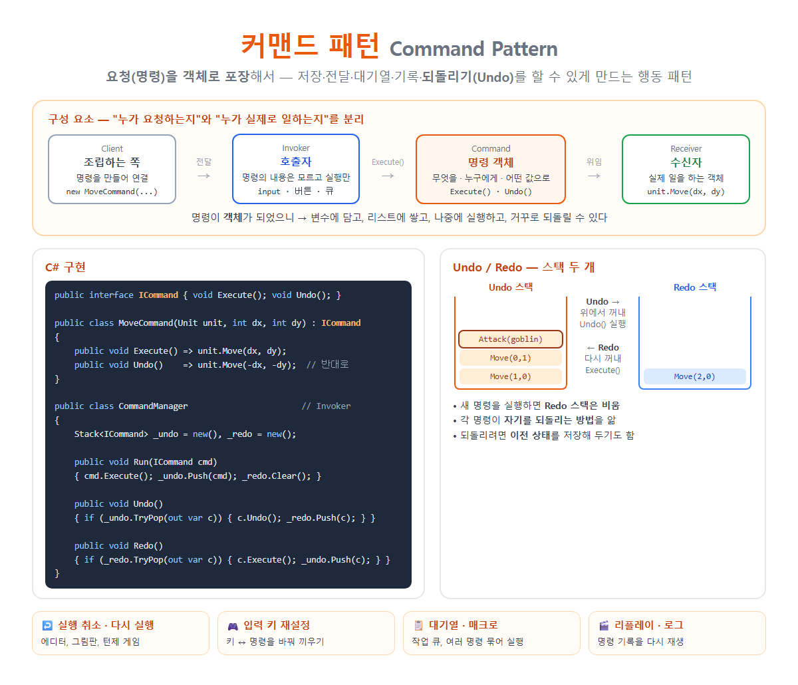

# [커맨드 패턴(Command)](../KeywordsList.md)

</img>

| 항목 | 내용 |
| --- | --- |
| 분류 | GoF 행동 패턴 |
| 정의 | 요청을 객체로 캡슐화 |
| 구성 | Command, ConcreteCommand, Receiver, Invoker, Client |
| 핵심 메서드 | `Execute()` (+ `Undo()`) |
| 장점 | 호출자·수신자 분리, Undo/Redo, 대기열·로그·리플레이, 매크로, OCP |
| 단점 | 명령마다 클래스가 늘어남, 기록이 쌓이면 메모리 사용 |
| Undo 구현 | 반대 동작 실행 또는 이전 상태 저장 (메멘토와 조합) |
| C# 관련 | `Action`/`Func` 델리게이트, WPF·MAUI의 `ICommand` |
| 대표 사례 | 에디터의 Ctrl+Z, 게임 키 설정, 작업 큐, 리플레이 |

## 정의

- GoF 디자인 패턴 중 행동 패턴의 하나
- 요청(명령)을 객체로 캡슐화하여, 요청을 매개변수화하고, 대기열에 넣거나 기록하고, 실행 취소(Undo)할 수 있게 한다.
- 평소에는 `unit.Move(1, 0)`처럼 메서드를 바로 호출. 커맨드 패턴은 이 호출 자체를 `MoveCommand`라는 객체로 만듦. 명령이 객체가 되면 다음과 같은 일을 할 수 있음.
    - 변수에 담기
    - 리스트에 쌓기
    - 나중에 실행하기
    - 거꾸로 되돌리기
    - 저장했다가 다시 재생하기

## 구성요소

| 역할 | 설명 | 예 |
| --- | --- | --- |
| **Command (인터페이스)** | 실행 방법을 정의 (`Execute`, 선택적으로 `Undo`) | `ICommand` |
| **ConcreteCommand** | 실제 명령. 수신자 + 필요한 값을 담고, 수신자에게 일을 시킴 | `MoveCommand`, `AttackCommand` |
| **Receiver (수신자)** | 실제로 일을 하는 객체 | `Unit`, `Document`, `Light` |
| **Invoker (호출자)** | 명령을 받아서 실행만 함 (내용은 모름) | 입력 처리기, 버튼, 작업 큐, `CommandManager` |
| **Client** | 명령 객체를 만들고 연결하는 쪽 | 게임 초기화 코드 |

## 특징

- 요청이 객체가 됨. 일반 데이터처럼 저장하고, 전달하고, 복사할 수 있음.
- 호출자와 수신자가 분리됨. Invoker(버튼, 입력 처리기)는 명령의 내용을 모르고 `Execute()`만 부름. 그래서 같은 버튼에 다른 명령을 쉽게 연결할 수 있음.
- 실행 시점을 미룰 수 있음. 만들어 두었다가 나중에, 다른 스레드에서, 다른 컴퓨터에서 실행할 수 있음.
- 명령마다 자기를 되돌리는 방법을 알고 있어서 Undo를 구현하기 쉬움.
    - 되돌리기 어렵다면 실행 전 상태를 저장해 두는 방식(메멘토 패턴과 조합)을 씀.

## 기능

| 활용 | 설명 |
| --- | --- |
| **실행 취소 / 다시 실행** | 텍스트 에디터, 그림판, 레벨 에디터, 턴제 게임의 무르기 |
| **입력 키 재설정** | `Space → JumpCommand`, `J → AttackCommand`처럼 키와 동작을 분리해서 키 설정 변경을 쉽게 함 |
| **AI와 플레이어 공용** | 플레이어 입력과 AI가 같은 명령 객체를 만들어 같은 방식으로 실행 |
| **작업 대기열** | 명령을 큐에 넣고 순서대로 처리 (작업 스케줄러, 백그라운드 처리) |
| **매크로** | 여러 명령을 묶은 `MacroCommand` 하나로 실행 |
| **리플레이 · 로그** | 실행한 명령을 기록해 두었다가 그대로 다시 재생 (게임 리플레이, 장애 복구) |
| **네트워크 동기화** | 명령만 전송해서 다른 클라이언트에서도 같은 순서로 실행 (락스텝 방식) |
| **트랜잭션** | 여러 명령을 실행하다 실패하면 실행한 것들을 Undo로 롤백 |