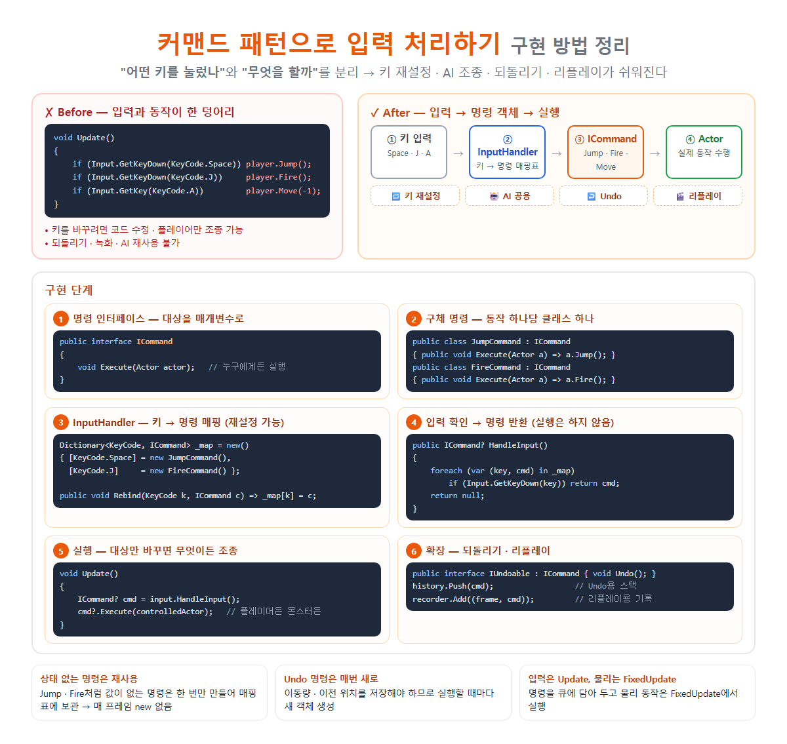

# [커맨드 패턴(Command 이용 입력처리 구현방법 정리)](../KeywordsList.md)

</img>

| 구성 요소 | 역할 | 이 구현에서 |
| --- | --- | --- |
| **Command** | 실행할 동작의 약속 | `ICommand.Execute(Actor)` |
| **ConcreteCommand** | 실제 명령 | `JumpCommand`, `FireCommand`, `MoveCommand` |
| **Receiver** | 실제 동작 수행 | `Actor` (플레이어, 몬스터 공통) |
| **Invoker** | 입력을 명령으로 변환 | `InputHandler` (매핑표) |
| **Client / 실행자** | 명령을 대상에게 실행 | `PlayerController`, `EnemyAI` |
| **확장: Undo** | 되돌리기 | `IUndoableCommand` + 스택 2개 |
| **확장: Replay** | 녹화·재생 | `(frame, command)` 기록 |

| 단계 | 할 일 |
| --- | --- |
| 1 | 공통 동작을 가진 `Actor` 만들기 |
| 2 | `ICommand` 인터페이스 정의 (대상은 매개변수로) |
| 3 | 동작마다 구체 명령 클래스 작성 |
| 4 | `InputHandler`에 키 → 명령 매핑표 구성 (재설정 메서드 포함) |
| 5 | 컨트롤러에서 명령을 받아 조종 대상에게 실행 |
| 6 | AI, Undo, 리플레이로 확장 |

## 개요

- 입력 처리에 커맨드 패턴을 쓰는 목적은 "어떤 키를 눌렀는가(입력)"와 "무엇을 할 것인가(동작)"를 분리하는 것
- 이 방식은 로버트 나이스트롬의 『게임 프로그래밍 패턴』에서 대표 예제로 소개된 구조

| 구분 | 직접 호출 방식 | 커맨드 방식 |
| --- | --- | --- |
| 키 → 동작 연결 | 코드에 하드코딩 | 매핑표(Dictionary)로 관리 |
| 키 재설정 | 코드 수정 필요 | 매핑표만 교체 |
| 조종 대상 | 플레이어 고정 | 어떤 Actor든 가능 |
| AI 재사용 | 별도 코드 | 같은 명령 객체 사용 |
| 되돌리기 · 리플레이 | 불가 | 명령을 저장해서 가능 |

## 문제 : 입력과 동작이 한 덩어리

```csharp
public class PlayerController : MonoBehaviour
{
    [SerializeField] private Player player;

    private void Update()
    {
        if (Input.GetKeyDown(KeyCode.Space)) player.Jump();
        if (Input.GetKeyDown(KeyCode.J))     player.Fire();
        if (Input.GetKey(KeyCode.A))         player.Move(-1);
        if (Input.GetKey(KeyCode.D))         player.Move(1);
    }
}
```

- 문제점
    - 키를 바꾸려면 코드를 수정해야 함. 게임 옵션에서 키 설정 기능을 만들기 어려움.
    - 플레이어만 조종할 수 있음. 몬스터를 조종하거나 AI가 같은 동작을 쓰려면 코드를 따로 만들어야 함.
    - 실행한 동작이 기록되지 않아서 되돌리기(Undo)나 리플레이를 할 수 없음.

## 구현 단계

#### 1단계 : Actor(Receiver, 실제 동작을 수행하는 쪽)

- 플레이어와 몬스터가 공통으로 가지는 동작을 정의

```csharp
using UnityEngine;

public class Actor : MonoBehaviour
{
    [SerializeField] private float moveSpeed = 5f;
    [SerializeField] private float jumpPower = 7f;
    private Rigidbody2D _rb;

    private void Awake() => _rb = GetComponent<Rigidbody2D>();

    public void Move(float dir) => _rb.velocity = new Vector2(dir * moveSpeed, _rb.velocity.y);
    public void Jump()          => _rb.AddForce(Vector2.up * jumpPower, ForceMode2D.Impulse);
    public void Fire()          => Debug.Log($"{name} 발사!");
}
```

#### 2단계 : 명령 인터페이스 - 대상을 매개변수로 받기

```csharp
public interface ICommand
{
    void Execute(Actor actor);    // "누구에게" 실행할지를 실행할 때 받음
}
```

- 핵심 포인트 : 명령이 특정 플레이어에 묶여 있지 않고 실행할 때 대상을 받습니다. 그래서 같은 `JumpCommand` 로 플레이어든 몬스터든 점프시킬 수 있습니다.

#### 3단계 : 구체 명령 - 동작 하나당 클래스 하나

```csharp
public class JumpCommand : ICommand
{
    public void Execute(Actor actor) => actor.Jump();
}

public class FireCommand : ICommand
{
    public void Execute(Actor actor) => actor.Fire();
}

public class MoveCommand : ICommand
{
    private readonly float _dir;
    public MoveCommand(float dir) => _dir = dir;
    public void Execute(Actor actor) => actor.Move(_dir);
}

// 아무것도 하지 않는 명령 (Null Object 패턴): null 체크 대신 사용
public class NullCommand : ICommand
{
    public static readonly NullCommand Instance = new();
    public void Execute(Actor actor) { }
}
```

#### 4단계 : InputHandler - 키 → 명령 매핑표

```csharp
using System.Collections.Generic;
using UnityEngine;

public class InputHandler
{
    // 한 번 누를 때 실행 (점프, 공격)
    private readonly Dictionary<KeyCode, ICommand> _pressMap = new()
    {
        [KeyCode.Space] = new JumpCommand(),
        [KeyCode.J]     = new FireCommand(),
    };

    // 누르고 있는 동안 실행 (이동)
    private readonly Dictionary<KeyCode, ICommand> _holdMap = new()
    {
        [KeyCode.A] = new MoveCommand(-1),
        [KeyCode.D] = new MoveCommand(1),
    };

    // 이번 프레임의 명령들을 반환 (실행은 하지 않음!)
    public List<ICommand> HandleInput()
    {
        var result = new List<ICommand>();
        foreach (var pair in _pressMap)
            if (Input.GetKeyDown(pair.Key)) result.Add(pair.Value);
        foreach (var pair in _holdMap)
            if (Input.GetKey(pair.Key)) result.Add(pair.Value);
        return result;
    }

    // 키 재설정
    public void RebindPress(KeyCode oldKey, KeyCode newKey)
    {
        if (_pressMap.Remove(oldKey, out var cmd))
            _pressMap[newKey] = cmd;
    }
}
```

- 포인트
    - `HandleInput()` 은 명령을 반환만 하고 실행하지 않음.
    - 실행 시점과 대상은 호출한 쪽이 결정. 이렇게 해야 기록, 지연 실행, 네트워크 전송이 가능해짐.

#### 5단계 : 컨트폴러 - 명령을 받아 대상에게 실행

```csharp
public class PlayerController : MonoBehaviour
{
    [SerializeField] private Actor controlledActor;     // 조종 대상 (언제든 교체 가능)
    private readonly InputHandler _input = new();

    private void Update()
    {
        foreach (var cmd in _input.HandleInput())
            cmd.Execute(controlledActor);
    }

    // 다른 캐릭터로 조종 전환 (빙의, 탈것 탑승 등)
    public void Possess(Actor target) => controlledActor = target;
}
```

#### 6단계 : AI도 같은 명령 사용

```csharp
public class EnemyAI : MonoBehaviour
{
    [SerializeField] private Actor self;
    [SerializeField] private Transform target;

    private static readonly ICommand Jump = new JumpCommand();
    private static readonly ICommand Fire = new FireCommand();

    private ICommand Decide()
    {
        float dx = target.position.x - self.transform.position.x;
        if (Mathf.Abs(dx) < 2f) return Fire;
        return new MoveCommand(Mathf.Sign(dx));
    }

    private void Update() => Decide().Execute(self);
}
```

- 플레이어 입력과 AI가 같은 명령 체계를 쓰므로, 동작 로직은 한 곳(Actor)에만 있음.