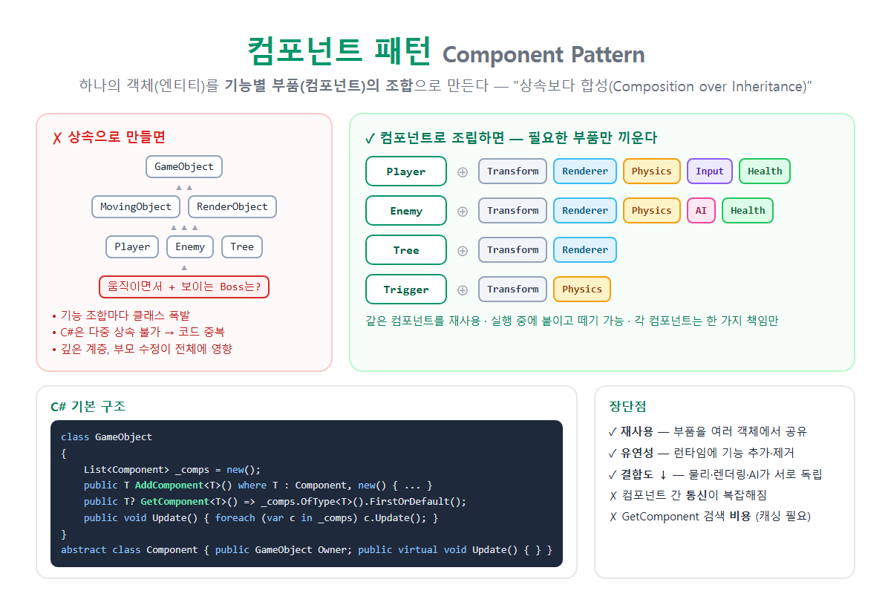

# [컴포넌트 패턴](../KeywordsList.md)

</img>

| 항목 | 내용 |
| --- | --- |
| 이름 | 컴포넌트 패턴 (Component Pattern) |
| 분류 | 게임 프로그래밍 패턴, 디커플링 패턴 |
| 핵심 원칙 | 상속보다 합성 (Composition over Inheritance) |
| 구성 | 엔티티(컨테이너) + 컴포넌트(기능 부품) |
| 주요 API | `AddComponent<T>()`, `GetComponent<T>()`, `RemoveComponent<T>()` |
| 통신 방식 | 직접 참조, 공유 상태, 메시지/이벤트 |
| 장점 | 재사용, 유연성, 런타임 변경, 낮은 결합도, SRP |
| 단점 | 통신 복잡, 간접 호출 증가, 검색 비용, 전체 흐름 파악이 어려움 |
| 대표 사례 | Unity (`GameObject` + `MonoBehaviour`), Unreal (`ActorComponent`) |
| 발전형 | ECS (Entity-Component-System) |

## 정의

- 하나의 객체(엔티티)를 거대한 클래스 하나나 깊은 상속 구조로 만들지 않는 방식
- 기능별로 나눈 작은 부품(컴포넌트)들을 조립해서 만듦
    - 엔티티 : 컴포넌트들을 담는 그릇(컨테이너)입니다. 예: `GameObject`
    - 컴포넌트 : 위치, 그래픽, 물리, 입력, AI처럼 한 가지 기능만 맡는 부품
- 게임 개발에서 특히 많이 쓰며, 로버트 나이스트롬(Robert Nystrom)의 『게임 프로그래밍 패턴』에서 디커플링(결합도 낮추기) 패턴으로 소개됨
- 핵심 원칙은 "상속보다 합성(Composition over Inheritance)”

## 왜 필요한가?

```csharp
// ❌ 상속으로 기능 조합을 표현하면
class GameObject { }
class MovingObject : GameObject { void Move() { } }      // 움직이는 것
class RenderObject : GameObject { void Draw() { } }      // 보이는 것

class Player : MovingObject { }   // 움직이지만... 그리기는?
class Tree   : RenderObject { }   // 보이지만 움직이지 않음
class Boss   : ???               // 움직이면서 보여야 하는데 둘 중 하나만 상속 가능!
```

문제점

- C#은 다중 상속이 불가능. "움직이면서 보이는" 객체를 만들려면 코드를 복사해야 함.
- 기능 조합마다 클래스가 필요. `MovingRenderObject`, `MovingPhysicsRenderObject`... 처럼 클래스 수가 폭발함.
- 계층이 깊어질수록 부모 클래스를 수정하면 자식 전체에 영향이 감.
- 기능을 실행 중에 추가하거나 제거할 수 없음. 예: 버프를 받아서 날 수 있게 되는 경우

```csharp
해결 : 컴포넌트로 조립
// 컴포넌트 기반 클래스
public abstract class Component
{
    public GameObject Owner { get; internal set; } = null!;
    public virtual void Update(float dt) { }
}

// 엔티티 = 컴포넌트 컨테이너
public class GameObject
{
    private readonly List<Component> _components = new();

    public T AddComponent<T>() where T : Component, new()
    {
        var c = new T { Owner = this };
        _components.Add(c);
        return c;
    }

    public T? GetComponent<T>() where T : Component
        => _components.OfType<T>().FirstOrDefault();

    public void RemoveComponent<T>() where T : Component
        => _components.RemoveAll(c => c is T);

    public void Update(float dt)
    {
        foreach (var c in _components) c.Update(dt);
    }
}

// 기능별 컴포넌트 (각자 한 가지 책임)
public class Transform : Component { public float X, Y; }

public class Physics : Component
{
    public float VelocityX;
    public override void Update(float dt)
    {
        var t = Owner.GetComponent<Transform>()!;   // 다른 컴포넌트와 협력
        t.X += VelocityX * dt;
    }
}

public class Health : Component
{
    public int Hp = 100;
    public void Damage(int amount) => Hp -= amount;
}

// 조립: 필요한 부품만 끼움
var player = new GameObject();
player.AddComponent<Transform>();
player.AddComponent<Physics>().VelocityX = 5;
player.AddComponent<Health>();

var tree = new GameObject();
tree.AddComponent<Transform>();        // 움직이지 않으니 Physics 없음

// 런타임에 기능 추가·제거
player.RemoveComponent<Physics>();      // 기절 → 움직임 정지
```

## 특징

- 엔티티는 껍데기. 엔티티 자체에는 기능이 거의 없고, 어떤 컴포넌트를 가졌는지가 그 객체의 정체를 결정.
- 컴포넌트마다 한 가지 책임만 맡음(SRP). 물리 컴포넌트는 렌더링을 모르고, 렌더링 컴포넌트는 AI를 모름.
- 조합으로 다양성을 만듦. 같은 컴포넌트 몇 개로 플레이어, 적, 나무, 트리거 등을 자유롭게 만들 수 있음.
- 런타임에 구성을 바꿀 수 있음. 실행 중에 컴포넌트를 붙이고 떼면서 동작을 바꿈.
- 데이터 기반 설계와 잘 맞음. JSON이나 에디터(Unity Inspector)에서 컴포넌트 구성을 정의하면, 코드를 바꾸지 않고 새 객체를 만들 수 있음.

## 기능

| 방법 | 설명 | 예 | 특징 |
| --- | --- | --- | --- |
| **직접 참조** | 다른 컴포넌트를 찾아서 직접 호출 | `GetComponent<Health>().Damage(10)` | 간단하지만 결합도가 생김 |
| **공유 상태** | 엔티티(컨테이너)에 공용 데이터를 둠 | 위치를 `Transform`에 두고 모두가 읽음 | 명확하지만 공유 데이터가 늘어남 |
| **메시지 / 이벤트** | 이벤트를 보내면 관심 있는 컴포넌트만 반응 | `OnDamaged` 이벤트 → UI, 사운드가 반응 | 결합도가 가장 낮지만 흐름 추적이 어려움 |