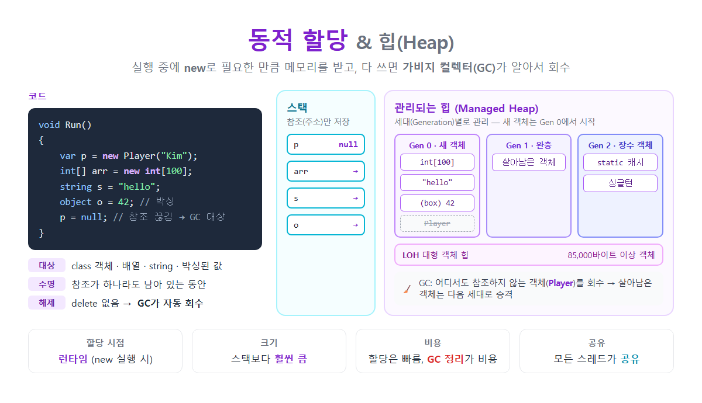

# [동적 할당(Dynamic Allocation)과 힙(Heap)](../KeywordsList.md)

</img>

| 항목 | 내용 |
| --- | --- |
| 정의 | 런타임에 `new`로 메모리를 받아 객체를 만드는 것 / 그 객체가 저장되는 영역 |
| 할당 키워드 | `new` (참조 형식), 박싱 시 자동 할당 |
| 저장 대상 | 클래스 객체, 배열, string, 델리게이트, 박싱된 값 |
| 수명 | 참조가 하나라도 남아 있는 동안 |
| 해제 | 가비지 컬렉터(GC)가 자동 회수 (`delete` 없음) |
| 할당 속도 | 빠름 (포인터 이동) |
| 비용 | GC 실행 시 일시 정지, CPU 사용 |
| 크기 | 큼 (시스템 메모리만큼) |
| 스레드 | 모든 스레드가 공유 |
| 관련 예외 | `OutOfMemoryException` |

## 정의

- 동적 할당 : 프로그램이 실행되는 동중(런타임)에 필요한 만큼 메모리를 받아 쓰는 것. C#에서는 `new` 키워드로 참조 형식 객체를 만들 때 동적 할당이 일어남
- 힙(Heap) : 동적 할당된 객체가 저장되는 메모리 영역. C#의 힙은 .NET 런타임(CLR)이 관리하므로 관리되는 힙이라고 부름. 다 쓴 메모리는 개발자가 직접 해제하지 않고, 가비지 컬렉터가 자동으로 회수

```csharp
void Run()
{
    var p = new Player("Kim");    // 힙에 Player 객체 생성, p(스택)에는 주소만
    int[] arr = new int[100];     // 배열도 힙에 저장
    string s = "hello";           // string도 참조 형식 → 힙
    object o = 42;                // 박싱: int 값을 힙에 복사해서 넣음

    p = null;                     // 참조가 끊김 → Player 객체는 GC 회수 대상
}                                 // 메서드 종료 → arr, s, o의 참조도 사라짐 → 나중에 GC가 회수
```

## 힙에 할당되는 요소

| 대상 | 예 |
| --- | --- |
| 클래스 인스턴스 | `new Player()`, `new List<int>()` |
| 배열 (요소가 값 형식이어도) | `new int[100]`, `new Point[10]` |
| 문자열 | `"hello"`, `$"{name}님"` |
| 델리게이트, 람다 | `Action a = () => ...;` |
| 박싱된 값 형식 | `object o = 42;`, `IComparable c = 3.14;` |
| 클래스 필드로 들어있는 값 형식 | `class A { int x; }`의 `x`는 A 객체와 함께 힙에 저장 |
| 람다가 캡처한 변수, async/yield 메서드의 지역 변수 | 컴파일러가 만든 클래스의 필드로 옮겨짐 |

## 특징

- 런타임에 크기를 정할 수 있음. `new int[n]`처럼 실행 중에 정해지는 크기로 만들 수 있음.
- 수명이 메서드와 독립적. 메서드가 끝나도 어딘가에서 참조하고 있으면 객체는 계속 살아 있음. 메서드에서 객체를 반환하거나 필드에 저장할 수 있는 이유.
- 모든 스레드가 공유. 그래서 여러 스레드가 같은 객체를 동시에 고치면 `lock` 같은 동기화가 필요.
- 크기가 큼. 스택이 스레드당 1MB 정도인 것과 달리, 힙은 시스템 메모리가 허용하는 만큼 커질 수 있음.
- 자동으로 해제됨. C/C++의 `free`나 `delete`가 없음. GC가 더 이상 참조되지 않는 객체를 찾아서 회수함.
- 할당은 빠르지만, 정리에 비용이 듦.
    - .NET에서 새 객체 할당은 포인터를 앞으로 미는 것만으로 끝나서 매우 빠름.
    - 대신 GC가 실행될 때 살아 있는 객체를 추적하고, 메모리를 정리하고, 객체를 옮기는(압축) 비용이 듦.

## 기능

- 크기를 미리 알 수 없는 데이터 저장 : 사용자 입력에 따라 크기가 달라지는 리스트, 파일 내용 등
- 메서드보다 오래 사는 데이터 보관 : 게임 캐릭터, 설정 객체, 캐시 등
- 여러 곳에서 같은 객체 공유 : 참조만 넘기면 복사 없이 같은 객체를 여러 곳에서 씀.
- 다형성 지원 : `IShape s = new Circle();`처럼 부모 타입 참조로 자식 객체를 다룰 수 있음.

## 스택 vs 힙

| 구분 | 스택 | 힙 |
| --- | --- | --- |
| 저장 대상 | 지역 변수 (값 형식 값, 참조 형식의 주소) | `new`로 만든 객체 |
| 할당 시점 | 메서드 호출 시 | `new` 실행 시 |
| 해제 | 메서드 종료 시 자동 (프레임 pop) | GC가 회수 |
| 속도 | 매우 빠름 | 할당은 빠르지만 GC 비용이 있음 |
| 크기 | 작음 (약 1MB) | 큼 |
| 스레드 | 스레드마다 따로 | 모든 스레드가 공유 |
| 넘치면 | `StackOverflowException` | `OutOfMemoryException` |