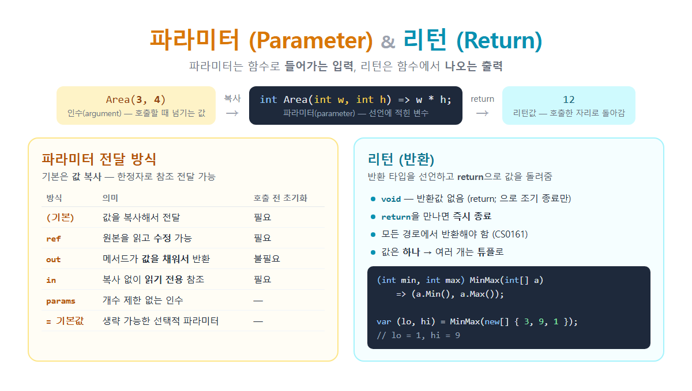

# [의존성 역전 원칙 (DIP)](../KeywordsList.md)

</img>

| 항목 | 내용 |
| --- | --- |
| 이름 | 의존성 역전 원칙 (Dependency Inversion Principle) |
| 위치 | SOLID의 D |
| 규칙 A | 상위 모듈과 하위 모듈 모두 추상화에 의존 |
| 규칙 B | 추상화는 세부에 의존하지 않고, 세부가 추상화에 의존 |
| "역전"의 의미 | 소스 코드 의존 방향이 하위 → 상위(추상화)로 뒤집힘 |
| 인터페이스 소유 | 상위 모듈(도메인) 쪽 |
| 구현 기법 | 의존성 주입(DI): 생성자 주입이 기본 |
| .NET 도구 | `IServiceCollection`, `AddScoped`/`AddTransient`/`AddSingleton` |
| 위반 신호 | 비즈니스 로직 속 `new`, static 인프라 호출, 테스트 불가 |
| 효과 | 교체 용이, 테스트 용이, 결합도 감소, OCP 실현 |
| 관련 원칙 | OCP(목표), LSP(구현이 약속을 지켜야 함), ISP(작은 추상화) |

## 정의

- 상위 모듈은 하위 모듈에 의존해서는 안 된다. 둘 다 추상화에 의존해야 함.
- 추상화는 세부 사항에 의존해서는 안 된다. 세부 사항이 추상화에 의존해야 함.

| 용어 | 의미 | 예 |
| --- | --- | --- |
| **상위 모듈** | 비즈니스 규칙, 정책. 앱의 핵심 로직 | `OrderService`, `PaymentProcessor` |
| **하위 모듈** | 기술적인 세부 구현 | `SqlRepository`, `SmtpEmailSender`, 파일 I/O |
| **추상화** | 인터페이스나 추상 클래스 | `IOrderRepository`, `IEmailSender` |

```csharp
// ❌ 위반: 상위 모듈이 구체 클래스를 직접 생성하고 의존
public class OrderService
{
    private readonly SqlOrderRepository _repo = new SqlOrderRepository();
    private readonly SmtpEmailSender _email = new SmtpEmailSender();

    public void PlaceOrder(Order order)
    {
        _repo.Save(order);
        _email.Send(order.CustomerEmail, "주문 완료");
    }
}
```

- SQL Server를 MongoDB로 바꾸거나 이메일을 카카오 알림톡으로 바꾸면 `OrderService`를 수정해야 함. (비즈니스 로직은 그대로)
- 단위 테스트를 할 수 없음. 테스트할 때마다 실제 DB에 저장되고 실제 이메일이 나감.
- 하위 모듈이 바뀌면 상위 모듈도 다시 컴파일하고 배포해야 함.

```csharp
// ✅ 해결: 추상화를 만들고, 생성자로 주입받기
public interface IOrderRepository { void Save(Order order); }
public interface INotifier        { void Send(string to, string message); }

public class OrderService
{
    private readonly IOrderRepository _repo;
    private readonly INotifier _notifier;

    public OrderService(IOrderRepository repo, INotifier notifier)   // 생성자 주입
    {
        _repo = repo;
        _notifier = notifier;
    }

    public void PlaceOrder(Order order)
    {
        _repo.Save(order);
        _notifier.Send(order.CustomerEmail, "주문 완료");
    }
}

// 하위 모듈: 추상화를 구현
public class SqlOrderRepository : IOrderRepository { public void Save(Order o) { ... } }
public class EmailNotifier      : INotifier        { public void Send(string t, string m) { ... } }
public class KakaoNotifier      : INotifier        { public void Send(string t, string m) { ... } }
```

```csharp
builder.Services.AddScoped<IOrderRepository, SqlOrderRepository>();
builder.Services.AddScoped<INotifier, KakaoNotifier>();      // 이 한 줄만 바꾸면 교체 완료
builder.Services.AddScoped<OrderService>();
```

```csharp
var fakeRepo = new FakeOrderRepository();     // 메모리에만 저장
var fakeNotifier = new FakeNotifier();         // 실제로 보내지 않음
var service = new OrderService(fakeRepo, fakeNotifier);

service.PlaceOrder(order);
Assert.Single(fakeRepo.SavedOrders);
```

## 특징

- 추상화가 중심. 상위 모듈과 하위 모듈이 서로를 모르고, 인터페이스라는 약속만 공유.
- 인터페이스는 상위 모듈 쪽이 소유.
    - `IOrderRepository`는 "비즈니스 로직이 필요로 하는 기능"을 정의한 것. 그래서 상위 모듈 쪽(도메인 계층)에 둠.
    - 하위 모듈이 그 약속에 맞춰 구현.
    - 이것이 규칙 B "세부 사항이 추상화에 의존해야 한다"의 의미.
- 객체를 직접 생성하지 않음. 상위 모듈 안에서 `new SqlRepository()`처럼 쓰지 않고, 외부에서 받음(주입).
- 안정적인 쪽에 의존. 인터페이스는 잘 바뀌지 않고, 구현은 자주 바뀜. 그래서 바뀌기 쉬운 것이 바뀌기 어려운 것에 의존하게 만듦.

## 기능

| 효과 | 설명 |
| --- | --- |
| **교체 용이** | DB, 외부 API, 알림 수단을 바꿔도 비즈니스 로직은 수정 없음 |
| **테스트 용이** | 가짜 구현(Fake, Mock)을 주입해서 빠르고 독립적인 단위 테스트 가능 |
| **병렬 개발** | 인터페이스만 정해 두면 상위와 하위 모듈을 동시에 개발 가능 |
| **OCP 실현** | 새 구현 클래스를 추가하는 것만으로 기능 확장 |
| **계층 분리** | 클린 아키텍처, 헥사고날 아키텍처의 핵심 원리 |
| **결합도 감소** | 모듈 간 영향이 인터페이스 경계에서 차단됨 |

## 위반 신호(Code Smell)

- 비즈니스 로직 안에 `new 구체클래스()`가 있음. 예: `new SqlConnection()`, `new HttpClient()`, `new SmtpClient()`
- 인프라 기능을 static으로 직접 호출함.
    - `DateTime.Now`, `File.ReadAllText()`, `Environment.GetEnvironmentVariable()`
    - 이런 코드는 테스트에서 시간이나 파일을 마음대로 바꿀 수 없음.
- 단위 테스트를 하려면 실제 DB, 네트워크, 파일이 필요.
- 하위 모듈을 바꾸면 상위 모듈도 수정해야 함.
- 도메인 계층 프로젝트가 인프라 계층 프로젝트(EF Core 등)를 참조.

```csharp
// ❌ 테스트할 때 시간을 바꿀 수 없음
bool IsExpired(Coupon c) => DateTime.Now > c.ExpireAt;

// ✅ .NET 8+의 TimeProvider로 추상화
public class CouponService(TimeProvider time)
{
    public bool IsExpired(Coupon c) => time.GetUtcNow() > c.ExpireAt;
}
// 테스트: new FakeTimeProvider(원하는 시각) 주입 (Microsoft.Extensions.TimeProvider.Testing 패키지)
```