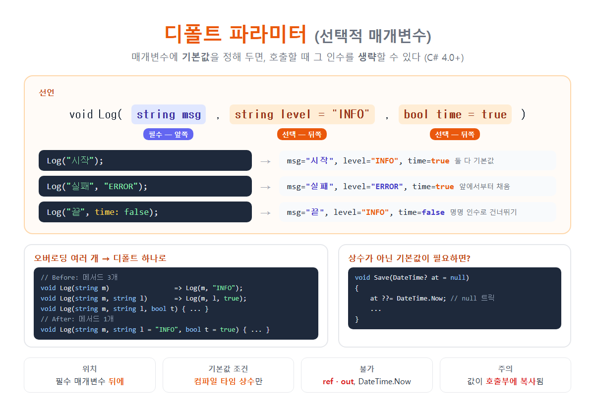

# [디폴트 파라미터](../KeywordsList.md)

</img>

| 항목 | 내용 |
| --- | --- |
| 이름 | 디폴트 파라미터, 선택적 매개변수 (Optional Parameter) |
| 도입 | C# 4.0 |
| 문법 | `타입 이름 = 기본값` |
| 위치 | 필수 매개변수 뒤 (`params`만 그 뒤에 올 수 있음) |
| 기본값 조건 | 컴파일 타임 상수, `null`, `default`, `new 구조체()` |
| 사용 불가 | `ref`/`out` 매개변수, `DateTime.Now`, `new 클래스()` |
| 생략 규칙 | 앞에서부터 채움, 중간을 건너뛰려면 명명 인수 |
| 대표 용도 | 옵션 값, `CancellationToken cancellationToken = default` |
| 관련 오류 | CS1736 (상수가 아님), CS1737 (위치 오류) |
| 람다 | C# 12부터 람다에도 사용 가능 |

## 정의

- 매개변수를 선언할 때 기본값을 미리 정해 둔 매개변수
- 호출할 때 그 인수를 생략하면 기본값이 자동으로 들어감.
- 선택적 매개변수(Optional Parameter)

```csharp
void Log(string msg, string level = "INFO", bool time = true)
{
    string prefix = time ? $"[{DateTime.Now:HH:mm:ss}] " : "";
    Console.WriteLine($"{prefix}[{level}] {msg}");
}

Log("시작");                      // level = "INFO", time = true   (둘 다 기본값)
Log("실패", "ERROR");             // level = "ERROR", time = true  (앞에서부터 채움)
Log("끝", time: false);           // level = "INFO", time = false  (명명 인수로 건너뛰기)
```

## 특징

- 필수 매개변수 뒤에 와야 함.

```
void A(int x, int y = 0) { }      // ✅
void B(int x = 0, int y) { }      // ❌ CS1737: 선택적 매개변수 뒤에 필수 매개변수가 올 수 없음
```

-예외적으로 `params`는 선택적 매개변수 뒤에 올 수 있음. 예: `void F(int a = 1, params int[] rest)`

- 기본값은 컴파일 타임에 정해지는 값이어야 함.

| 사용 가능 ✅ | 사용 불가 ❌ |
| --- | --- |
| 리터럴: `10`, `"INFO"`, `true`, `3.14` | `DateTime.Now` (실행 중에 정해지는 값) |
| `const` 상수: `= MaxCount` | `new List<int>()` (참조 형식 객체 생성) |
| `null` (참조 형식, nullable) | 메서드 호출 결과: `= GetDefault()` |
| `default`, `default(T)` | `static readonly` 필드 |
| `new MyStruct()` (값 형식의 기본 생성) | `TimeSpan.FromSeconds(5)` |
| enum 값: `= Color.Red` |  |

어기면 오류 CS1736(기본값은 컴파일 타임 상수여야 함)이 납니다.

- `ref`, `out`에는 기본값을 쓸 수 없음 (`in`은 가능)
- 인수는 앞에서부터 순서대로 채워짐.
    - 중간의 매개변수만 건너뛰고 싶으면 명명 인수(Named Argument)를 씀.
    - 예: `Log("끝", time: false)`는 `level`을 건너뛰고 `time`만 지정.

## 기능

| 기능 | 설명 |
| --- | --- |
| **오버로딩 줄이기** | 인수 개수만 다른 메서드를 여러 개 만들 필요가 없음 |
| **호출 간소화** | 대부분 같은 값을 쓰는 옵션은 생략하고, 필요할 때만 지정 |
| **API 확장** | 기존 메서드에 새 옵션을 추가해도 기존 호출 코드가 그대로 동작 (소스 호환) |
| **가독성** | 명명 인수와 함께 쓰면 `Connect(timeout: 30)`처럼 의도가 명확 |

```csharp
// Before: 오버로딩 3개
void Log(string m)                   => Log(m, "INFO");
void Log(string m, string l)         => Log(m, l, true);
void Log(string m, string l, bool t) { ... }

// After: 메서드 1개
void Log(string m, string l = "INFO", bool t = true) { ... }
```