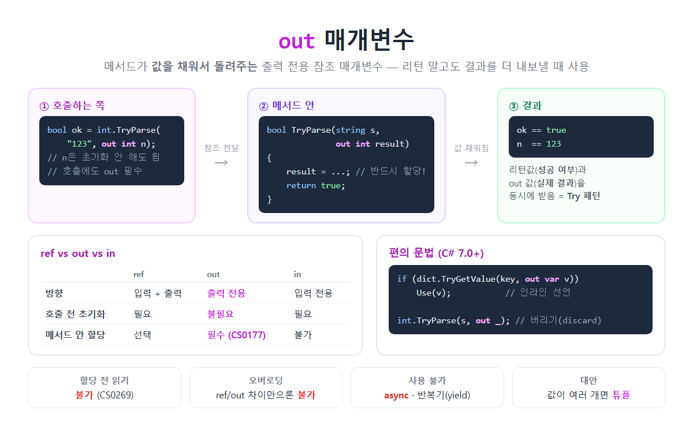

# [의존성 주입 (Dependency Injection)](../KeywordsList.md)

</img>

| 항목 | 내용 |
| --- | --- |
| 이름 | 의존성 주입 (Dependency Injection) |
| 종류 | 기법(패턴). DIP(원칙)를 구현하는 수단 |
| 정의 | 필요한 객체를 외부에서 만들어 넣어 주는 것 |
| 주입 방식 | 생성자 주입 ⭐, 메서드 주입, 속성 주입 |
| .NET 도구 | `IServiceCollection`(등록), `IServiceProvider`(해결) |
| 수명 | Transient, Scoped, Singleton |
| 컴포지션 루트 | 모든 연결을 한곳에서 함 (`Program.cs`) |
| 효과 | 느슨한 결합, 교체 용이, 테스트 용이, 수명 자동 관리 |
| 안티패턴 | 서비스 로케이터, 생성자 과다 주입, Captive Dependency |

## 정의

- 클래스가 일하는 데 필요한 객체(의존성)를 클래스 안에서 직접 만들지 않고, 외부에서 만들어서 넣어 주는(주입하는) 기법
- 2004년 마틴 파울러가 이름을 붙임
    - **의존성(Dependency)** : 클래스가 일하는 데 필요한 다른 객체. 예를 들어 `OrderService`가 쓰는 `IOrderRepository`, `ILogger`
    - **주입(Injection)** : 그 객체를 외부에서 전달해 주는 것. 보통 생성자를 통해 전달.

```csharp
// ❌ DI 없이: 필요한 객체를 스스로 생성
public class OrderService
{
    private readonly SqlOrderRepository _repo = new SqlOrderRepository();
    private readonly EmailSender _mail = new EmailSender();
}

// ✅ DI: 필요한 객체를 생성자로 받음
public class OrderService
{
    private readonly IOrderRepository _repo;
    private readonly INotifier _notifier;

    public OrderService(IOrderRepository repo, INotifier notifier)
    {
        _repo = repo;
        _notifier = notifier;
    }
}
```

- DIP와의 관계
    - **DIP**는 "추상화에 의존하라"는 설계 원칙.
    - DI는 그 원칙을 실제로 구현하는 기법.
    - 클래스가 인터페이스에만 의존하려면, 실제 구현 객체는 누군가 밖에서 넣어 줘야 함. 그 "넣어 주는 방법"이 DI.

## 특징

- 객체 생성 책임이 분리됨. 클래스는 사용만 하고, 생성과 연결은 외부가 담당.
- 의존성이 드러남. 생성자만 보면 이 클래스가 무엇을 필요로 하는지 한눈에 알 수 있음.
- 제어의 역전(IoC)이 일어남. 객체를 언제 어떻게 만들지 결정하는 권한이 클래스에서 외부(컨테이너, 프레임워크)로 넘어감.
- 컨테이너 없이도 할 수 있음. DI는 개념이라서 `new OrderService(new SqlRepo(), new EmailNotifier())`처럼 직접 연결해도 DI. 이를 순수 DI, Pure DI라고 함. 컨테이너는 이 작업을 자동화하는 도구일 뿐.

## 주입 방식

| 방식 | 형태 | 용도 | 비고 |
| --- | --- | --- | --- |
| **생성자 주입** | `OrderService(IRepo repo)` | 반드시 필요한 의존성 | 기본이자 권장 방식. 의존성 없이는 객체를 만들 수 없어서 안전 |
| **메서드 주입** | `Handle(Order o, IClock clock)` | 호출할 때마다 달라지는 의존성 | ASP.NET Core 미니멀 API, `[FromServices]` |
| **속성 주입** | `public ILogger? Logger { get; set; }` | 없어도 동작하는 선택적 의존성 | .NET 기본 컨테이너는 지원하지 않음 |

```csharp
// 생성자 주입 (C# 12 기본 생성자로 더 짧게)
public class OrderService(IOrderRepository repo, ILogger<OrderService> logger)
{
    public void Place(Order o)
    {
        repo.Save(o);
        logger.LogInformation("주문 {Id} 완료", o.Id);
    }
}

// 메서드 주입 (ASP.NET Core 미니멀 API: 매개변수에 서비스가 자동 주입됨)
app.MapPost("/orders", (Order o, OrderService service) => service.Place(o));
```

## 기능 : .NET DI 컨테이너 사용법

- **등록 (Program.cs)** : 어떤 인터페이스에 어떤 구현을 쓸지 알려 줌.

```csharp
var builder = WebApplication.CreateBuilder(args);

builder.Services.AddScoped<IOrderRepository, SqlOrderRepository>();   // 인터페이스 → 구현
builder.Services.AddSingleton<ICache, MemoryCache>();
builder.Services.AddTransient<IPriceCalculator, PriceCalculator>();
builder.Services.AddScoped<OrderService>();                            // 구체 클래스 자체도 등록 가능

// 팩토리로 등록 (생성 과정에 로직이 필요할 때)
builder.Services.AddSingleton<IClock>(sp => new SystemClock(TimeZoneInfo.Local));
```

- **해결 (Resolve)**
    - `OrderService`가 필요해지면 컨테이너가 생성자를 보고 `IOrderRepository`가 필요하다는 것을 알아냄.
    - 그래서 `SqlOrderRepository`를 먼저 만들어서 넣어 줌.
    - 의존성의 의존성까지 자동으로 끝까지 연결.
- **수명 관리** : 등록 방식에 따라 객체를 재사용할지 새로 만들지 결정하고, `IDisposable` 객체는 컨테이너가 알아서 **`Dispose()`**

#### 서비스 수명 (Lifetime)

| 등록 | 인스턴스 | 대표 예 | 주의 |
| --- | --- | --- | --- |
| `AddTransient` | 요청할 때마다 새로 | 가볍고 상태 없는 서비스 | 무거운 객체면 성능 부담 |
| `AddScoped` | 스코프(HTTP 요청)당 1개 | `DbContext`, 리포지토리 | 같은 요청 안에서는 공유됨 |
| `AddSingleton` | 앱 전체에서 1개 | 설정, 캐시, `HttpClient` 팩토리 | 스레드 안전해야 함 |