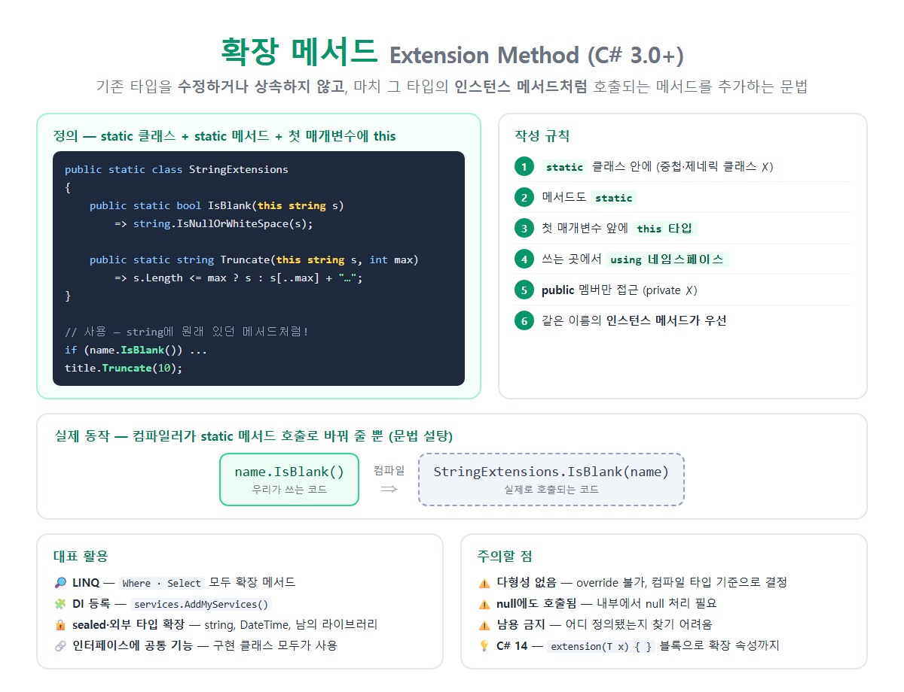

# [확장 메서드 (Extension Method)](../KeywordsList.md)

</img>

| 항목 | 내용 |
| --- | --- |
| 이름 | 확장 메서드 (Extension Method) |
| 도입 | C# 3.0 (LINQ와 함께) |
| 정의 | 기존 타입을 수정하지 않고 인스턴스 메서드처럼 호출되는 메서드를 추가 |
| 형태 | `static class` 안의 `static` 메서드, 첫 매개변수에 `this 타입` |
| 실제 동작 | 컴파일러가 static 메서드 호출로 변환 (문법 설탕) |
| 사용 조건 | 해당 네임스페이스 `using` |
| 접근 범위 | 대상 타입의 public 멤버만 |
| 우선순위 | 같은 시그니처면 인스턴스 메서드가 우선 |
| 바인딩 | 정적 (컴파일 타입 기준) → 다형성 없음 |
| 대표 사례 | LINQ, DI 등록(`AddXxx`), 미들웨어(`UseXxx`), 유틸리티 |
| C# 14 | `extension` 블록으로 확장 속성, static 확장 멤버까지 |

## 정의

- 기존 타입을 수정하거나 상속하지 않고도, 그 타입에 새 메서드가 원래 있었던 것처럼 호출할 수 있게 해 주는 C# 문법
- 컴파일러가 obj.Method() 모양의 호출을 클래스.Method(obj)로 바꿔 줄 뿐 ⇒ 문법 설탕(Syntactic Sugar)

```csharp
public static class StringExtensions
{
    public static bool IsBlank(this string? s)          // ← this가 핵심
        => string.IsNullOrWhiteSpace(s);

    public static string Truncate(this string s, int max)
        => s.Length <= max ? s : s[..max] + "…";
}

// 사용: string에 원래 있던 메서드처럼 호출
string name = "   ";
if (name.IsBlank()) Console.WriteLine("이름을 입력하세요");

"안녕하세요 반갑습니다".Truncate(5);    // "안녕하세요…"
```

| # | 규칙 | 어기면 |
| --- | --- | --- |
| 1 | `static` 클래스 안에 정의 (제네릭이 아니고 중첩되지 않은 최상위 클래스) | CS1106 |
| 2 | 메서드도 `static` |  |
| 3 | 첫 번째 매개변수 앞에 `this 타입`: 확장할 대상 타입 |  |
| 4 | 사용하는 쪽에서 그 클래스의 네임스페이스를 `using` | 메서드가 안 보임 |
| 5 | 확장 대상의 public 멤버만 접근 가능 (private, protected ✗) |  |
| 6 | 같은 이름, 같은 시그니처의 인스턴스 메서드가 있으면 그쪽이 우선 | 확장 메서드는 무시됨 |

## 특징

- 원본 타입을 건드리지 않음. `string`, `DateTime`, `int`처럼 수정할 수 없는 타입이나 `sealed` 클래스, 외부 라이브러리 타입에도 기능을 더할 수 있음.
- 인터페이스, 제네릭, enum에도 붙일 수 있음.
- 인스턴스 메서드처럼 점(`.`)으로 호출되므로, IntelliSense 자동 완성에 나타나고 메서드 체이닝이 자연스러워짐.
- 정적 바인딩. 어떤 확장 메서드가 호출될지 컴파일 시점의 변수 타입으로 결정됨. 그래서 `override` 같은 다형성이 없음.
- null인 변수에도 호출됨. 실제로는 static 메서드에 null을 인수로 넘기는 것이기 때문. 인스턴스 메서드라면 `NullReferenceException`이 나는 상황.

```csharp
string? s =null;
s.IsBlank();// ✅ 예외 없음 → IsBlank(null) 호출
s.Length;// 💥 NullReferenceException
```

## 기능

#### **유틸리티 메서드를 자연스럽게**

```csharp
public static class DateTimeExtensions
{
    public static bool IsWeekend(this DateTime d)
        => d.DayOfWeek is DayOfWeek.Saturday or DayOfWeek.Sunday;

    public static int Age(this DateTime birth)
        => DateTime.Today.Year - birth.Year - (DateTime.Today < birth.AddYears(DateTime.Today.Year - birth.Year) ? 1 : 0);
}

if (DateTime.Today.IsWeekend()) ...
int age = birthday.Age();
```

#### **인터페이스에 공통 기능 추가**

- 인터페이스를 구현한 모든 타입이 그 기능을 쓸 수 있게 됨.

```csharp
public static class EnumerableExtensions
{
    public static bool IsNullOrEmpty<T>(this IEnumerable<T>? source)
        => source is null || !source.Any();

    public static void ForEach<T>(this IEnumerable<T> source, Action<T> action)
    {
        foreach (var item in source) action(item);
    }
}

new List<int>().IsNullOrEmpty();     // List, 배열, HashSet 모두 사용 가능
new[] { 1, 2, 3 }.ForEach(Console.WriteLine);
```

#### LINQ: 확장 메서드의 대표작

- `Where`, `Select`, `OrderBy`, `First`, `Sum` 등은 모두 `IEnumerable<T>`의 확장 메서드. `System.Linq` 네임스페이스의 `Enumerable` 클래스에 정의되어 있음.

```csharp
var result = numbers.Where(n => n > 10).OrderBy(n => n).Select(n => n * 2);
// 실제로는: Enumerable.Select(Enumerable.OrderBy(Enumerable.Where(numbers, ...), ...), ...)
```

- 그래서 `using System.Linq;`를 지우면 이 메서드들이 사라짐.

#### **DI 등록을 깔끔하게 (ASP.NET Core)**

```csharp
public static class ServiceCollectionExtensions
{
    public static IServiceCollection AddGameServices(this IServiceCollection services)
    {
        services.AddSingleton<IGameState, GameState>();
        services.AddScoped<IScoreRepository, ScoreRepository>();
        return services;   // 체이닝 가능하도록 자신을 반환
    }
}

// Program.cs
builder.Services.AddGameServices().AddLogging();
```

- `AddControllers()`, `AddDbContext()`, `UseRouting()`도 모두 확장 메서드.

#### **플루언트(Fluent) API 만들기**

```csharp
var player = new Player()
    .WithName("Kim")
    .WithLevel(10)
    .WithItem("Sword");
```