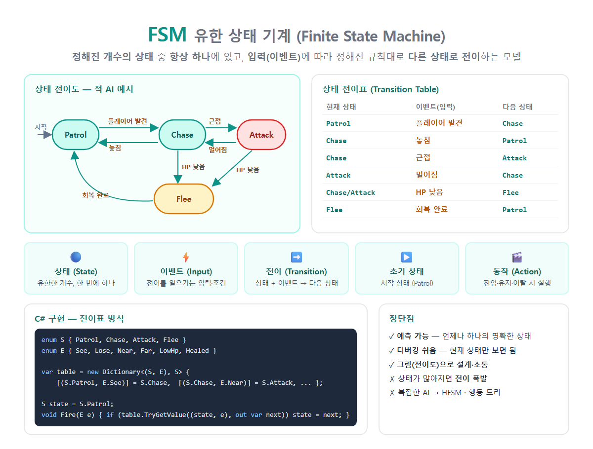

# [Finite State Machine](../KeywordsList.md)

</img>

| 항목 | 내용 |
| --- | --- |
| 이름 | 유한 상태 기계 (Finite State Machine) |
| 정의 | 유한한 상태 중 하나에 있고, 입력에 따라 정해진 규칙대로 전이하는 모델 |
| 구성 | 상태, 이벤트(입력), 전이, 초기 상태, 동작, (종료 상태) |
| 핵심 성질 | 한 번에 하나의 상태, 결정적, 허용된 전이만 |
| 표현 | 상태 전이도, 상태 전이표 |
| C# 구현 | enum+switch, Dictionary 전이표, switch 식, 상태 패턴 |
| 장점 | 예측 가능, 디버깅 쉬움, 설계·소통 용이, 잘못된 상태 방지 |
| 단점 | 상태가 늘면 전이 수가 폭발, 복잡한 AI에는 경직됨 |
| 확장형 | HFSM(계층형), 푸시다운 오토마타, 동시 FSM |
| 대안 | 행동 트리(Behavior Tree), GOAP, 유틸리티 AI |

## 정의

- FSM(유한 상태 기계)은 시스템의 동작을 표현하는 수학적 모델
    - 정해진 개수(유한)의 상태 중 언제나 딱 하나의 상태
    - 입력(이벤트)이 들어오면 미리 정한 규칙(전이)에 따라 다른 상태로 바뀜.
- 빨강 → 초록 → 노랑 → 빨강을 반복하고, 동시에 두 색이 켜지지 않습니다. 이것이 가장 단순한 FSM

```csharp
[Patrol] ──플레이어 발견──▶ [Chase] ──근접──▶ [Attack]
    ▲                          │                  │
    └────────놓침──────────────┘                  │
    ▲                          │HP 낮음           │HP 낮음
    └──────회복 완료──── [Flee] ◀──────────────────┘
```

#### 구성요소

| 구성 요소 | 설명 | 적 AI 예시 |
| --- | --- | --- |
| **상태 (State)** | 시스템이 있을 수 있는 상황. 유한 개이며 한 번에 하나 | Patrol, Chase, Attack, Flee |
| **이벤트 / 입력 (Input)** | 전이를 일으키는 신호나 조건 | 플레이어 발견, 근접, HP 낮음 |
| **전이 (Transition)** | (현재 상태 + 이벤트) → 다음 상태 규칙 | (Patrol, 발견) → Chase |
| **초기 상태 (Initial State)** | 처음 시작하는 상태 | Patrol |
| **동작 (Action)** | 상태에 들어갈 때, 머무는 동안, 나갈 때 실행하는 일 | Chase 진입 시 달리기 애니메이션 |
| **종료 상태 (Final State)** | 도달하면 끝나는 상태 (선택 사항) | Dead |

## 특징

- 항상 하나의 상태에만 있음. "추격하면서 동시에 도망"같이 모순된 상태가 생기지 않음.
- 결정적(Deterministic). 같은 상태에서 같은 입력이 들어오면 항상 같은 결과가 나옴. 그래서 예측할 수 있고 재현하기 쉬움.
- 허용된 전이만 일어남. 전이표에 없는 조합(예: Patrol에서 바로 Attack)은 무시하거나 오류로 처리.
- 그림(상태 전이도)과 표(전이표)로 표현할 수 있음. 기획자와 개발자가 소통하기 좋음.
- 현재 상태만 알면 다음 동작을 알 수 있음. 과거 이력이 필요 없어서 디버깅이 쉬움.

## 표현 방법

1. 상태 전이도(State Diagram) : 원(상태)과 화살표(전이)로 그린 그림
2. 상태 전이표(Transition Table)

| 현재 상태 | 이벤트 | 다음 상태 |
| --- | --- | --- |
| Patrol | 플레이어 발견 | Chase |
| Chase | 놓침 | Patrol |
| Chase | 근접 | Attack |
| Attack | 멀어짐 | Chase |
| Chase / Attack | HP 낮음 | Flee |
| Flee | 회복 완료 | Patrol |

## 기능

#### enum + switch: 가장 간단

```csharp
enum State { Patrol, Chase, Attack, Flee }
State _state = State.Patrol;

void Update()
{
    switch (_state)
    {
        case State.Patrol:
            Wander();
            if (SeePlayer()) _state = State.Chase;
            break;
        case State.Chase:
            MoveToPlayer();
            if (IsNear())      _state = State.Attack;
            else if (!SeePlayer()) _state = State.Patrol;
            if (Hp < 20)       _state = State.Flee;
            break;
        // ...
    }
}
```

- 상태가 적고 단순할 때 적합.

#### 전이표 (Dictionary): 규칙을 데이터로

```csharp
enum S { Patrol, Chase, Attack, Flee }
enum E { See, Lose, Near, Far, LowHp, Healed }

var table = new Dictionary<(S, E), S>
{
    [(S.Patrol, E.See)]    = S.Chase,
    [(S.Chase,  E.Lose)]   = S.Patrol,
    [(S.Chase,  E.Near)]   = S.Attack,
    [(S.Attack, E.Far)]    = S.Chase,
    [(S.Chase,  E.LowHp)]  = S.Flee,
    [(S.Attack, E.LowHp)]  = S.Flee,
    [(S.Flee,   E.Healed)] = S.Patrol,
};

S state = S.Patrol;

void Fire(E e)
{
    if (table.TryGetValue((state, e), out var next))
        state = next;          // 허용된 전이만 실행, 나머지는 무시
}
```

- 전이 규칙이 한눈에 보이고, JSON 등 외부 데이터로 관리하기도 좋음.

#### switch 식 + 튜플 패턴: 간결

```csharp
S Next(S s, E e) => (s, e) switch
{
    (S.Patrol, E.See)                    => S.Chase,
    (S.Chase,  E.Lose)                   => S.Patrol,
    (S.Chase,  E.Near)                   => S.Attack,
    (S.Attack, E.Far)                    => S.Chase,
    (S.Chase or S.Attack, E.LowHp)       => S.Flee,
    (S.Flee,   E.Healed)                 => S.Patrol,
    _                                    => s          // 허용되지 않으면 그대로
};
```

#### 상태 패턴: 상태별 로직이 클 때

- 상태마다 클래스를 만들고 `Enter`/`Update`/`Exit`를 구현. 자세한 내용은 앞에서 정리한 **"**상태 패턴**"**을 참고.

| 방법 | 적합한 상황 |
| --- | --- |
| enum + switch | 상태 2~4개, 로직 단순 |
| 전이표 (Dictionary) | 전이 규칙이 많거나 데이터로 관리하고 싶을 때 |
| switch 식 | 전이 규칙만 간결하게 표현할 때 |
| 상태 패턴 | 상태별 동작이 복잡하고, 상태가 계속 늘어날 때 |