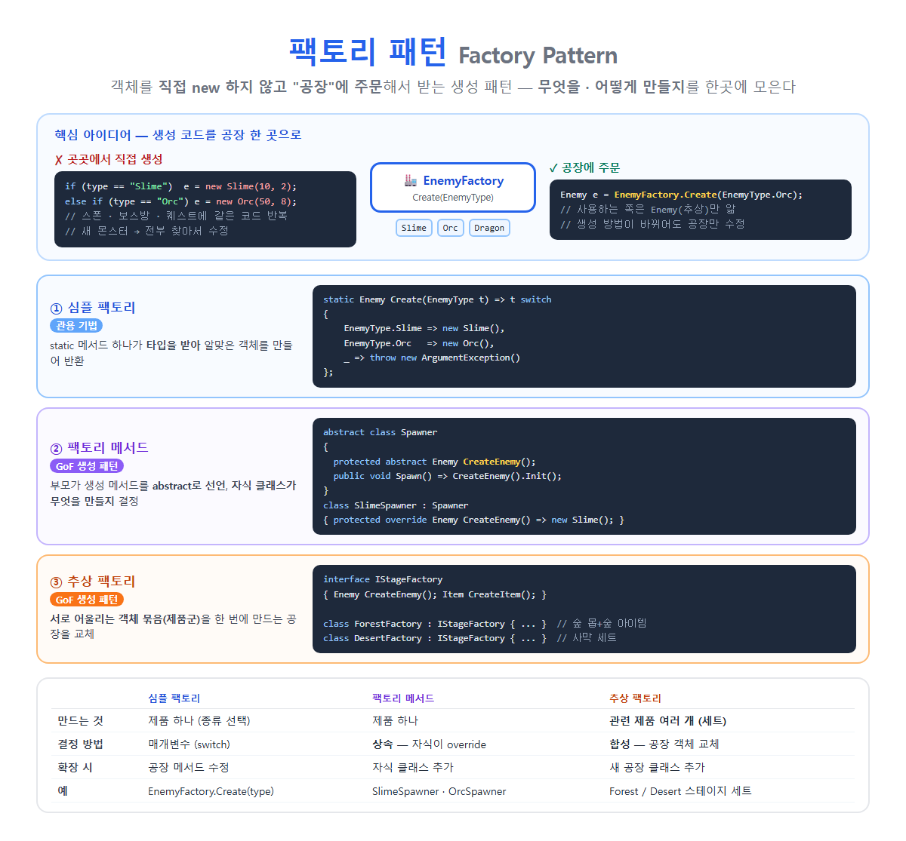

# [팩토리 패턴(Factory)](../KeywordsList.md)

</img>

| 항목 | 내용 |
| --- | --- |
| 분류 | 생성 패턴 (팩토리 메서드, 추상 팩토리는 GoF) |
| 정의 | 객체 생성을 전담 객체·메서드에게 맡김 |
| 핵심 | `new`를 한 곳으로 모으고, 사용하는 쪽은 추상 타입만 앎 |
| 종류 | 심플 팩토리 / 팩토리 메서드(상속) / 추상 팩토리(제품군, 합성) |
| 장점 | 중복 제거, 생성 로직 캡슐화, 결합도 감소, 확장 용이(OCP), 테스트 시 가짜 객체 주입 |
| 단점 | 클래스 수 증가, 단순한 생성에는 과설계 |
| 관련 원칙 | OCP, DIP, SRP |
| 함께 쓰는 패턴 | 싱글톤(공장 하나), 오브젝트 풀, 프로토타입, 전략 |

## 정의

- 팩토리 패턴은 객체를 new로 직접 만들지 않고, 생성을 전담하는 "공장(Factory)"에게 맡기는 생성 패턴
- 사용하는 쪽은 "무엇이 필요한지"만 요청
- "어떤 클래스를 어떻게 만들지"는 공장이 결정

| 종류 | 분류 | 한 줄 요약 |
| --- | --- | --- |
| **심플 팩토리** (Simple Factory) | 관용 기법 (GoF 아님) | 메서드 하나가 매개변수를 보고 알맞은 객체를 생성 |
| **팩토리 메서드** (Factory Method) | GoF 생성 패턴 | 생성 메서드를 자식 클래스가 재정의해서 무엇을 만들지 결정 |
| **추상 팩토리** (Abstract Factory) | GoF 생성 패턴 | 서로 어울리는 객체 묶음(제품군)을 만드는 공장을 통째로 교체 |

## 필요한 이유

```csharp
// ❌ 몬스터 생성 코드가 여러 곳에 흩어짐
// SpawnManager.cs
Enemy e = type switch { "Slime" => new Slime(10, 2), "Orc" => new Orc(50, 8), _ => null };
// BossRoom.cs
Enemy e = type == "Slime" ? new Slime(10, 2) : new Orc(50, 8);
// QuestSystem.cs ... 또 같은 코드
```

- 문제점
    - 같은 생성 코드가 여러 곳에 중복됨.
    - 새 몬스터를 추가하거나 생성 방법(능력치, 초기화)이 바뀌면 흩어진 곳을 전부 찾아 수정해야 함.
    - 사용하는 쪽이 구체 클래스(`Slime`, `Orc`)에 직접 의존(DIP 위반).

## 특징

- 생성 코드를 한 곳에 모음. 생성 방법이 바뀌어도 팩토리만 수정하면 됨.
- 사용하는 쪽은 추상 타입만 앎. `Enemy`, `IStageFactory`처럼 인터페이스나 부모 클래스에만 의존.
- 복잡한 생성 과정을 숨김. 초기화, 설정값 주입, 의존성 연결, 풀(Pool)에서 꺼내기 등을 공장 안에서 처리.
- 반환 타입을 추상화하므로 나중에 실제 생성되는 클래스를 바꿔도 호출부는 그대로.

## 기능

| 분야 | 예 |
| --- | --- |
| **게임** | 몬스터·아이템·총알 생성, 스테이지별 오브젝트 세트, 데이터(JSON) 기반 생성 |
| **UI** | 테마별 컨트롤 세트, 플랫폼별 UI 요소 |
| **데이터 접근** | DB 종류에 따른 Connection·Command 생성 |
| **파일 처리** | 확장자에 따라 `CsvParser`, `JsonParser` 생성 |
| **결제·알림** | 설정값에 따라 `CardPayment`, `KakaoPayment` 생성 |
| **.NET 내장** | `IHttpClientFactory`, `ILoggerFactory`, `Task.Factory`, `DbProviderFactory`, `TimeSpan.FromSeconds()` 같은 정적 생성 메서드 |

## 종류별 구현

#### 1. 심플 팩토리 (Simple Factory)

- static 메서드 하나가 타입을 받아 알맞은 객체를 만들어 돌려줌. 가장 단순하고 가장 많이 씀.

```csharp
public enum EnemyType { Slime, Orc, Dragon }

public abstract class Enemy
{
    public int Hp { get; protected set; }
    public abstract void Attack();
}
public class Slime  : Enemy { public Slime()  { Hp = 10;  } public override void Attack() => Console.WriteLine("몸통 박치기"); }
public class Orc    : Enemy { public Orc()    { Hp = 50;  } public override void Attack() => Console.WriteLine("도끼 공격"); }
public class Dragon : Enemy { public Dragon() { Hp = 500; } public override void Attack() => Console.WriteLine("화염 브레스"); }

public static class EnemyFactory
{
    public static Enemy Create(EnemyType type) => type switch
    {
        EnemyType.Slime  => new Slime(),
        EnemyType.Orc    => new Orc(),
        EnemyType.Dragon => new Dragon(),
        _ => throw new ArgumentOutOfRangeException(nameof(type))
    };
}

// 사용: 구체 클래스를 몰라도 됨
Enemy e = EnemyFactory.Create(EnemyType.Orc);
e.Attack();   // 도끼 공격
```

- 단점 : 새 몬스터를 추가하면 팩토리의 `switch`를 수정해야 함. 그래도 수정할 곳이 한 곳으로 모였다는 것이 큰 장점.

#### 2. 팩토리 메서드 (Factory Method)

- 부모 클래스가 생성 메서드를 `abstract`로 선언하고, 자식 클래스가 무엇을 만들지 결정. 부모는 "만들고 → 초기화하고 → 배치하는" 공통 흐름을 가짐.

```csharp
public abstract class Spawner
{
    protected abstract Enemy CreateEnemy();           // ← 팩토리 메서드 (자식이 구현)

    public Enemy Spawn()                              // 공통 흐름 (변하지 않음)
    {
        Enemy e = CreateEnemy();
        Console.WriteLine($"스폰! HP {e.Hp}");
        return e;
    }
}

public class SlimeSpawner : Spawner
{
    protected override Enemy CreateEnemy() => new Slime();
}

public class DragonSpawner : Spawner
{
    protected override Enemy CreateEnemy() => new Dragon();
}

// 사용
Spawner spawner = new DragonSpawner();
spawner.Spawn();       // 스폰! HP 500
```

- 새 몬스터가 생기면 `Spawner` 자식 클래스만 추가하면 됨. 기존 코드는 수정하지 않음(OCP).

#### 3. 추상 팩토리 (Abstract Factory)

- 함께 쓰여야 하는 여러 객체(제품군)를 일관되게 만드는 공장. 공장 객체를 바꾸면 세트 전체가 바뀜.

```csharp
// 제품군: 스테이지마다 몬스터와 아이템이 세트
public interface IStageFactory
{
    Enemy CreateEnemy();
    Item CreateItem();
}

public class ForestFactory : IStageFactory
{
    public Enemy CreateEnemy() => new Slime();         // 숲 몬스터
    public Item CreateItem()   => new Herb();          // 숲 아이템
}

public class VolcanoFactory : IStageFactory
{
    public Enemy CreateEnemy() => new Dragon();        // 화산 몬스터
    public Item CreateItem()   => new FireGem();       // 화산 아이템
}

// 사용: 공장만 바꾸면 스테이지 전체 구성이 바뀜
public class Stage(IStageFactory factory)
{
    public void Build()
    {
        var enemy = factory.CreateEnemy();
        var item  = factory.CreateItem();
        // 숲이면 Slime + Herb, 화산이면 Dragon + FireGem → 섞일 일이 없음
    }
}

new Stage(new VolcanoFactory()).Build();
```

- 대표 예 : UI 테마(다크 버튼 + 다크 창), DB 종류별 객체 세트(SQL Server용 Connection + Command), 플랫폼별 UI(Windows / Mac)