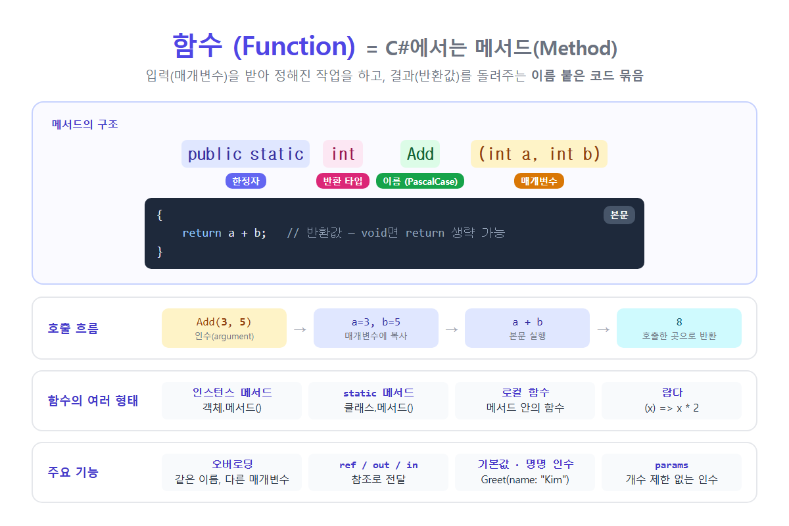

# [함수](../KeywordsList.md)

</img>

| 항목 | 내용 |
| --- | --- |
| 정의 | 입력을 받아 작업 후 결과를 반환하는 이름 붙은 코드 묶음 |
| C# 명칭 | 메서드 (Method) — 반드시 클래스나 구조체 안에 소속 |
| 구성 | 한정자 + 반환 타입 + 이름 + 매개변수 + 본문 |
| 반환 없음 | `void` |
| 전달 방식 | 기본은 값 복사, `ref`/`out`/`in`으로 참조 전달 |
| 오버로딩 | 같은 이름 + 다른 매개변수 목록 |
| 편의 기능 | 기본값, 명명 인수, `params`, 식 본문(`=>`) |
| 형태 | 인스턴스, static, 로컬 함수, 람다, 확장 메서드 |
| 이름 규칙 | PascalCase + 동사 (`GetName`, `SaveFile`) |
| 관련 오류 | CS0161 (모든 경로에서 반환 안 함), CS0111 (같은 시그니처 중복) |

## 정의

- 입력(매개변수)을 받아 정해진 작업을 하고, 결과(반환값)를 돌려주는, 이름 붙은 코드 묶음
- C#에서는 함수를 보통 메서드(Method)라고 부름 → 반드시 클래스나 구조체 안에 소속되어야 하기 때문

```csharp
public class Calculator
{
    public static int Add(int a, int b)   // 메서드 선언
    {
        return a + b;
    }
}

int result = Calculator.Add(3, 5);        // 메서드 호출 → 8
```

### 구조

```csharp
[한정자]  [반환 타입]  [이름]  ([매개변수 목록])
{
    [본문]
    return [반환값];
}
```

| 구성 요소 | 예 | 설명 |
| --- | --- | --- |
| **접근 한정자** | `public`, `private`, `protected`, `internal` | 누가 호출할 수 있는지 정함 (생략하면 `private`) |
| **기타 한정자** | `static`, `virtual`, `override`, `abstract`, `async` | 메서드의 성격 |
| **반환 타입** | `int`, `string`, `void`, `Task<T>` | 돌려주는 값의 타입 (`void` = 반환값 없음) |
| **이름** | `Add`, `GetUser`, `CalculateTotal` | PascalCase + 동사로 짓는 것이 관례 |
| **매개변수** | `(int a, int b)` | 받을 입력값. 없으면 `()` |
| **본문** | `{ ... }` | 실제로 실행되는 코드 |
| **return** | `return a + b;` | 값을 돌려주고 메서드를 즉시 종료 |

### 매개 변수 VS 인수

- **매개변수(Parameter)** : 메서드를 선언할 때 적는 변수. 위 예의 `a`, `b`
- **인수(Argument)** : 메서드를 호출할 때 넘기는 실제 값. 위 예의 `3`, `5`

## 특징

- 이름으로 호출. 한 번 정의해 두면 여러 곳에서 반복해서 쓸 수 있음.
- 값에 의한 전달이 기본. 인수는 매개변수로 복사되어 들어감. 그래서 메서드 안에서 매개변수를 바꿔도 호출한 쪽의 변수는 그대로. 단, 참조 형식은 참조(주소)가 복사되므로, 객체 내용을 바꾸면 호출한 쪽에서도 바뀐 내용이 보임.
- 호출할 때마다 새 스택 프레임이 만들어지고, 매개변수와 지역 변수는 그 안에 저장됨.
- `return`을 만나면 즉시 종료되고 호출한 곳으로 돌아감.
- 반환 타입이 `void`가 아니면 모든 실행 경로에서 값을 반환해야 함. 그렇지 않으면 오류 CS0161 발생.

## 기능

| 기능 | 설명 |
| --- | --- |
| **재사용** | 같은 코드를 여러 번 쓰지 않고 호출만 하면 됨 (DRY: Don’t Repeat Yourself) |
| **추상화** | 내부 구현을 몰라도 이름만 보고 사용 가능 (`list.Sort()`) |
| **분해** | 큰 문제를 작은 단위로 나눠서 해결 |
| **가독성** | `CalculateTax()`처럼 이름이 코드의 의도를 설명 |
| **유지보수** | 수정할 때 한 곳만 고치면 됨 |
| **테스트** | 함수 단위로 단위 테스트 작성 가능 |

### **오버로딩 (Overloading)**

- 이름은 같고, 매개변수의 개수나 타입이 다른 메서드를 여러 개 만들 수 있음. 반환 타입만 다른 것으로는 오버로딩이 안 됨.

```csharp
int    Add(int a, int b)          => a + b;
double Add(double a, double b)    => a + b;
int    Add(int a, int b, int c)   => a + b + c;
```

### **매개변수 한정자 (`ref`, `out`, `in`)**

```csharp
void Double(ref int x) => x *= 2;            // ref: 원본 변수를 직접 수정
int n = 5; Double(ref n);                     // n == 10

bool ok = int.TryParse("42", out int value); // out: 메서드가 값을 채워서 돌려줌

void Print(in BigStruct s) { ... }            // in: 복사 없이 읽기 전용 참조로 전달
```

### **기본값과 명명 인수 (Optional / Named Arguments)**

```csharp
void Greet(string name, string greeting = "안녕하세요") 
    => Console.WriteLine($"{greeting}, {name}님");

Greet("Kim");                                 // 기본값 사용
Greet(greeting: "반가워요", name: "Lee");      // 이름으로 지정 → 순서 무관
```

### **`params`: 개수 제한 없는 인수**

```csharp
int Sum(params int[] nums) => nums.Sum();
Sum(1, 2, 3, 4, 5);                           // 15
```

### **식 본문 메서드 (Expression-bodied, `=>`)**

- 본문이 한 줄이면 중괄호와 `return` 없이 짧게 쓸 수 있음.

```csharp
public int Square(int x) => x * x;
```

## C# 함수의 여러 형태

| 종류 | 예 | 설명 |
| --- | --- | --- |
| **인스턴스 메서드** | `player.Move()` | 객체를 만들어야 호출 가능. 객체의 필드를 사용 |
| **static 메서드** | `Math.Max(3, 5)` | 객체 없이 `클래스명.메서드()`로 호출 |
| **로컬 함수** (C# 7.0+) | 메서드 안에 선언한 함수 | 그 메서드 안에서만 사용하는 보조 함수 |
| **람다 식** | `x => x * 2` | 이름 없는 함수. 델리게이트, LINQ에서 사용 |
| **확장 메서드** | `"abc".IsNullOrEmpty()` | 기존 타입에 메서드를 추가한 것처럼 사용 |
| **생성자** | `new Player("Kim")` | 객체 생성 시 자동 호출되는 특수 메서드 |
| **속성(Property)의 get/set** | `p.Name = "Kim"` | 내부적으로는 메서드 |

```csharp
// 로컬 함수
int Factorial(int n)
{
    return Calc(n);
    int Calc(int k) => k <= 1 ? 1 : k * Calc(k - 1);   // 메서드 안의 함수
}

// 람다
Func<int, int> twice = x => x * 2;
var evens = numbers.Where(n => n % 2 == 0);
```