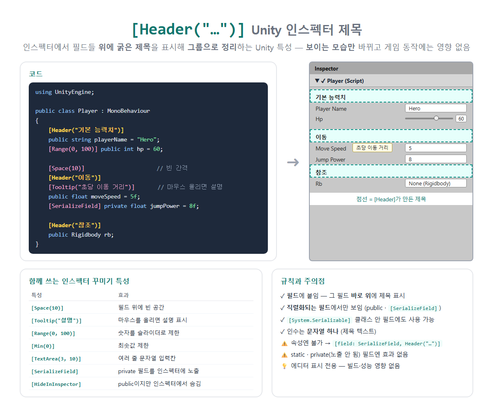

# [[Header]](../KeywordsList.md)

</img>

| 항목 | 내용 |
| --- | --- |
| 정체 | `UnityEngine.HeaderAttribute` (Unity 전용) |
| 형태 | `[Header("제목 텍스트")]` |
| 대상 | 필드 |
| 효과 | 인스펙터에서 필드 위에 굵은 제목 표시 |
| 표시 조건 | 직렬화되는 필드 (`public` 또는 `[SerializeField]`) |
| 실행 영향 | 없음 (에디터 표시 전용) |
| 내부 구현 | `PropertyAttribute` + `DecoratorDrawer` |
| 짝꿍 특성 | `[Space]`, `[Tooltip]`, `[Range]`, `[SerializeField]`, `[HideInInspector]` |
| 효과 없는 경우 | `static` 필드, 노출되지 않은 `private` 필드, 일반 속성(Property) |

## 정의

- Unity 에디터의 인스펙터(Inspector) 창에서 필드 위에 굵은 제목(헤더)을 표시하는 특성(Attribute)
- 필드가 많은 스크립트를 그룹별로 보기 좋게 정리할 때 사용
- 에디터에서 보이는 모습만 바꿀 뿐, 게임 실행이나 데이터에는 아무 영향이 없음

```csharp
using UnityEngine;

public class Player : MonoBehaviour
{
    [Header("기본 능력치")]
    public string playerName = "Hero";
    public int hp = 100;

    [Header("이동")]
    public float moveSpeed = 5f;
    [SerializeField] private float jumpPower = 8f;

    [Header("참조")]
    public Rigidbody rb;
}
```

## 특징

- 필드에 붙임. 제목은 그 필드 바로 위에 한 번 그려짐. 이후 필드들은 다음 `[Header]`가 나올 때까지 같은 그룹처럼 보임. 실제로 그룹 기능이 있는 것은 아니고 시각적인 구분.
- 인수는 문자열 하나. 제목으로 표시할 텍스트.
- 직렬화되어 인스펙터에 나타나는 필드에서만 보임.
    - `public` 필드, 또는 `[SerializeField]`가 붙은 `private` 필드
    - `[System.Serializable]` 클래스 안의 필드에도 쓸 수 있음. 중첩된 데이터를 펼쳤을 때 제목이 보임.
- 배열이나 리스트 필드에 붙이면 요소마다 붙지 않고 목록 위에 한 번 표시됨(최신 Unity 기준).
- 에디터 전용 표시. 빌드된 게임의 성능이나 동작에는 영향이 없음.
- Unity 내부적으로는 `PropertyAttribute`를 상속하고, `DecoratorDrawer`로 그려짐. DecoratorDrawer는 필드 앞에 장식을 그리는 기능.

## 기능

| 기능 | 설명 |
| --- | --- |
| **가독성 향상** | 필드가 수십 개인 컴포넌트를 "능력치 / 이동 / 사운드 / 참조"처럼 구역별로 나눔 |
| **협업 편의** | 기획자나 디자이너가 인스펙터에서 값을 조정할 때 어떤 값인지 쉽게 파악 |
| **실수 방지** | 비슷한 이름의 필드가 섞이지 않도록 시각적으로 구분 |

## 인스펙터 꾸미기 특성

| 특성 | 효과 | 예 |
| --- | --- | --- |
| **`[Header("제목")]`** | 굵은 제목 | `[Header("이동")]` |
| **`[Space(픽셀)]`** | 빈 공간 추가 | `[Space(10)]` |
| **`[Tooltip("설명")]`** | 마우스를 올리면 설명 표시 | `[Tooltip("초당 이동 거리")]` |
| **`[Range(min, max)]`** | 숫자를 **슬라이더**로, 범위 제한 | `[Range(0, 100)] public int hp;` |
| **`[Min(값)]`** | 최솟값 제한 | `[Min(0)] public float speed;` |
| **`[TextArea(최소, 최대)]`** | 여러 줄 문자열 입력칸 | `[TextArea(3, 10)] public string desc;` |
| **`[Multiline(줄수)]`** | 여러 줄 입력 (간단 버전) | `[Multiline(3)]` |
| **`[SerializeField]`** | private 필드를 인스펙터에 노출 | `[SerializeField] private int hp;` |
| **`[HideInInspector]`** | public 필드지만 인스펙터에서 숨김 (직렬화는 유지) |  |
| **`[ColorUsage(true, true)]`** | 색상 선택기 옵션 (알파, HDR) |  |
| **`[InspectorName("이름")]`** | enum 값의 표시 이름 변경 |  |
| **`[ContextMenu("이름")]`** | 컴포넌트 우클릭 메뉴에 메서드 실행 항목 추가 |  |