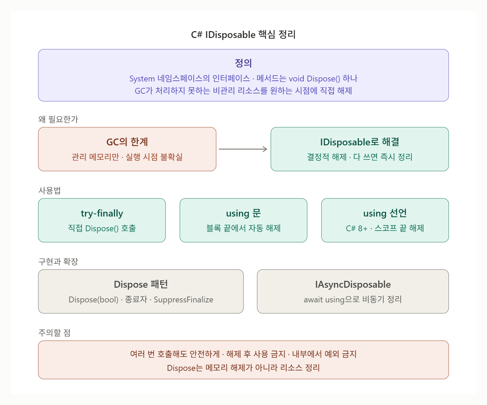

# [IDisposable](../KeywordsList.md)

</img>

| 구분 | 핵심 내용 |
| --- | --- |
| **정의** | `System` 네임스페이스의 인터페이스, `void Dispose()` 메서드 하나로 구성 |
| **목적** | GC가 처리하지 못하는 비관리 리소스(파일, 소켓, DB 연결, 네이티브 메모리)를 원하는 시점에 결정적으로 해제 |
| **특징** | 자동 호출 안 됨 / 여러 번 호출해도 안전해야 함 / 해제 후 사용 시 `ObjectDisposedException` / Dispose 내부에서 예외 금지 / 생성한 쪽이 해제 책임 |
| **사용법** | `try-finally`에서 직접 호출, `using` 문, `using` 선언(C# 8+) |
| **구현 패턴** | `Dispose()` + `protected virtual Dispose(bool disposing)` + 종료자(비관리 리소스 있을 때만) + `GC.SuppressFinalize` |
| **권장 사항** | 비관리 핸들은 `SafeHandle`로 감싸기, sealed 클래스면 간단한 구현으로 충분 |
| **비동기** | `IAsyncDisposable` + `await using`으로 비동기 정리 |
| **주의점** | Dispose ≠ 메모리 해제 / `HttpClient`는 재사용 / Unity의 `UnityEngine.Object`는 `Destroy()`, `NativeArray` 등은 `Dispose()` |

## 정의

- `IDisposable`은 `System` 네임스페이스에 있는 인터페이스
- 사용이 끝난 리소스를 원하는 시점에 직접 해제하기 위한 약속
- 이 인터페이스를 구현한 클래스는 "나는 정리해야 할 리소스를 가지고 있으니, 다 쓰면 `Dispose()`를 호출해 달라"고 사용하는 쪽에 알리는 셈

```csharp
public interface IDisposable
{
    void Dispose();
}
```

## 필요한 이유

C#은 가비지 컬렉터(GC)가 메모리를 자동으로 관리하지만 GC에는 두 가지 한계가 있음.

- **관리 메모리만 정리 :** 파일 핸들, 네트워크 소켓, DB 연결, OS 핸들, 네이티브 메모리 같은 비관리(unmanaged) 리소스는 GC가 해제 방법을 모름.
- **비결정적 :** 객체가 더 이상 쓰이지 않아도 GC가 언제 수거할지 보장되지 않음. 그동안 파일이 잠긴 채로 남거나 DB 연결 풀이 바닥날 수 있음.

⇒ `IDisposable`은 이 문제를 결정적(deterministic) 해제, 즉 개발자가 정한 시점에 즉시 해제하는 방식으로 해결

## 특징

- 메서드가 `Dispose()` 하나뿐인 단순한 계약.
- 자동으로 호출되지 않기 때문에 직접 호출하거나 `using`을 써야 함. 호출하지 않으면 리소스 누수 발생.
- 여러 번 호출해도 안전해야 함(멱등성). 두 번째 호출부터는 아무 일도 하지 않도록 구현하는 것이 규칙.
- Dispose 이후의 사용은 금지됨. 해제된 객체의 메서드를 호출하면 보통 `ObjectDisposedException`을 던짐.
- `Dispose()` 안에서는 예외를 던지지 않는 것이 원칙. `finally` 블록에서 호출되므로, 여기서 예외가 나면 원래 예외가 가려짐.
- 소유권 규칙을 따름. 리소스를 만든(소유한) 쪽이 해제할 책임을 짐. 다른 곳에서 받아 쓰기만 한 객체는 함부로 Dispose하지 않음.

## 기능

#### (1) 직접 호출 (try-finally)

```csharp
var reader = new StreamReader("data.txt");
try
{
    Console.WriteLine(reader.ReadToEnd());
}
finally
{
    reader.Dispose(); // 예외가 나도 반드시 해제
}
```

#### (2) using 문

- 위 코드를 컴파일러가 대신 만들어 주는 문법. 블록을 벗어나면 예외 여부와 관계없이 `Dispose()`가 호출됨.

```csharp
using (var reader = new StreamReader("data.txt"))
{
    Console.WriteLine(reader.ReadToEnd());
} // 여기서 Dispose()
```

#### (3) using 선언 (C# 8.0+)

- 중괄호 없이 선언하면 변수가 속한 스코프가 끝날 때 해제됨. 중첩이 줄어 가독성이 좋아짐.

```csharp
void ReadFile()
{
    using var reader = new StreamReader("data.txt");
    using var writer = new StreamWriter("out.txt");
    writer.Write(reader.ReadToEnd());
} // 메서드 끝에서 writer → reader 순서(선언 역순)로 Dispose()
```

## **Unity에서의 IDisposable**

- `GameObject`, `Texture2D` 같은 `UnityEngine.Object`는 `IDisposable`이 아님 → 이들은 `Destroy()`로 정리.
- 반면 `NativeArray<T>`(Job System/Burst), `UnityWebRequest`, `CancellationTokenSource`, `ComputeBuffer` 등은 Dispose(또는 `Release`)가 필요하며, 빠뜨리면 메모리 누수 경고가 발생.
- `OnDestroy()`에서 해당 컴포넌트가 소유한 Disposable 객체들을 정리하는 패턴이 흔함.