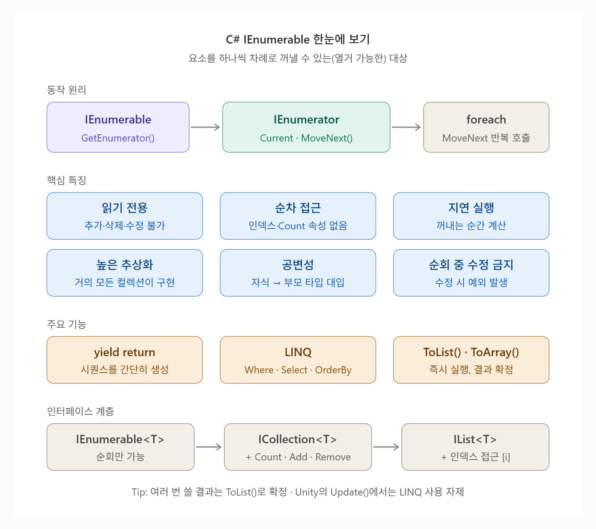

# [IEnumerable](../KeywordsList.md)

</img>

| 항목 | 내용 |
| --- | --- |
| **정의** | 요소를 하나씩 차례로 꺼낼 수 있는(열거 가능한) 대상을 나타내는 인터페이스 |
| **유일한 메서드** | `GetEnumerator()` → 순회를 담당하는 `IEnumerator` 반환 |
| **IEnumerator** | `Current`(현재 값), `MoveNext()`(다음으로 이동), `Reset()`을 가진 커서 역할 |
| **foreach** | 내부적으로 `GetEnumerator()` → `MoveNext()` → `Current` 반복으로 변환됨 |
| **yield return** | 열거자 클래스를 직접 만들지 않아도 컴파일러가 자동 생성. 값을 넘기고 그 자리에서 일시 정지 |
| **지연 실행** | 값은 실제로 꺼낼 때 계산됨. 무한 수열도 표현 가능 |
| **LINQ** | `Where`, `Select` 등은 IEnumerable의 확장 메서드이며 지연 실행됨. `ToList()` 등으로 즉시 실행 |
| **주의점** | 여러 번 순회하면 매번 재계산 → 반복 사용 시 `ToList()`로 확정 |
| **계층 구조** | `IEnumerable<T>`(순회) ⊂ `ICollection<T>`(개수·추가·삭제) ⊂ `IList<T>`(인덱스 접근) |
| **실무 팁** | 순회만 필요한 매개변수는 `IEnumerable<T>`로 받으면 유연함 |
| **Unity** | 코루틴은 `IEnumerator` + `yield return` 원리로 동작 |

## `IEnermerable`

- 하나씩 차례대로 꺼내볼 수 있는 (열거 가능한) 대상을 나타내는 인터페이스
- 배열, `List`, `Dictionary`, `HashSet` 처럼 `foreach`를 쓸 수 있는 컬렉션은 모두 이 인터페이스를 구현함.
- `foreach`를 쓸 수 있다는 것은 `IEnumerable`을 구현했다는 뜻

```csharp
public interface IEnumerable
{
    IEnumerator GetEnumerator();
}

public interface IEnumerable<out T> : IEnumerable
{
    IEnumerator<T> GetEnumerator();
}
```

## 특징

- 읽기 전용 : IEnumerable에는 요소를 추가, 삭제, 수정하는 메서드가 없음. 할 수 있는 것은 꺼내보기 뿐.

```csharp
IEnumerable<int> nums = new List<int> { 1, 2, 3 };
// nums.Add(4);   // 컴파일 에러! IEnumerable에는 Add가 없음

public class Inventory
{
    private List<Item> items = new List<Item>();

    // 외부에서는 읽기만 가능
    public IEnumerable<Item> Items => items;
}
```

- 앞으로만 순차적으로 진행(Forward-only) : 처음부터 끝까지 한 방향으로 하나씩만 이동
    - 뒤로가기 불가
    - 특정 위치로 바로 이동 불가(인덱스 접근 없음0
    - 전체 개수(`Count` 속성)를 바로 알 수 없음

```csharp
IEnumerable<int> nums = GetNumbers();
// nums[2];       // 에러: 인덱서 없음
// nums.Count;    // 에러: Count 속성 없음
int c = nums.Count();  // LINQ 메서드로는 가능하지만, 처음부터 끝까지 다 세어봄
```

- 지연 실행(Lazy Evaluation) : 값을 미리 다 만들어 두지 않고, 요청받는 순간에 하나씩 만듦.
    - 장점 : 메모리 절약, 필요한 만큼만 계산, 무한 시퀀스 표현 가능
    - 단점 : 여러 번 순회하면 매번 다시 계산, 원본이 바뀌면 결과도 바뀜

```csharp
// 100만 개 중 처음 3개만 필요한 경우
var first3 = Enumerable.Range(1, 1_000_000)
                       .Select(x => x * x)
                       .Take(3);   // 실제로는 3개만 계산됨
```

- 추상화 수준이 가장 높음(다형성) : 배열, `List`, `HashSet`, `Dictionary`, `Queue`, `Stack`, LINQ 결과, `yield` 메서드 등 거의 모든 컬렉션이 IEnumerable. 그래서 매개변수 타입으로 쓰면 어떤 컬렉션이든 받을 수 있음

```csharp
int Sum(IEnumerable<int> source) { ... }

Sum(new int[] { 1, 2 });
Sum(new List<int> { 1, 2 });
Sum(new HashSet<int> { 1, 2 });
Sum(Enumerable.Range(1, 10));
```

- 공변성(Covariance)을 지원 : `IEnumerable<out T>`의 `out` 키워드 덕분에, 자식 타입의 시퀀스를 부모 타입의 시퀀스로 취급할 수 있음

```csharp
class Enemy { }
class Slime : Enemy { }

IEnumerable<Slime> slimes = new List<Slime>();
IEnumerable<Enemy> enemies = slimes;   // OK! (공변성)

List<Enemy> list = new List<Slime>();  // 에러! List<T>는 공변성 없음
```

- 순회 중 원본 수정 시 예외 발생 : `List`같은 컬렉션을 `foreach`로 도는 도중에 원본을 수정하면 `InvalidOperationException`이 발생

```csharp
foreach (var enemy in enemies)
{
    if (enemy.IsDead)
        enemies.Remove(enemy);  // 예외 발생!
}

// 해결 방법
enemies.RemoveAll(e => e.IsDead);
// 또는 복사본을 순회
foreach (var enemy in enemies.ToList()) { ... }
// 또는 역방향 for문
for (int i = enemies.Count - 1; i >= 0; i--) { ... }
```

## 기능

### foreach 순회

- 가장 기본적인 기능
- IEnumerable을 구현하면 `foreach`를 쓸 수 있음

### yield를 이용한 시퀀스 생성

- `yield return` / `yield break`로 복잡한 순회 로직을 간단하게 작성 가능

```csharp
IEnumerable<int> EvenNumbers(int max)
{
    for (int i = 0; i <= max; i += 2)
        yield return i;
}
```

### LINQ 확장 메서드 사용

- `using System.Linq;`를 추가하면 수많은 기능을 쓸 수 있음

| 분류 | 메서드 | 예시 |
| --- | --- | --- |
| 필터링 | `Where`, `OfType` | `nums.Where(x => x > 5)` |
| 변환 | `Select`, `SelectMany` | `names.Select(n => n.ToUpper())` |
| 정렬 | `OrderBy`, `OrderByDescending`, `ThenBy` | `players.OrderBy(p => p.Score)` |
| 개수 조절 | `Take`, `Skip`, `TakeWhile`, `Distinct` | `nums.Skip(2).Take(3)` |
| 요소 하나 | `First`, `FirstOrDefault`, `Last`, `Single`, `ElementAt` | `nums.FirstOrDefault(x => x > 10)` |
| 집계 | `Count`, `Sum`, `Average`, `Max`, `Min`, `Aggregate` | `scores.Average()` |
| 조건 검사 | `Any`, `All`, `Contains` | `enemies.Any(e => e.IsBoss)` |
| 그룹·결합 | `GroupBy`, `Join`, `Zip`, `Concat` | `items.GroupBy(i => i.Type)` |
| 변환(즉시 실행) | `ToList`, `ToArray`, `ToDictionary`, `ToHashSet` | `query.ToList()` |

```csharp
// 예: 점수 상위 3명의 이름
var top3 = players.OrderByDescending(p => p.Score)
                  .Take(3)
                  .Select(p => p.Name)
                  .ToList();
```

### 시퀀스 생성 도우미

```csharp
Enumerable.Range(1, 5);         // 1, 2, 3, 4, 5
Enumerable.Repeat("A", 3);      // "A", "A", "A"
Enumerable.Empty<int>();        // 빈 시퀀스 (null 대신 반환하기 좋음)
```

### 다른 컬렉션으로 변환

- ToList(), ToArray()등으로 지연 실행을 끝내고 결과를 확정한 뒤, 인덱스 접근이나 수정이 가능한 컬렉션으로 바꿀 수 있음