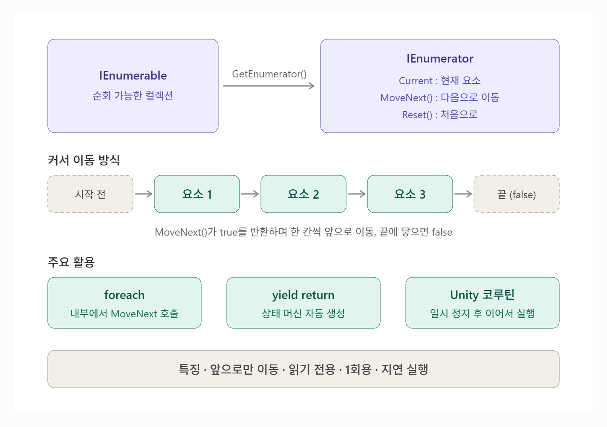

# [IEnumerator](../KeywordsList.md)

</img>

| 구분 | 핵심 내용 |
| --- | --- |
| **정의** | 컬렉션 요소를 순서대로 하나씩 꺼내는 "커서" 역할의 인터페이스 |
| **네임스페이스** | `System.Collections` (비제네릭), `System.Collections.Generic` (제네릭) |
| **주요 멤버** | `Current`(현재 요소), `MoveNext()`(다음 이동), `Reset()`(초기화) |
| **IEnumerable과의 관계** | IEnumerable은 `GetEnumerator()`로 IEnumerator를 만들고, 순회는 IEnumerator가 수행 |
| **주요 기능** | foreach 내부 동작, `yield return` 반복기, 지연 실행, Unity 코루틴 |
| **yield return** | 컴파일러가 상태 머신 자동 생성, 값 반환 후 일시 정지했다가 이어서 실행 |
| **특징** | 첫 요소 이전에서 시작, 앞으로만 이동, 읽기 전용, 상태 보유(1회용) |
| **주의점** | 순회 중 컬렉션 수정 시 예외 발생, `Reset()`은 지원 안 되는 경우가 많음 |
| **Unity 활용** | `StartCoroutine()` + `yield return null / WaitForSeconds`로 시간 흐름에 따른 처리 |

## 정의

- 컬렉션의 요소를 하나씩 순서대로 꺼내 볼 수 있게 해 주는 인터페이스
- `System.Collections` 네임스페이스에 있고, 제네릭 버전인 `IEnumerator<T>`는 `System.Collections.Generic`에 있음
- 지금 어디를 가리키는지 기억하고, 한 칸씩 앞으로 이동

```csharp
public interface IEnumerator
{
    object Current { get; }   // 현재 가리키는 요소
    bool MoveNext();          // 다음 요소로 이동, 요소가 있으면 true / 끝이면 false
    void Reset();             // 처음 위치(첫 요소 이전)로 되돌림
}

// 제네릭 버전: 형변환이 필요 없고 IDisposable도 상속
public interface IEnumerator<T> : IEnumerator, IDisposable
{
    T Current { get; }
}
```

## 기능

#### foreach의 내부 동작

- `foreach`는 사실 IEnumerator를 사용하는 코드로 바뀌어 컴파일됨.

```csharp
List<int> numbers = new List<int> { 1, 2, 3 };

foreach (int n in numbers)
    Console.WriteLine(n);

// ↓ 컴파일러가 실제로 만드는 코드 (단순화)
IEnumerator<int> e = numbers.GetEnumerator();
try
{
    while (e.MoveNext())
    {
        int n = e.Current;
        Console.WriteLine(n);
    }
}
finally
{
    e.Dispose();
}
```

#### yield return으로 간단히 만들기

- IEnumerator를 직접 구현하려면 클래스를 따로 만들어야 해서 번거로움. `yield return`을 쓰면 컴파일러가 상태 머신을 자동으로 생성.

```csharp
IEnumerator<int> CountUp(int max)
{
    for (int i = 1; i <= max; i++)
    {
        yield return i;   // 값을 하나 내보내고 여기서 일시 정지
    }                     // 다음 MoveNext() 때 이어서 실행
}

var e = CountUp(3);
while (e.MoveNext())
    Console.WriteLine(e.Current);   // 1, 2, 3
```

#### 지연 실행 (Lazy Evaluation)

- `yield return` 메서드는 호출 시점이 아니라 `MoveNext()`가 호출될 때마다 필요한 만큼만 실행됨. 그래서 무한 시퀀스나 큰 데이터도 메모리 부담 없이 다룰 수 있음.

```csharp
IEnumerable<int> Infinite()
{
    int i = 0;
    while (true) yield return i++;   // 무한 루프지만 필요한 만큼만 실행됨
}
```

#### Unity 코루틴

- Unity에서는 이 "일시 정지 후 이어서 실행" 특성을 이용해 코루틴을 만듦. Unity 엔진이 매 프레임 `MoveNext()`를 호출해 주는 방식.

```csharp
IEnumerator SpawnObstacles()
{
    while (true)
    {
        Instantiate(obstaclePrefab);
        yield return new WaitForSeconds(2f);   // 2초 대기 후 이어서 실행
    }
}

void Start()
{
    StartCoroutine(SpawnObstacles());
}
```

- `yield return null`은 한 프레임 대기, `WaitForSeconds`는 지정한 시간 대기를 의미. 무한 러닝 게임의 장애물 생성, 페이드 인/아웃, 쿨타임 처리 같은 작업에 자주 사용.

## 특징

- **초기 위치는 첫 요소 "이전" :** 생성 직후에는 `Current`가 유효하지 않으므로 반드시 `MoveNext()`를 먼저 호출해야 함.
- **앞으로만 이동(Forward-only) :** 뒤로 가거나 특정 위치로 바로 이동할 수 없음.
- **읽기 전용 :** `Current`로 요소를 읽을 수만 있고, 컬렉션 자체를 바꿀 수는 없음.
- **순회 중 컬렉션을 수정하면 안  :** `foreach` 도중 `List`에 Add나 Remove를 하면 `InvalidOperationException`이 발생.
- **상태를 가짐 :** 현재 위치를 기억하므로 한 번 끝까지 순회한 IEnumerator는 다시 쓸 수 없음. 다시 순회하려면 `GetEnumerator()`로 새로 만들어야 함.