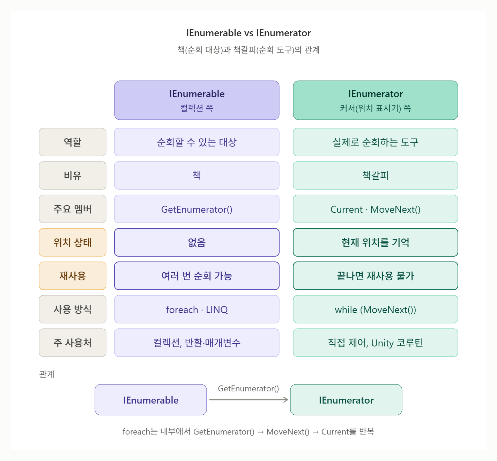

# [IEnumerable vs IEnumerator](../KeywordsList.md)

</img>

| 구분 | IEnumerable | IEnumerator |
| --- | --- | --- |
| 역할 | 순회할 수 있는 대상 | 실제로 순회하는 도구 |
| 비유 | 책 | 책갈피 |
| 주요 멤버 | `GetEnumerator()` | `Current`, `MoveNext()`, `Reset()` |
| 상태(위치) | 없음 | 현재 위치를 기억 |
| 재사용 | 여러 번 순회 가능 | 한 번 끝나면 재사용 불가 |
| 관계 | IEnumerator를 생성해 줌 | IEnumerable이 만들어 냄 |
| 사용 방식 | `foreach`, LINQ | `while (MoveNext())`로 직접 제어 |
| 주 사용처 | 컬렉션, 반환·매개변수 타입 | 직접 순회 제어, Unity 코루틴 |

## 구조

```csharp
public interface IEnumerable<T>
{
    IEnumerator<T> GetEnumerator();   // 책갈피를 하나 만들어 줌
}

public interface IEnumerator<T>
{
    T Current { get; }   // 현재 위치의 요소
    bool MoveNext();     // 다음으로 이동 (있으면 true)
    void Reset();        // 처음으로 (거의 안 씀)
}
```

- IEnumerable은 IEnumerator를 만들어주는 역할, 실제 이동과 값 읽기는 IEnumerator가 담당

## 상태(위치) 보유 여부

- **IEnumerable**: 현재 위치를 모름 (상태 없음)
- **IEnumerator**: 현재 위치를 기억함 (상태 있음)
- IEnumerable은 여러 번 순회할 수 있지만, IEnumerator는 한 번 끝까지 가면 다시 쓸 수 없음

```csharp
var list = new List<int> { 1, 2, 3 };

foreach (var x in list) { }   // OK
foreach (var x in list) { }   // OK, 새 열거자가 만들어짐

var e = list.GetEnumerator();
while (e.MoveNext()) { }      // 끝까지 이동
e.MoveNext();                 // false, 이미 끝남
```

## 사용 방식

```csharp
// IEnumerable → foreach로 간편하게
foreach (var x in list)
    Console.WriteLine(x);

// IEnumerator → 직접 하나씩 제어
var e = list.GetEnumerator();
while (e.MoveNext())
    Console.WriteLine(e.Current);
```

- `foreach`는 내부적으로 `GetEnumerator()`를 호출해 IEnumerator를 얻고, `MoveNext()`와 `Current`를 반복하는 코드로 바꿈

## 언제 무엇을 쓰나

- **IEnumerable**: 일반적인 경우 대부분. 반환 타입·매개변수, `foreach`, LINQ
- **IEnumerator**: 순회를 직접 세밀하게 제어할 때, 그리고 **Unity 코루틴**

```csharp
// Unity 코루틴은 IEnumerator를 반환
IEnumerator Spawn()
{
    yield return new WaitForSeconds(1f);
    Debug.Log("1초 후 실행");
}
```

- `yield return`은 두 타입 모두에 쓸 수 있음. `foreach`나 LINQ에서 쓸 시퀀스면 IEnumerable, Unity 코루틴이면 IEnumerator를 반환.