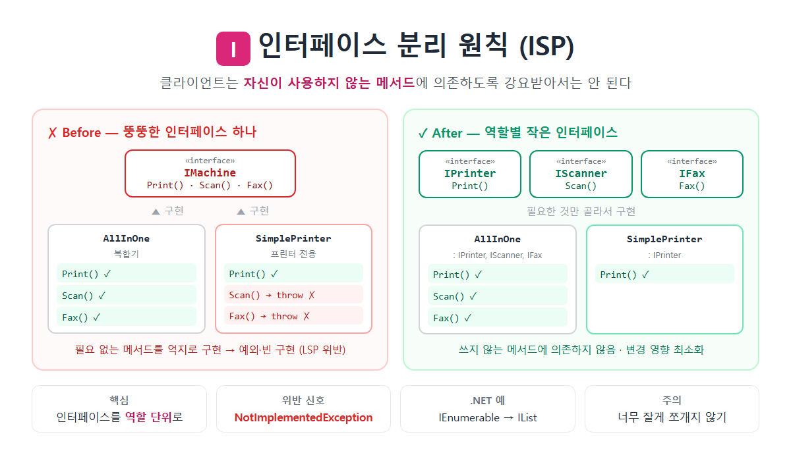

# [인터페이스 분리(ISP)](../KeywordsList.md)

</img>

| 항목 | 내용 |
| --- | --- |
| 이름 | 인터페이스 분리 원칙 (Interface Segregation Principle) |
| 위치 | SOLID의 I |
| 정의 | 클라이언트는 사용하지 않는 메서드에 의존하면 안 됨 |
| 핵심 | 뚱뚱한 인터페이스 → 역할별 작은 인터페이스로 분리 |
| 설계 기준 | 구현이 아닌 사용하는 쪽(클라이언트)의 필요 |
| C# 도구 | 인터페이스 다중 구현, 인터페이스 상속 |
| 위반 신호 | `NotImplementedException`, 빈 구현, 일부 메서드만 사용 |
| 효과 | 결합도 감소, LSP 위반 예방, 테스트 용이 |
| 관련 원칙 | SRP(인터페이스 판), LSP(위반 예방), DIP(작은 추상화에 의존) |
| 주의 | 메서드 하나짜리 인터페이스를 남발하면 오히려 복잡해짐 |

## 정의

- 클라이언트는 자신이 사용하지 않는 메서드에 의존하도록 강요받아서는 안 된다.
- 큰 인터페이스 하나보다 역할별로 나눈 작은 인터페이스 여러 개가 낫다는 원칙

```csharp
// ❌ 위반: 뚱뚱한(fat) 인터페이스
public interface IMachine
{
    void Print(Document d);
    void Scan(Document d);
    void Fax(Document d);
}

public class AllInOnePrinter : IMachine       // 복합기: 모두 구현 가능
{
    public void Print(Document d) { ... }
    public void Scan(Document d)  { ... }
    public void Fax(Document d)   { ... }
}

public class SimplePrinter : IMachine         // 단순 프린터: 인쇄만 가능
{
    public void Print(Document d) { ... }
    public void Scan(Document d) => throw new NotSupportedException();   // 억지 구현
    public void Fax(Document d)  => throw new NotSupportedException();   // 억지 구현
}
```

- `SimplePrinter`는 쓰지도 않는 메서드를 억지로 구현해야 함.
- `IMachine`을 받는 코드는 `Scan()`을 호출해도 되는지 알 수 없어서, 런타임 예외 위험이 있습니다. 이는 LSP 위반이기도 함.
- `Fax()`의 시그니처가 바뀌면 팩스와 상관없는 `SimplePrinter`도 수정하고 다시 컴파일해야 함.

```csharp
// ✅ 해결: 역할(role)별로 인터페이스 분리
public interface IPrinter { void Print(Document d); }
public interface IScanner { void Scan(Document d); }
public interface IFax     { void Fax(Document d); }

public class SimplePrinter : IPrinter                        // 필요한 것만
{
    public void Print(Document d) { ... }
}

public class AllInOnePrinter : IPrinter, IScanner, IFax     // 여러 개 동시 구현
{
    public void Print(Document d) { ... }
    public void Scan(Document d)  { ... }
    public void Fax(Document d)   { ... }
}

// 사용하는 쪽도 필요한 역할만 요구
public class PrintService
{
    private readonly IPrinter _printer;              // IMachine 전체가 아니라 IPrinter만
    public PrintService(IPrinter printer) => _printer = printer;
}
```

## 특징

- 클라이언트 관점으로 설계. 구현 클래스가 무엇을 할 수 있는지가 아니라, 사용하는 쪽이 무엇을 필요로 하는지를 기준으로 인터페이스를 나눔.
- 역할 인터페이스(Role Interface)를 씀. `IPrinter`, `IScanner`처럼 하나의 역할만 표현하는 작은 인터페이스.
- C#은 인터페이스 다중 구현을 지원. 한 클래스가 `: IPrinter, IScanner, IFax`처럼 여러 인터페이스를 구현할 수 있어서 ISP를 적용하기 쉬움.
- 인터페이스 판 SRP. SRP가 "클래스의 변경 이유는 하나"라면, ISP는 "인터페이스가 다루는 역할은 하나"

## 기능

| 효과 | 설명 |
| --- | --- |
| **불필요한 의존 제거** | 쓰지 않는 메서드가 바뀌어도 영향을 받지 않음 |
| **억지 구현 제거** | `NotImplementedException`, 빈 메서드가 사라짐 → LSP 위반 예방 |
| **테스트 용이** | 작은 인터페이스는 Mock(가짜 객체) 만들기가 쉬움 |
| **의도가 명확** | 생성자가 `IPrinter`를 받으면 "인쇄만 한다"는 것이 바로 보임 |
| **유연한 조합** | 필요한 역할만 골라서 구현하고 조합 |
| **빌드·배포 범위 축소** | 큰 시스템에서 다시 컴파일하고 배포해야 할 범위가 줄어듦 |

## 위반 신호(Code Smell)

- 구현 클래스에 `throw new NotImplementedException()`이나 `NotSupportedException`이 있음.
- 아무것도 하지 않는 빈 메서드 구현이 있음.
- 인터페이스의 메서드 수가 많고, 구현 클래스마다 실제로 쓰는 메서드가 다름.
- 사용하는 쪽이 인터페이스의 일부 메서드만 호출. 예를 들어 `IRepository`를 받아놓고 `Get()`만 씀.
- 테스트할 때 Mock에서 쓰지도 않는 메서드까지 설정해야 함.
- 인터페이스 이름이 `IManager`, `IService`, `IHelper`처럼 너무 포괄적.