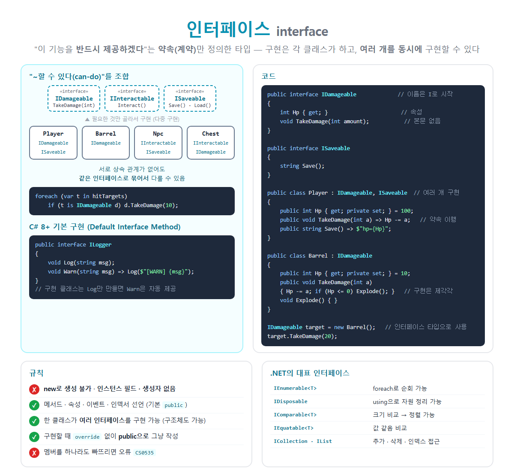

# [인터페이스 (Interface)](../KeywordsList.md)

</img>

| 항목 | 내용 |
| --- | --- |
| 정의 | 구현해야 할 멤버의 약속(계약)만 정의한 타입 |
| 키워드 | `interface` (이름은 `I`로 시작) |
| 생성 | ❌ `new` 불가 |
| 가질 수 있는 것 | 메서드, 속성, 이벤트, 인덱서 (C# 8+ 기본 구현, static 멤버) |
| 가질 수 없는 것 | 인스턴스 필드, 생성자 |
| 기본 접근 | `public` |
| 구현 개수 | 클래스·구조체가 여러 개 구현 가능 |
| 관계 | "~할 수 있다" (can-do) |
| 구현 방법 | `class A : IFoo` → public 멤버로 구현 (override 없음) |
| 관련 오류 | CS0535 (멤버 미구현), CS0144 (생성 불가) |
| 관련 원칙 | ISP(작게 나누기), DIP(추상화에 의존), OCP |

## 정의

- interface 키워드로 정의하는 "이 기능을 반드시 제공하겠다"는 약속(계약)
- 무엇을 할 수 있는지(메서드, 속성 등의 시그니처)만 정의
- 어떻게 하는지(구현)는 인터페이스를 구현하는 각 클래스가 정함.
- 한 클래스가 여러 인터페이스를 동시에 구현할 수 있음.

```csharp
public interface IDamageable          // 이름은 I로 시작하는 것이 관례
{
    int Hp { get; }                   // 속성
    void TakeDamage(int amount);      // 본문 없음, 자동으로 public
}

public interface ISaveable
{
    string Save();
}

public class Player : IDamageable, ISaveable      // 여러 개 구현
{
    public int Hp { get; private set; } = 100;
    public void TakeDamage(int a) => Hp -= a;     // 약속 이행
    public string Save() => $"hp={Hp}";
}

public class Barrel : IDamageable                 // 전혀 다른 클래스도 같은 약속
{
    public int Hp { get; private set; } = 10;
    public void TakeDamage(int a) { Hp -= a; if (Hp <= 0) Explode(); }
    private void Explode() { }
}

// 서로 상속 관계가 없어도 같은 인터페이스로 묶어서 처리
foreach (var target in hitTargets)
    if (target is IDamageable d) d.TakeDamage(10);
```

## 특징

- `new`로 생성할 수 없음. 인스턴스 필드와 생성자도 없음.
- 멤버는 기본적으로 `public`이고 abstract. 메서드, 속성, 이벤트, 인덱서를 선언할 수 있음.
- 다중 구현이 가능. 클래스는 부모 클래스는 하나지만, 인터페이스는 여러 개 구현할 수 있음.
- 구조체(struct)도 구현할 수 있음.
- 구현할 때는 `override` 없이 public 멤버로 작성.
- 멤버를 하나라도 구현하지 않으면 오류 CS0535 발생.
- 인터페이스끼리 상속할 수 있음. 예: `interface IBoss : IDamageable, IAttacker`
- C# 8+: 기본 구현(Default Interface Method)을 가질 수 있음.
- C# 11+: static abstract 멤버를 가질 수 있음. 제네릭 수학(`INumber<T>`)에 쓰임.

```csharp
public interface ILogger
{
    void Log(string msg);
    void Warn(string msg) => Log($"[WARN] {msg}");   // 기본 구현 (C# 8+)
}
```

## 기능

| 기능 | 설명 |
| --- | --- |
| **공통 능력 부여** | 상속 관계와 무관하게 "피해를 받을 수 있다", "저장할 수 있다" 같은 능력을 조합 |
| **다형성** | `IDamageable` 타입 하나로 플레이어, 몬스터, 나무통을 똑같이 처리 |
| **결합도 감소** | 구체 클래스 대신 인터페이스에 의존 (DIP) |
| **교체 · 테스트** | 구현을 바꿔 끼우거나 Mock 객체로 테스트 (DI, 전략 패턴) |
| **다중 상속 대체** | 클래스 다중 상속이 안 되는 C#에서 여러 역할을 표현 |