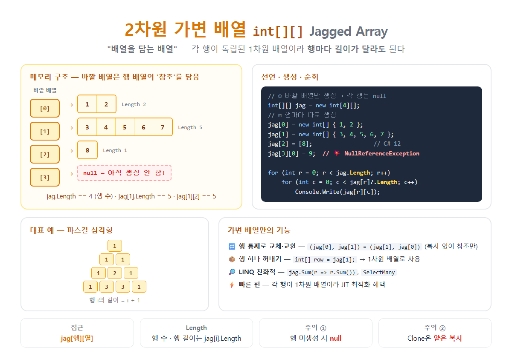

# [2차원 가변형 배열](../KeywordsList.md)

</img>

| 항목 | 내용 |
| --- | --- |
| 정의 | 1차원 배열들을 요소로 가지는 배열 (배열의 배열) |
| 선언 | `타입[][] 이름 = new 타입[행수][];` → 각 행 `new` |
| 접근 | `jag[행][열]` |
| 행 길이 | 행마다 다를 수 있음 |
| `Length` | 행의 개수 (각 행은 `jag[i].Length`) |
| 생성 직후 | 각 행이 `null` |
| 메모리 | 바깥 배열(참조) + 흩어진 행 배열들 |
| 객체 수 | 행 수 + 1 |
| 행 단위 조작 | ✅ 꺼내기, 교환, 교체, 정렬 |
| LINQ | ✅ 바로 사용 가능 |
| 컬렉션 식 | ✅ `[[1, 2], [3]]` (C# 12+) |
| 대표 용도 | 파스칼 삼각형, 인접 리스트, 반별 점수, 줄별 텍스트 |

## 정의

- 가변 배열은 배열을 요소로 가지는 배열
- 바깥 배열의 각 칸에는 1차원 배열(행)의 참조
- 각 행은 독립된 배열이라서 행마다 길이가 달라도 됨.

```csharp
int[][] jag = new int[3][];        // 행 3개짜리 바깥 배열 (각 행은 아직 null)
jag[0] = new int[] { 1, 2 };       // 길이 2
jag[1] = new int[] { 3, 4, 5, 6, 7 }; // 길이 5
jag[2] = new int[] { 8 };          // 길이 1

Console.WriteLine(jag[1][2]);      // 5  ← [행][열]
```

## 특징

- 행마다 길이가 다를 수 있음. 삼각형 모양이나 들쭉날쭉한 데이터를 낭비 없이 저장.
- 2단계로 생성. 바깥 배열을 만든 뒤, 각 행을 따로 `new`해야 함.
- 만든 직후 각 행은 `null`. 행을 만들지 않고 접근하면 `NullReferenceException`이 발생.
- 접근 문법은 `jag[행][열]`. 대괄호를 두 번 씀.
- `Length`는 행의 개수. 각 행의 길이는 `jag[i].Length`로 따로 구함.
- 메모리에 행들이 흩어져 있음. 바깥 배열은 참조만 담고, 각 행은 힙의 서로 다른 위치에 있음.
- 바깥 배열과 각 행이 모두 참조 형식 객체. 행이 N개라면 객체는 N + 1.

## 기능

#### **순회**

```csharp
for (int r = 0; r < jag.Length; r++)            // 행 수
{
    for (int c = 0; c < jag[r].Length; c++)     // 그 행의 길이
        Console.Write($"{jag[r][c]} ");
    Console.WriteLine();
}

// foreach: 행 → 요소 2단계
foreach (int[] row in jag)
    foreach (int v in row)
        Console.Write(v);
```

#### **행 단위로 다루기 (가변 배열만의 장점)**

```csharp
int[] row = jag[1];// 행 하나를 1차원 배열로 꺼냄
Array.Sort(jag[1]);// 특정 행만 정렬
(jag[0], jag[1]) =(jag[1], jag[0]);// 행 교환 → 데이터 복사 없이 참조만 바꿈
jag[2] =newint[10];// 특정 행만 다른 길이로 교체
```

#### **LINQ 활용**

```csharp
int total   = jag.Sum(r => r.Sum());// 전체 합
int maxLen  = jag.Max(r => r.Length);// 가장 긴 행의 길이
int[] flat  = jag.SelectMany(r => r).ToArray();// 1차원으로 펼치기
int[][] sorted = jag.OrderBy(r => r.Length).ToArray();// 행 길이순 정렬
```

#### **대표 예: 파스칼 삼각형**

```csharp
int n = 5;
int[][] pascal = new int[n][];
for (int i = 0; i < n; i++)
{
    pascal[i] = new int[i + 1];               // i행의 길이 = i + 1
    pascal[i][0] = pascal[i][i] = 1;
    for (int j = 1; j < i; j++)
        pascal[i][j] = pascal[i - 1][j - 1] + pascal[i - 1][j];
}
// 1
// 1 1
// 1 2 1
// 1 3 3 1
// 1 4 6 4 1
```

#### **대표 예: 그래프의 인접 리스트**

```csharp
// 노드마다 연결된 이웃 수가 다름
int[][] graph =
[
    [1, 2],      // 0번 노드 → 1, 2
    [2],         // 1번 노드 → 2
    [0, 1, 3],   // 2번 노드 → 0, 1, 3
    []           // 3번 노드 → 없음
];

foreach (int next in graph[2]) Console.Write(next);   // 013
```