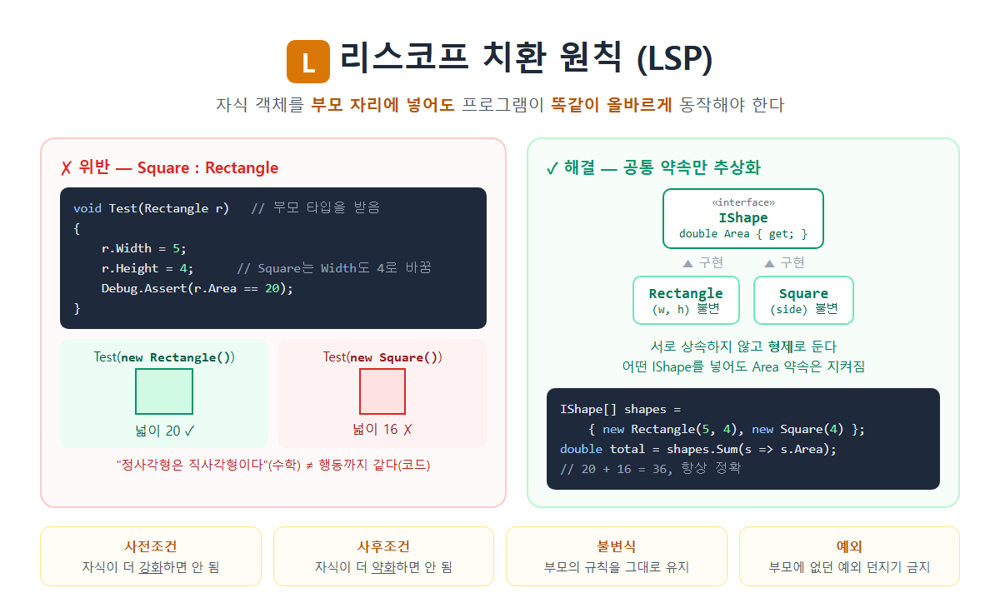

# [리스코프 치환원칙(LSP)](../KeywordsList.md)

</img>

| 항목 | 내용 |
| --- | --- |
| 이름 | 리스코프 치환 원칙 (Liskov Substitution Principle) |
| 위치 | SOLID의 L |
| 제안자 | 바바라 리스코프 (1987) |
| 정의 | 자식 객체는 부모 자리를 대체해도 프로그램이 올바르게 동작해야 함 |
| 핵심 | 상속은 행동(계약)까지 같을 때만 사용 |
| 규칙 | 사전조건 강화 금지, 사후조건 약화 금지, 불변식 유지, 새 예외 금지 |
| 위반 신호 | override에서 예외, 빈 구현, `is` 타입 검사 |
| 해결 방법 | 상속 구조 재설계, 인터페이스로 능력 분리, 상속 대신 합성, 불변 객체 |
| 관련 원칙 | OCP의 전제 조건, ISP와 함께 쓰면 효과적 |

## 정의

- "자식 타입(S)의 객체는 부모 타입(T)의 객체를 대체할 수 있어야 하며, 그래도 프로그램은 올바르게 동작해야 한다.”
- 바바라 리스코프가 발표했고 이후 로버트 C. 마틴이 SOLID의 L로 정리
- 부모 타입을 사용하는 코드에 자식 객체를 넣어도, 그 코드는 차이를 모르고 똑같이 잘 동작해야 함. 상속은 “is-a(~이다)” 관계가 행동까지 성립할 때만 써야 한다는 원칙

#### 대표 예시 : 직사각형 - 정사각형 문제

```csharp
// ❌ 위반: 수학적으로는 "정사각형은 직사각형이다"가 맞지만...
public class Rectangle
{
    public virtual int Width { get; set; }
    public virtual int Height { get; set; }
    public int Area => Width * Height;
}

public class Square : Rectangle
{
    public override int Width
    {
        get => base.Width;
        set { base.Width = value; base.Height = value; }   // 가로를 바꾸면 세로도 바뀜
    }
    public override int Height
    {
        get => base.Height;
        set { base.Width = value; base.Height = value; }
    }
}

// 부모 타입(Rectangle)을 믿고 작성한 코드
void Test(Rectangle r)
{
    r.Width = 5;
    r.Height = 4;
    Debug.Assert(r.Area == 20);   // Rectangle → 20 ✓ / Square → 16 ✗
}
```

#### 문제점

- `Rectangle`을 쓰는 사람은 "가로와 세로는 따로 바꿀 수 있다"고 믿음.
- 그런데 `Square`는 이 약속을 깸.
- 그래서 `Test`는 `Square`가 들어오면 조용히 틀린 결과

```csharp
// ✅ 해결: 상속 관계를 끊고, 공통 약속(넓이)만 추상화
public interface IShape
{
    double Area { get; }
}

public sealed record Rectangle(double Width, double Height) : IShape
{
    public double Area => Width * Height;
}

public sealed record Square(double Side) : IShape
{
    public double Area => Side * Side;
}

IShape[] shapes = { new Rectangle(5, 4), new Square(4) };
double total = shapes.Sum(s => s.Area);   // 어떤 IShape든 약속대로 동작
```

#### 핵심 해결 방법 두 가지

1. `Rectangle`과 `Square`를 부모-자식이 아닌 형제로 둠.
2. 객체를 불변(immutable)으로 만들어서 "가로만 바꾸기" 같은 약속 자체를 없앰

## 특징: 자식이 지켜야 할 규칙(계약에 의한 설계)

| 규칙 | 의미 | 위반 예 |
| --- | --- | --- |
| **사전조건을 강화하지 말 것** | 자식이 부모보다 입력을 더 까다롭게 요구하면 안 됨 | 부모는 모든 양수를 받는데, 자식은 100 이하만 받음 |
| **사후조건을 약화하지 말 것** | 자식이 부모가 보장한 결과를 덜 보장하면 안 됨 | 부모는 null이 아닌 값을 반환하는데, 자식은 null을 반환 |
| **불변식을 유지할 것** | 부모가 항상 지키던 규칙을 자식도 지켜야 함 | "가로와 세로는 독립적이다"를 Square가 깸 |
| **새로운 예외를 던지지 말 것** | 부모가 던지지 않는 예외를 자식이 던지면 안 됨 | override에서 `NotSupportedException` |
| **히스토리 제약** | 부모가 변경 불가라고 약속한 상태를 자식이 바꾸면 안 됨 | 불변 부모를 상속한 자식이 값을 바꿀 수 있게 만듦 |

## 기능(얻는 효과)

- 다형성을 안전하게 씀. `IShape`, `Stream`, `IEnumerable<T>`처럼 부모 타입으로 받는 코드가 어떤 자식이 들어와도 믿고 동작할 수 있음.
- OCP가 가능해짐. 새 자식 클래스를 추가해도 기존 코드가 깨지지 않습니다. LSP는 OCP의 전제 조건.
- 타입 검사 코드가 사라짐. `if (x is Square)` 같은 분기가 필요 없어짐.
- 예측 가능한 코드가 됨. 부모의 문서와 계약만 보고 코드를 작성해도 안전함.

## 위반 신호(Code Smell)

- override한 메서드에서 `NotSupportedException`이나 `NotImplementedException`을 던짐.
- override한 메서드가 아무 일도 안 함(빈 구현). 부모가 약속한 동작을 무시하는 것.
- 부모 타입 변수를 받아 놓고 `is`, `as`, `GetType()`으로 자식 타입을 검사.
- 자식 클래스에 맞춰 사용하는 쪽 코드를 고쳐야 함.
- 문서에 "이 자식 클래스에서는 이 메서드를 호출하지 마세요"라고 적혀 있음.

```csharp
// ❌ 대표적인 위반 패턴
class Penguin : Bird
{
    public override void Fly() => throw new NotSupportedException("펭귄은 못 날아요");
}

void MakeAllFly(List<Bird> birds)
{
    foreach (var b in birds)
        if (b is not Penguin) b.Fly();   // 타입 검사가 생김 = LSP 위반의 증거
}
```