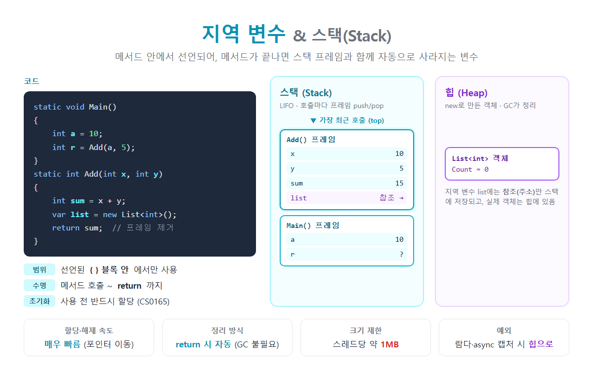

# [지역변수(스택)](../KeywordsList.md)

</img>

| 항목 | 지역 변수 | 스택 |
| --- | --- | --- |
| 정의 | 메서드나 블록 안에서 선언한 변수 | 메서드 호출과 지역 변수를 저장하는 LIFO 메모리 |
| 생성 시점 | 메서드 호출 시 (선언 지점) | 스레드 생성 시 |
| 소멸 시점 | 메서드 `return` 또는 블록 종료 | 프레임 단위로 pop |
| 초기화 | 사용 전 직접 할당 필수 (CS0165) | — |
| 접근 범위 | 선언된 블록 안 | 해당 스레드 전용 |
| 정리 주체 | 자동 (프레임 제거) | 자동 (GC 불필요) |
| 속도 | — | 할당과 해제가 매우 빠름 |
| 크기 | — | 스레드당 약 1MB |
| 관련 오류 | CS0165 (미할당), CS0136 (이름 중복) | `StackOverflowException` |

## 정의

- 지역 변수는 메서드나 블록 안에서 선언한 변수. 선언된 블록 안에서만 쓸 수 있고, 메서드 실행이 끝나면 사라짐. 메서드의 매개변수도 지역 변수와 똑같이 취급됨.
- 스택은 메서드 호출 정보와 지역 변수를 저장하는 메모리 영역
    - 스레드마다 하나씩 있음
    - 나중에 들어간 것이 먼저 나오는 LIFO 구조
    - 메서드가 호출될 때마다 스택 프레임이 하나씩 쌓이고, 메서드가 끝나면 그 프레임이 통째로 제거됨.

```csharp
static void Main()
{
    int a = 10;              // Main 프레임에 저장
    int r = Add(a, 5);       // Add 호출 → Add 프레임이 위에 쌓임
}                            // Main 종료 → a, r 사라짐

static int Add(int x, int y) // 매개변수 x, y도 지역 변수
{
    int sum = x + y;                // Add 프레임에 저장
    var list = new List<int>();     // 참조는 스택, List 객체는 힙
    return sum;                     // Add 프레임 제거 → x, y, sum, list 사라짐
}
```

## 특징

### 지역 변수의 특징

- 범위(Scope) : 선언된 `{ }` 블록 안에서만 접근 가능. `if`나 `for` 블록 안에서 선언한 변수는 블록 밖에서 쓸 수 없음.
- 수명(Lifetime) : 메서드가 호출될 때 생기고, `return` 하면 사라짐.
- 반드시 초기화 : 값을 넣지 않고 읽으면 컴파일 오류 CS0165 발생. 필드는 기본값으로 자동 초기화되지만, 지역 변수는 그렇지 않음.
- 접근 제한자 불가 : 지역 변수에는 `public`, `private`, `static`을 붙일 수 없음. 메서드 안에서만 쓰이는 변수이기 때문.
- 이름 중복 불가 : 바깥 블록과 같은 이름의 변수를 안쪽 블록에서 다시 선언할 수 없음(CS0136).
- 메서드를 호출할 때마다 새로 만들어짐. 재귀 호출을 하면 호출마다 독립된 지역 변수가 생김.

### 스택의 특징

- 할당과 해제가 매우 빠름. 메모리를 쓰고 돌려주는 일이 스택 포인터를 위아래로 옮기는 것만으로 끝남.
- 자동으로 정리됨. 메서드가 끝나면 프레임이 제거되므로 가비지 컬렉터(GC)가 관여하지 않음.
- 크기가 작음. 스레드당 기본 약 1MB. 재귀가 너무 깊으면 `StackOverflowException`이 발생.
- 스레드마다 따로 있음. 그래서 지역 변수는 다른 스레드와 공유되지 않아 스레드에 안전함. 단, 람다 등으로 캡처한 경우는 예외.

## 기능

- 임시 계산 값 저장 : 계산 중간 결과, 반복문 카운터, 메서드 안에서만 필요한 값을 담음.
- 메서드 호출 관리 : 스택은 "어느 메서드가 어느 메서드를 불렀는지"와 "끝나면 어디로 돌아갈지(복귀 주소)"를 기록. 예외가 났을 때 보이는 스택 트레이스(Stack Trace)가 바로 이 정보.
- 캡슐화 : 메서드 밖에서는 지역 변수에 접근할 수 없으므로 다른 코드와 섞일 일이 없음.

## 스택에 저장되는 것

| 지역 변수 종류 | 스택에 저장되는 것 | 힙에 저장되는 것 |
| --- | --- | --- |
| 값 형식 (`int`, `double`, `bool`, `struct`) | 값 자체 | 없음 |
| 참조 형식 (`string`, `class`, 배열, `List<T>`) | 참조(주소)만 | 실제 객체 |
| 람다나 익명 메서드에서 캡처한 변수 | 없음 | 컴파일러가 만든 클래스의 필드로 저장 |
| `async` 메서드, `yield` 반복기의 지역 변수 | 없음 | 상태 머신 객체의 필드로 저장 |