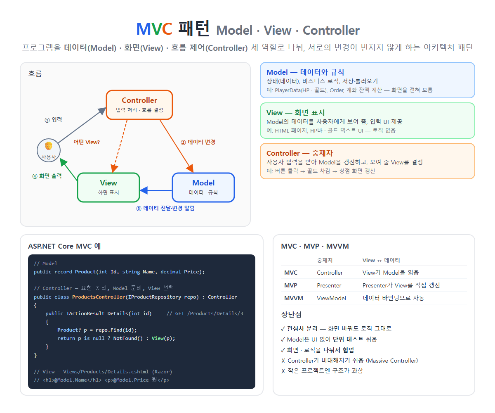

# [MVC 패턴 (Model-View-Controller)](../KeywordsList.md)

</img>

| 항목 | 내용 |
| --- | --- |
| 분류 | 아키텍처 패턴 (구조 패턴) |
| 구성 | Model (데이터·규칙) / View (화면) / Controller (입력·흐름) |
| 핵심 | 관심사 분리 → 변경의 영향이 번지지 않음 |
| 흐름 | 입력 → Controller → Model 갱신 → View 표시 |
| 장점 | 유지보수 쉬움, Model 단위 테스트 용이, 분업(디자이너/개발자), View 교체·재사용 |
| 단점 | Controller 비대화(Massive Controller), 작은 프로젝트엔 과함, 파일 수 증가 |
| 대표 사례 | ASP.NET Core MVC, Spring MVC, Rails, iOS UIKit |
| 관련 패턴 | 옵저버(변경 알림), 전략(Controller 교체), MVP·MVVM |

## 정의

- 프로그램을 세 가지 역할로 나누는 아키텍처 패턴
    - Model : 데이터와 규칙
    - View : 화면
    - Controller : 흐름 제어
- 화면을 바꿔도 로직이 영향받지 않고, 로직을 바꿔도 화면이 영향받지 않음.

```csharp
사용자 ──① 입력──▶ Controller ──② 데이터 변경──▶ Model
  ▲                    │                        │
  │                    └─ 어떤 View를 보여줄지 ─┐   │ ③ 데이터 전달·변경 알림
  │                                          ▼   ▼
  └──────────④ 화면 출력─────────────────────  View
```

## 구성요소

| 역할 | 하는 일 | 하지 않는 일 | 예 |
| --- | --- | --- | --- |
| **Model** | 데이터(상태), 비즈니스 규칙, 저장·불러오기 | 화면을 모름 | `PlayerData`(HP, 골드), `Order`, 잔액 계산 |
| **View** | Model의 데이터를 보여 주고, 입력 UI를 제공 | 비즈니스 로직 없음 | HTML 페이지, HP바, 골드 텍스트 |
| **Controller** | 사용자 입력을 받아 Model을 갱신하고, 어떤 View를 보여 줄지 결정 | 데이터를 직접 그리지 않음 | 버튼 클릭 → 골드 차감 → 상점 화면 갱신 |

## 특징

- 관심사 분리 : 데이터, 표현, 흐름이 각자 독립적.
- Model은 UI를 모름. 같은 Model을 웹, 모바일, 콘솔 등 여러 View에서 재사용할 수 있음.
- 변경 알림 : Model이 바뀌면 View가 갱신됨. 이때 옵저버 패턴을 자주 씀.
- Controller는 중재자. 사용자 입력을 해석해서 Model과 View를 연결.