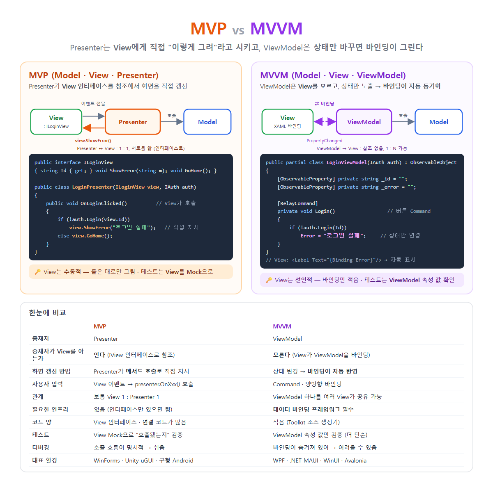

# [MVP vs MVVM](../KeywordsList.md)

</img>

| 구분 | MVP | MVVM |
| --- | --- | --- |
| 중재자 | Presenter | ViewModel |
| 중재자 → View 참조 | ✅ 있음 (`IView` 인터페이스) | ❌ 없음 |
| 화면 갱신 | Presenter가 메서드 호출로 직접 지시 | 상태 변경 → 바인딩이 자동 반영 |
| 사용자 입력 전달 | View 이벤트 → `presenter.OnXxx()` | Command, 양방향 바인딩 |
| View의 성격 | 수동적 (인터페이스 구현 + 이벤트 전달) | 선언적 (바인딩만 작성) |
| 관계 | 보통 View 1 : Presenter 1 | ViewModel 하나를 여러 View가 공유 가능 |
| 필요한 인프라 | 없음 (인터페이스만 있으면 됨) | 데이터 바인딩 프레임워크 |
| 작성할 코드 | View 인터페이스, 연결 코드가 많음 | 적음 (Toolkit 소스 생성기 활용) |
| 테스트 방법 | View를 Mock → "이 메서드가 호출됐나?" | ViewModel 속성 값 확인 (더 단순) |
| 디버깅 | 호출 흐름이 명시적 → 쉬움 | 바인딩이 숨겨져 있어 → 어려울 수 있음 |
| 성능 | 필요한 것만 직접 갱신 | 알림이 많으면 부담, 바인딩 오버헤드 |
| 대표 환경 | WinForms, Unity uGUI, 구형 Android | WPF, .NET MAUI, WinUI, Avalonia |

## MVP vs MVVM

- 둘 다 MVC에서 발전한 UI 아키텍처 패턴으로, 화면(View)과 로직을 분리해서 테스트하기 쉽게 만드는 것이 목표
- 차이는 "중재자가 화면을 어떻게 갱신하느냐”

## MVP(**Model-View-Presenter)**

- Presenter가 View 인터페이스(ILoginView)를 참조
    - View는 사용자 입력이 들어오면 Presenter의 메서드를 호출
    - Presenter는 Model을 사용해 처리한 뒤, View의 메서드를 호출해서 화면을 직접 갱신
- View는 들은 대로만 그리는 수동적인 존재(Passive View)

```csharp
// 1. View 인터페이스: Presenter가 View에게 시킬 수 있는 것
public interface ILoginView
{
    string Id { get; }
    string Password { get; }
    void ShowError(string message);
    void SetLoading(bool on);
    void GoToHome();
}

// 2. Presenter: 로직 담당, View는 인터페이스로만 앎
public class LoginPresenter(ILoginView view, IAuthService auth)
{
    public async Task OnLoginClicked()                 // View가 호출
    {
        if (string.IsNullOrWhiteSpace(view.Id))
        {
            view.ShowError("아이디를 입력하세요");        // 직접 지시
            return;
        }

        view.SetLoading(true);
        bool ok = await auth.LoginAsync(view.Id, view.Password);   // Model 사용
        view.SetLoading(false);

        if (ok) view.GoToHome();
        else view.ShowError("로그인 실패");
    }
}

// 3. View 구현 (Unity uGUI 예): 화면 조작과 이벤트 전달만
public class LoginView : MonoBehaviour, ILoginView
{
    [SerializeField] private TMP_InputField idInput, pwInput;
    [SerializeField] private TMP_Text errorText;
    [SerializeField] private GameObject spinner;
    private LoginPresenter _presenter = null!;

    private void Awake() => _presenter = new LoginPresenter(this, new AuthService());

    public void OnLoginButton() => _ = _presenter.OnLoginClicked();   // 이벤트 → Presenter

    public string Id => idInput.text;
    public string Password => pwInput.text;
    public void ShowError(string m) => errorText.text = m;
    public void SetLoading(bool on) => spinner.SetActive(on);
    public void GoToHome() => SceneManager.LoadScene("Home");
}
```

- 쓰임 : 데이터 바인딩이 없는 환경(WinForms, Unity uGUI, 예전 Android), 화면 갱신 흐름을 명시적으로 제어하고 싶을 때

## MVVM (Model-View-ViewModel)

- ViewModel은 화면에 필요한 상태(속성)와 명령(Command)만 노출.
- View를 전혀 참조하지 않음.
- View가 바인딩으로 ViewModel을 바라보고, ViewModel이 값을 바꾸면 PropertyChanged 알림을 통해 화면이 자동 갱신.

```csharp
public partial class LoginViewModel(IAuthService auth) : ObservableObject
{
    [ObservableProperty] private string _id = "";
    [ObservableProperty] private string _password = "";
    [ObservableProperty] private string _error = "";
    [ObservableProperty] private bool _isLoading;

    [RelayCommand]
    private async Task LoginAsync()                    // 버튼 Command
    {
        if (string.IsNullOrWhiteSpace(Id)) { Error = "아이디를 입력하세요"; return; }  // 상태만 변경

        IsLoading = true;
        bool ok = await auth.LoginAsync(Id, Password);
        IsLoading = false;

        if (!ok) Error = "로그인 실패";
        else WeakReferenceMessenger.Default.Send(new LoggedInMessage());   // 화면 이동은 메시지·서비스로
    }
}
```

```csharp
<!-- View: 바인딩만 선언 -->
<Entry Text="{Binding Id}" />
<Entry Text="{Binding Password}" IsPassword="True" />
<Label Text="{Binding Error}" TextColor="Red" />
<ActivityIndicator IsRunning="{Binding IsLoading}" />
<Button Text="로그인" Command="{Binding LoginCommand}" />
```

- 쓰임 : 데이터 바인딩을 지원하는 환경(WPF, .NET MAUI, WinUI, Avalonia, Unity UI Toolkit 런타임 바인딩)

## 핵심 차이

| 질문 | MVP | MVVM |
| --- | --- | --- |
| 중재자가 View를 아는가? | 안다 (인터페이스로) | 모른다 |
| 화면은 누가 갱신하나? | Presenter가 메서드 호출로 직접 | 바인딩이 자동으로 |
| 바인딩 프레임워크가 필요한가? | 아니오 | 예 (필수) |

```csharp
//같은 "로그인 실패 표시"를 두 패턴으로 쓰면 이렇게 다름

view.ShowError("로그인 실패");   // MVP: 화면에게 지시
Error = "로그인 실패";           // MVVM: 상태만 바꿈 → 바인딩된 Label이 알아서 표시
```

## 언제 무엇을 사용할까?

| 상황 | 추천 |
| --- | --- |
| 플랫폼이 데이터 바인딩을 기본 지원 (WPF, MAUI, WinUI) | MVVM |
| 바인딩이 없거나 약함 (WinForms, Unity uGUI) | MVP |
| 화면 갱신 순서·타이밍을 세밀하게 제어해야 함 (애니메이션, 게임 UI) | MVP |
| 같은 데이터를 여러 화면에서 보여 줌 | MVVM |
| 상태가 많고 화면 요소 간 동기화가 복잡 | MVVM |
| 팀이 바인딩 디버깅에 익숙하지 않음 | MVP가 이해하기 쉬움 |