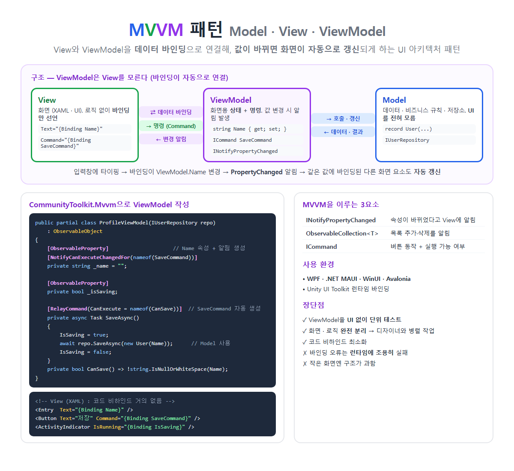

# [MVVM 패턴](../KeywordsList.md)

</img>

| 항목 | 내용 |
| --- | --- |
| 분류 | UI 아키텍처 패턴 |
| 구성 | Model (데이터·규칙) / View (화면) / ViewModel (화면용 상태·명령) |
| 연결 방식 | 데이터 바인딩 + Command + 변경 알림 |
| 핵심 인터페이스 | `INotifyPropertyChanged`, `ObservableCollection<T>`, `ICommand` |
| 의존 방향 | View → ViewModel → Model (ViewModel은 View를 모름) |
| 대표 환경 | WPF, .NET MAUI, WinUI, Avalonia, Unity UI Toolkit 런타임 바인딩 |
| 실무 라이브러리 | CommunityToolkit.Mvvm (`[ObservableProperty]`, `[RelayCommand]`) |
| 장점 | 테스트 용이, 관심사 분리, 병렬 작업, 반복 코드 감소 |
| 단점 | 바인딩 오류 디버깅 어려움, 학습 곡선, 작은 화면엔 과함, 구독 누수 주의 |

## 정의

- UI 프로그램을 Model, View, ViewModel 세 부분으로 나누는 아키텍처 패턴
- View와 ViewModel을 데이터 바인딩(Data Binding)으로 연결
- 그래서 ViewModel의 값이 바뀌면 화면이 자동으로 갱신되고, 사용자가 화면에서 입력하면 ViewModel의 값이 자동으로 바뀜.

## 구성요소

| 역할 | 하는 일 | 모르는 것 | 예 |
| --- | --- | --- | --- |
| **Model** | 데이터, 비즈니스 규칙, 저장소(DB·API) | UI 전부 | `User`, `IUserRepository`, 가격 계산 |
| **View** | 화면을 그리고, 바인딩을 선언 | 비즈니스 로직 | XAML 페이지, 버튼, 입력창 |
| **ViewModel** | 화면에 필요한 상태(속성)와 동작(Command)을 제공하고, 값이 바뀌면 알림 | View의 구체적인 모양 | `ProfileViewModel` (`Name`, `SaveCommand`) |
- 바인딩을 가능하게 하는 3요소

| 요소 | 역할 |
| --- | --- |
| **`INotifyPropertyChanged`** | "이 속성이 바뀌었다"고 View에 알림 → 화면 갱신 |
| **`ObservableCollection<T>`** | 목록에 항목이 추가·삭제될 때 알림 → 리스트 화면 갱신 |
| **`ICommand`** | 버튼 같은 동작을 메서드와 연결, 실행 가능 여부(`CanExecute`)로 버튼 활성·비활성 제어 |

## 특징

- 데이터 바인딩이 핵심. View와 ViewModel 사이의 동기화 코드를 직접 쓰지 않음.
- ViewModel은 View를 참조하지 않음. 그래서 UI 없이 단위 테스트할 수 있음.
- 선언적 UI. View는 "무엇을 어디에 연결할지"만 적음.
- 명령(Command)으로 사용자 동작을 표현. 클릭 이벤트 핸들러를 코드 비하인드에 쓰지 않음.
- ViewModel은 View에 맞춘 데이터를 제공. 예: 날짜를 표시용 문자열로 바꾸거나, 버튼 활성 여부를 계산

## 기능

| 장점 | 설명 |
| --- | --- |
| **테스트 용이** | ViewModel만 생성해서 "Name을 넣으면 SaveCommand가 활성화되는가?"를 UI 없이 검증 |
| **관심사 분리** | 화면 디자인과 로직이 완전히 분리됨 |
| **병렬 작업** | 디자이너는 XAML, 개발자는 ViewModel을 동시에 작업 |
| **코드 감소** | "값 바뀌면 화면 갱신" 같은 반복 코드가 사라짐 |
| **재사용** | 같은 ViewModel을 여러 View(데스크톱·모바일)에서 사용 |

```csharp
// UI 없이 테스트
[Fact]
public void Save_is_disabled_when_name_is_empty()
{
    var vm = new ProfileViewModel(new FakeRepo());
    Assert.False(vm.SaveCommand.CanExecute(null));
    vm.Name = "Kim";
    Assert.True(vm.SaveCommand.CanExecute(null));
}
```