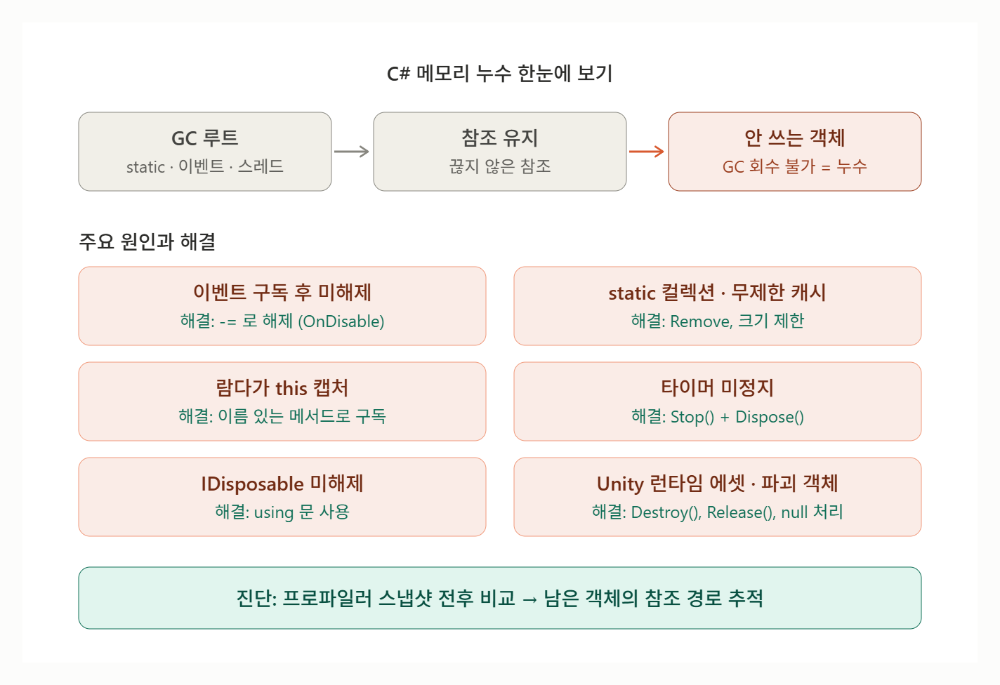

# [Memory Leak](../KeywordsList.md)

</img>

| 구분 | 원인 | 왜 누수가 되나 | 해결 방법 |
| --- | --- | --- | --- |
| 개념 | 의도치 않은 참조 유지 | GC는 참조가 있으면 회수하지 않음 | 쓰지 않는 객체의 참조를 끊기 |
| 이벤트 | `+=` 후 `-=` 안 함 | 발행자가 구독자를 계속 참조 | 수명 종료 시 `-=` (Unity: `OnDisable`/`OnDestroy`) |
| static | static 필드·컬렉션 | static은 GC 루트라 영원히 살아 있음 | 사용 후 Remove / null 처리 |
| 캐시 | 무제한 Dictionary 캐시 | 항목이 계속 쌓임 | 크기 제한, 만료 정책, `MemoryCache` |
| 람다 | 클로저가 `this` 캡처 | 오래 사는 델리게이트가 객체를 붙잡음 | 이름 있는 메서드로 구독 후 해제 |
| 타이머 | Timer 미정지 | 타이머가 콜백 대상을 참조 | `Stop()` + `Dispose()` |
| 비관리 리소스 | Dispose 누락 | 파일·DB 핸들은 GC가 관리 안 함 | `using` 문, Dispose 패턴 |
| 네이티브 메모리 | `AllocHGlobal` 등 | GC 대상이 아님 | 직접 `Free` 호출 |
| Unity | 파괴된 오브젝트 참조, 런타임 생성 에셋 | C# 객체·네이티브 에셋이 남음 | 리스트에서 제거, `Destroy()`, `Addressables.Release()` |
| 진단 | 메모리 지속 증가 | — | VS 진단 도구, dotMemory, Unity Memory Profiler로 스냅샷 비교 |

## 정의

- C#은 가비지 컬렉터가 메모리를 자동으로 관리. GC는 루트(static 필드, 스택의 지역 변수, CPU 레지스터 등)에서 참조로 도달할 수 있는 객체로 살아있다고 판단하고 도달할 수 없는 객체만 회수.
- 보통 C#의 메모리 누수는 보통 두 가지 형태
    - 관리 메모리 누수 : 더 이상 쓰지 않는 객체를 어딘가에서 의도치 않게 계속 참조하고 있어서 GC가 회수하지 못하는 경우
    - 비관리 리소스 누수 : 파일 핸들, DB 연결, 네이티브 메모리처럼 GC가 관리하지 않는 자원을 해제하지 않은 경우

## 대표적인 원인

1. 이벤트 구독 후 해제하지 않음
    - 이벤트를 구독하면 발행자(publisher)가 구독자(subscriber)를 참조하게 됨. 발행자가 오래 살아 있으면 구독자도 함께 살아남음.

```csharp
public class GameManager
{
    public static event Action OnScoreChanged;   // static → 앱 종료까지 살아 있음
}

public class ScoreUI
{
    public ScoreUI()
    {
        GameManager.OnScoreChanged += Refresh;   // 구독
    }
    void Refresh() { /* ... */ }
    // 해제(-=)하지 않으면 ScoreUI는 절대 GC되지 않음
}
```

- 해결 : 수명이 끝날 때 반드시 `-=`로 해제.

```csharp
public void Dispose() => GameManager.OnScoreChanged -= Refresh;
```

1. static 필드와 컬렉션
    - static 필드는 GC 루트이므로, 여기에 담긴 객체는 프로그램이 끝날 때까지 살아 있음.

```csharp
static List<Enemy> allEnemies = new();   // Add만 하고 Remove 안 하면 계속 쌓임
```

1. 크기 제한 없는 캐시
    - `Dictionary`로 캐시를 만들고 항목을 계속 추가하기만 하면 메모리가 무한히 늘어남. 크기 제한(LRU 등)이나 만료 정책을 두거나 `MemoryCache`를 사용함.
2. 람다/클로저의 변수 캡처
    - 람다는 바깥 변수를 캡처하면서 그 객체(종종 `this` 전체)에 대한 참조를 붙잡음. 
    이 람다를 오래 사는 곳(이벤트, 타이머, static 델리게이트)에 넘기면 1번과 같은 문제가 생깁니다. 또 익명 람다로 구독하면 `-=`로 해제할 방법이 없다는 점도 주의해야 함.

```csharp
button.Click += (s, e) => this.DoSomething();  // 나중에 해제 불가
```

1. 타이머
    - `System.Timers.Timer`나 `System.Threading.Timer`는 실행 중인 동안 콜백 대상을 붙잡습니다. 사용이 끝나면 `Stop()`과 `Dispose()`를 호출해야 함.
2. IDisposable 객체를 Dispose하지 않음
    - `FileStream`, `SqlConnection`, `HttpResponseMessage`, `Bitmap` 등은 내부에 비관리 리소스를 갖고 있음. 파이널라이저가 언젠가 정리해 줄 수도 있지만 시점이 보장되지 않고, 그 전에 핸들이 고갈될 수 있음.

```csharp
using var stream = new FileStream("data.txt", FileMode.Open);  // 스코프 끝에서 자동 Dispose
```

1. 직접 할당한 네이티브 메모리
    - `Marshal.AllocHGlobal`, `NativeMemory.Alloc` 등으로 할당한 메모리는 GC 대상이 아니므로 반드시 직접 해제해야 함.
2. 끝나지 않는 스레드/Task
    - 무한 루프를 도는 스레드나 취소되지 않는 `Task`는 자신이 참조하는 객체를 계속 살려 둠. `CancellationToken`으로 종료 경로를 만들어 두는 것이 좋음.

## 유니티에서 주의할 점

- **파괴된 오브젝트의 "가짜 null"** : `Destroy()`된 `GameObject`는 `== null`이 true를 반환하지만, C# 객체 자체는 리스트나 필드가 참조하는 한 메모리에 남아 있음. 파괴 후에는 리스트에서 제거하고 필드를 `null`로 만들어 줌.
- **이벤트 해제 위치** : `OnEnable`에서 구독했다면  `OnDisable`에서, `Awake/Start`에서 구독했다면 `OnDestroy`에서 해제하는 짝을 맞추는 것이 일반적.
- **런타임 생성 에셋** : 코드로 만든 `Texture2D`, `RenderTexture`, `Mesh`, `Material`은 씬이 바뀌어도 자동 해제되지 않음. `Destroy()`로 직접 해제해야 함. (`renderer.material`에 접근하면 머티리얼 복사본이 생긴다는 점도 주의)
- **Addressables / AssetBundle** : `LoadAssetAsync`로 불러온 것은 `Addressables.Release()`, AssetBundle은 `Unload()`를 해야 함.
- **static 싱글턴** : 씬이 바뀌어도 static 참조는 남으므로, 이전 씬의 오브젝트를 붙잡고 있지 않은지 확인 필요.
- 참고로 `Update()`에서 매 프레임 문자열을 합치거나 `new`를 하는 건 누수가 아니라 GC 압박(GC Alloc) 문제. 메모리가 계속 쌓이진 않지만 GC 스파이크로 프레임 드랍이 생김. 둘은 구분해서 보는 게 좋음.