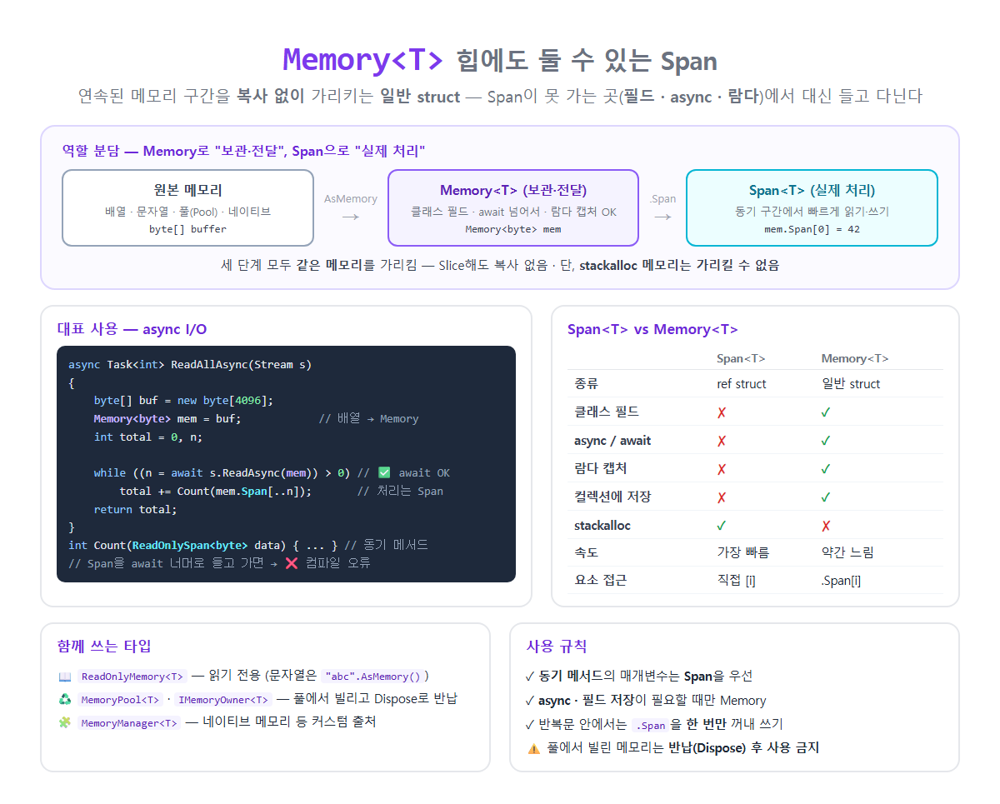

# [Memory\<T>](../KeywordsList.md)

</img>

| 항목 | 내용 |
| --- | --- |
| 정의 | 연속된 메모리 구간을 복사 없이 가리키는, 힙에 저장 가능한 struct |
| 도입 | .NET Core 2.1 (Span과 함께) |
| 종류 | 일반 `struct` (ref struct 아님) |
| 핵심 장점 | 필드·async·람다·컬렉션에서 사용 가능 + 복사 없는 Slice |
| 요소 접근 | `.Span`으로 Span을 꺼내서 |
| 읽기 전용 | `ReadOnlyMemory<T>` (문자열은 `AsMemory()`) |
| 가리킬 수 있는 것 | 배열, 문자열, 메모리 풀, `MemoryManager<T>` |
| 가리킬 수 없는 것 | `stackalloc` 스택 메모리 |
| 소유권 관리 | `MemoryPool<T>` + `IMemoryOwner<T>` (Dispose로 반납) |
| 대표 용도 | async I/O, 버퍼 보관, 파이프라인, 네트워크 처리 |

## 정의

- 연속된 메모리 구간을 복사 없이 가리키는 타입
- 하는 일은 Span<T>와 같지만, Span과 달리 ref struct가 아닌 일반 struct
- .NET Core 2.1에서 Span<T>과 함께 도입

```csharp
byte[] buffer = new byte[10];

Memory<byte> mem = buffer;              // 배열 → Memory (암시적 변환)
Memory<byte> part = mem.Slice(2, 4);    // buffer[2..6]을 가리킴 (복사 없음)

Span<byte> span = part.Span;            // 실제 읽기·쓰기는 Span으로
span[0] = 42;
Console.WriteLine(buffer[2]);           // 42 ← 같은 메모리
```

## 특징

- 일반 `struct`라서 힙에 저장될 수 있음. 필드, async, 람다, 컬렉션 어디에든 둘 수 있음.
- 복사 없는 자르기(Slice) : `Slice()`나 `[2..6]`으로 자르면 새 배열 없이 같은 메모리의 다른 구간을 가리킴.
- 직접 인덱싱이 안 됨. `mem[0]`처럼 쓸 수 없고, `.Span` 속성으로 Span을 꺼낸 뒤 접근.
- 스택 메모리(`stackalloc`)는 가리킬 수 없음. 힙에 저장될 수 있으므로, 사라질 수 있는 스택 메모리를 가리키면 위험하기 때문.
- 가리킬 수 있는 대상
    - 배열 : `arr.AsMemory()`
    - 문자열 : `"abc".AsMemory()` → `ReadOnlyMemory<char>`
    - 메모리 풀 : `MemoryPool<T>`
    - 네이티브 메모리 등 커스텀 출처 : `MemoryManager<T>`
- Span보다 약간 느림. `.Span`을 얻을 때 내부적으로 원본 종류를 확인하는 작은 비용이 있음.

## 관련 타입

| 타입 | 설명 |
| --- | --- |
| **`Memory<T>`** | 읽기 + 쓰기 가능한 메모리 구간 |
| **`ReadOnlyMemory<T>`** | 읽기 전용. 문자열은 이것으로만 가리킬 수 있음 |
| **`MemoryPool<T>`** | 메모리를 빌려 쓰고 반납하는 풀 (`MemoryPool<byte>.Shared`) |
| **`IMemoryOwner<T>`** | 풀에서 빌린 메모리의 소유권. `Dispose()`하면 반납 |
| **`MemoryManager<T>`** | 네이티브 메모리 등 직접 만든 메모리 출처를 Memory로 노출할 때 상속 |

## 기능

#### **async I/O: 가장 대표적인 용도**

```csharp
async Task<int> CountBytesAsync(Stream stream)
{
    byte[] buf = new byte[4096];
    Memory<byte> mem = buf;
    int total = 0, n;

    while ((n = await stream.ReadAsync(mem)) > 0)   // ✅ Memory는 await와 함께 사용 가능
        total += Count(mem.Span[..n]);              // 처리는 동기 메서드에서 Span으로

    return total;
}

int Count(ReadOnlySpan<byte> data) { /* 빠른 동기 처리 */ return data.Length; }
```

- `Stream.ReadAsync`, `WriteAsync`, `Socket.ReceiveAsync`, `PipeReader` 등 .NET의 async I/O API는 `Memory<T>`를 받음.

#### **클래스 필드에 보관**

```csharp
public class PacketParser
{
    private readonly ReadOnlyMemory<byte> _data;     // ✅ Span이었다면 ❌ (CS8345)
    public PacketParser(ReadOnlyMemory<byte> data) => _data = data;

    public int ReadHeader() => BitConverter.ToInt32(_data.Span[..4]);
}
```

#### **메모리 풀로 할당 줄이기**

```csharp
using IMemoryOwner<byte> owner = MemoryPool<byte>.Shared.Rent(4096);   // 빌리기
Memory<byte> mem = owner.Memory;                                       // 요청보다 클 수 있음!
int n = await stream.ReadAsync(mem);
Process(mem.Span[..n]);
// using 블록이 끝나면 Dispose → 풀에 반납
```

#### **문자열을 복사 없이 나눠 보관**

```csharp
string log ="2026-11-14 ERROR Disk full";
ReadOnlyMemory<char> date  = log.AsMemory(0, 10);    // "2026-11-14"
ReadOnlyMemory<char> level = log.AsMemory(11, 5);    // "ERROR"

var entries =new List<ReadOnlyMemory<char>> { date, level};   // 컬렉션에 저장 가능
```

#### **배열이 필요할 때**

```csharp
Memory<byte> mem = buffer.AsMemory(2, 4);
byte[] copy = mem.ToArray();                                   // 복사본 생성

if (MemoryMarshal.TryGetArray<byte>(mem, out ArraySegment<byte> seg))   // 복사 없이 원본 배열 정보 얻기
    OldApi(seg.Array!, seg.Offset, seg.Count);
```