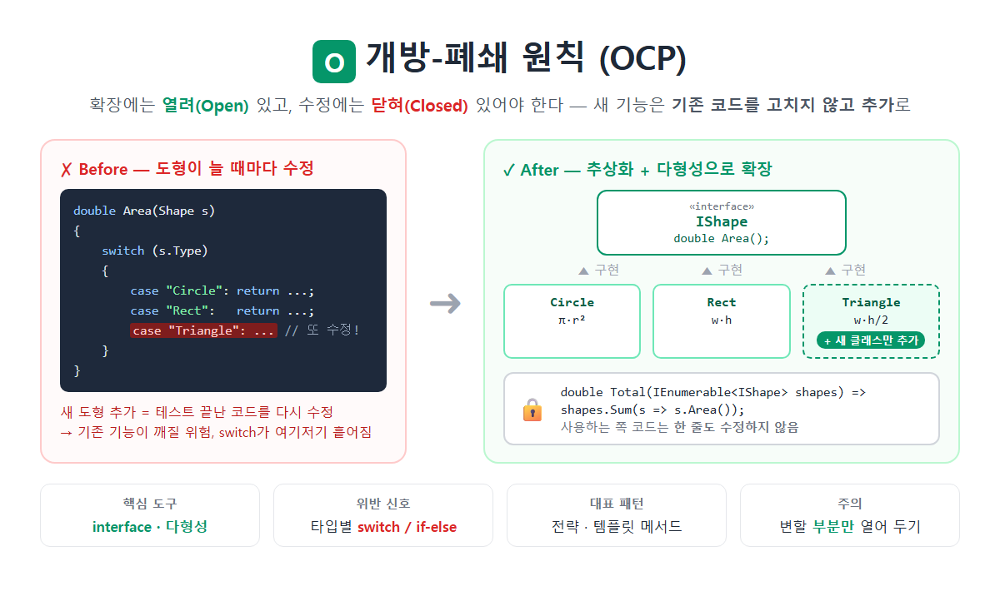

# [개방폐쇄원칙(OCP)](../KeywordsList.md)

</img>

| 항목 | 내용 |
| --- | --- |
| 이름 | 개방-폐쇄 원칙 (Open/Closed Principle) |
| 위치 | SOLID의 **O** |
| 정의 | 확장에는 열려 있고, 수정에는 닫혀 있어야 함 |
| 핵심 아이디어 | 변하는 것과 변하지 않는 것을 분리하고, 변하지 않는 것을 추상화 |
| 구현 도구 | 인터페이스, 추상 클래스, 다형성, 델리게이트, DI |
| 대표 패턴 | 전략, 템플릿 메서드, 데코레이터, 옵저버 |
| 위반 신호 | 타입별 `switch`/`if-else`, 반복되는 분기, 산탄총 수술 |
| 효과 | 회귀 버그 감소, 확장 용이, 테스트 범위 축소 |
| 주의 | 모든 변화에 대비하려 하면 과설계가 됨 |

## 정의

- 소프트웨어 개체(클래스, 모듈, 함수 등)는 확장에는 열려 있어야 하고, 수정에는 닫혀 있어야 한다.
- 확장에 열려 있다(Open) : 새로운 요구사항이 생기면 새 동작을 추가할 수 있음.
- 수정에 닫혀 있다(Closed) : 그렇게 추가할 때 이미 작성되고 테스트된 기존 코드는 고치지 않는다.
- 새 기능은 기존 코드를 고치는 대신, 새 코드를 추가해서 넣으라는 원칙

## 특징

- 추상화가 핵심. 변하지 않는 부분(`IShape.Area()`라는 약속)은 고정하고, 변하는 부분(각 도형의 계산 방식)은 구현 클래스로 분리.
- 다형성으로 동작. 사용하는 쪽은 `IShape`만 알고, 실제로 어떤 도형인지는 몰라도 됨.
- 수정이 아니라 추가로 확장. 새 클래스를 추가하는 것은 기존 코드에 영향을 주지 않으므로 회귀 버그(regression) 위험이 크게 줄어듦.
- 완벽하게 닫을 수는 없음. 모든 종류의 변경에 대비하는 것은 불가능. 그래서 "어떤 방향의 변화에 대해 닫을 것인가"를 골라야 함. 위 예제는 "도형 종류 추가"에는 닫혀 있지만, "둘레 계산 기능 추가"에는 닫혀 있지 않음.

## 기능(얻는 효과)

| 효과 | 설명 |
| --- | --- |
| **안정성** | 검증된 기존 코드를 건드리지 않아 기존 기능이 깨질 위험이 적음 |
| **확장성** | 새 요구사항을 클래스 추가만으로 반영 |
| **테스트 효율** | 새로 추가한 클래스만 테스트하면 됨 |
| **협업** | 여러 개발자가 각자 새 구현 클래스를 만들어도 충돌이 적음 |
| **플러그인 구조** | 외부에서 기능을 끼워 넣을 수 있음 (DLL 플러그인, 모드 등) |

## C#에서 OCP를 구현하는 방법

| 방법 | 예 |
| --- | --- |
| 인터페이스 | `IShape`, `IPayment`, `INotifier` |
| 추상 클래스 + `virtual`/`override` | `abstract class Shape { public abstract double Area(); }` |
| 전략 패턴 | 할인 정책, 정렬 기준을 객체로 바꿔 끼움 |
| 템플릿 메서드 패턴 | 큰 흐름은 부모가 고정하고, 세부 단계는 자식이 `override` |
| 델리게이트 / `Func<T>` | `list.Sort((a, b) => a.Age.CompareTo(b.Age))` |
| 확장 메서드 | 원래 클래스를 수정하지 않고 메서드 추가 (LINQ가 대표 예) |
| 의존성 주입(DI) | `services.AddScoped<INotifier, SmsNotifier>()`처럼 등록만 바꿔 동작 교체 |
| 제네릭 | 타입을 바꿔 끼워도 같은 코드가 동작 |

## 위반 신호(Code Smell)

- 타입이나 종류에 따라 분기하는 `switch`, `if-else`가 계속 늘어남.
    - `if (type == "A") ... else if (type == "B")`
    - `enum` 값마다 `case`를 쓰는 코드
- 같은 `switch`가 여러 곳에 복사되어 있음.
- `is`나 `GetType()`으로 타입을 검사해서 분기함.
- 기능을 하나 추가하는데 여러 파일을 동시에 고쳐야 함.