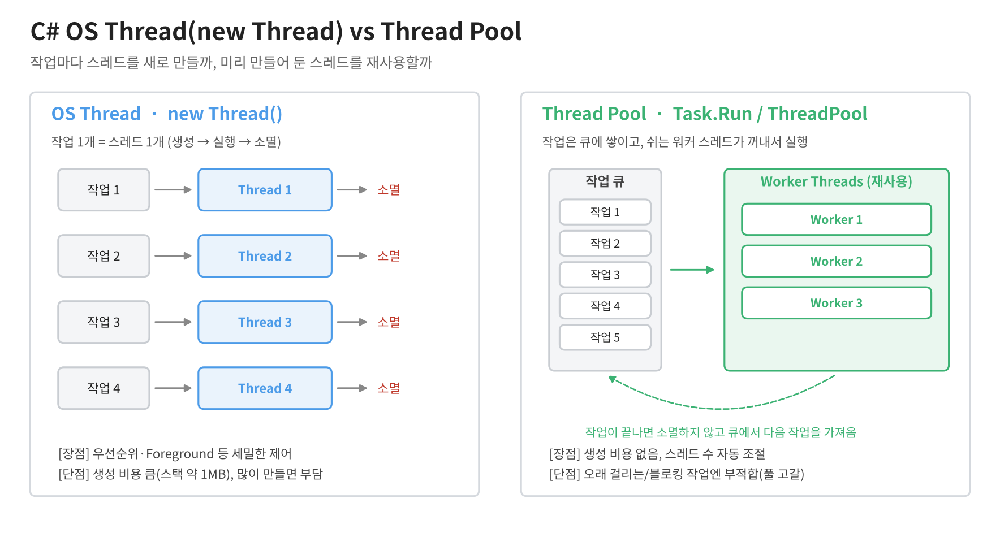

# [OS Thread vs Thread Pool](../KeywordsList.md)

</img>

| 항목 | OS Thread (`new Thread`) | Thread Pool (`Task.Run`, `ThreadPool`) |
| --- | --- | --- |
| 생성 방식 | 작업마다 직접 생성 | 런타임이 미리 만들어 재사용 |
| 생성 비용 | 큼 (커널 객체 + 스택 약 1MB) | 거의 없음 |
| 작업 후 | 스레드 소멸 | 풀로 돌아가 다음 작업 대기 |
| 스레드 수 관리 | 개발자 책임 | 런타임이 자동 조절 |
| Foreground/Background | 기본 Foreground, 변경 가능 | 항상 Background |
| 우선순위·이름 제어 | 가능 | 하지 않는 것이 원칙 |
| 적합한 작업 | 수명이 길고 블로킹되는 전용 작업 | 짧고 많은 작업, async/await 흐름 |
| 주의점 | 남발하면 메모리·컨텍스트 스위칭 부담 | 블로킹 작업이 많으면 풀 고갈 |
| 현대 C# 권장 | 특수한 경우에만 사용 | 기본 선택 (`Task`, `async/await`) |

## OS Thread(`new Thread`)

- `System.Threading.Thread` 클래스로 직접 만드는 스레드. 운영체제의 실제 스레드와 1:1로 대응.

```csharp
var t = new Thread(() => DoWork());
t.IsBackground = true;   // 메인 종료 시 함께 종료
t.Priority = ThreadPriority.AboveNormal;
t.Start();
t.Join();                // 끝날 때까지 대기
```

- 비용이 큼. 스레드를 하나 만들 때마다 OS 커널 객체와 스택 메모리(기본 약 1MB)가 할당됨. 작업이 끝나면 스레드는 소멸. 그래서 짧은 작업마다 스레드를 새로 만들면 생성·소멸 오버헤드가 실제 작업보다 커질 수 있음.
- 세밀하게 제어할 수 있음. 이름, 우선순위, Foreground/Background 여부, 아파트먼트 상태(STA/MTA)를 직접 지정할 수 있음.
- 기본값은 Foreground. 이 상태의 스레드가 살아 있으면 Main 메서드가 끝나도 프로세스가 종료되지 않음.
- 수명이 긴 전용 작업에 적합. 프로그램 내내 도는 루프, 소켓 수신 대기, 블로킹 I/O를 계속 붙잡는 작업 등이 여기에 해당.

## Thread Pool(`ThreadPool`, `Task.Run`)

- .NET 런타임이 워커 스레드를 미리 만들어 두고 재사용하는 구조. 작업을 넘기면 먼저 큐에 들어감. 그다음 놀고 있는 워커 스레드가 큐에서 작업을 꺼내 실행. 실행이 끝난 워커는 소멸하지 않고 다음 작업을 기다림.

```csharp
ThreadPool.QueueUserWorkItem(_ => DoWork());   // 저수준 방식
await Task.Run(() => DoWork());                // 현대적인 방식 (권장)
```

- 생성 비용이 거의 없음. 이미 있는 스레드를 재사용하기 때문에 짧은 작업을 많이 처리할 때 효율적.
- 스레드 수를 런타임이 조절. CPU 코어 수를 기준으로 최소 개수를 유지함. 작업이 밀리면 Hill Climbing 알고리즘으로 스레드를 천천히 늘림.
- 풀 스레드는 항상 Background. 이름과 우선순위도 바꾸지 않는 것이 원칙. 풀 스레드는 공용 자원이기 때문.
- `Task`/`async-await`의 기반. `Task.Run`, `await` 이후의 이어지는 코드(continuation), `Parallel.For` 등이 기본적으로 스레드 풀 위에서 실행.

## Unity에서 참고할 점

- Unity API(Transform, GameObject 등)는 메인 스레드에서만 호출할 수 있음.
- 이 규칙은 `new Thread`와 `Task.Run` 모두에 똑같이 적용됨.
- 따라서 백그라운드 스레드에서는 계산이나 파일 I/O만 처리하고, 결과를 메인 스레드로 넘겨서 반영해야 함.
- 대량 계산을 병렬로 처리하고 싶다면 Unity 전용 Job System을 고려할 수 있음.