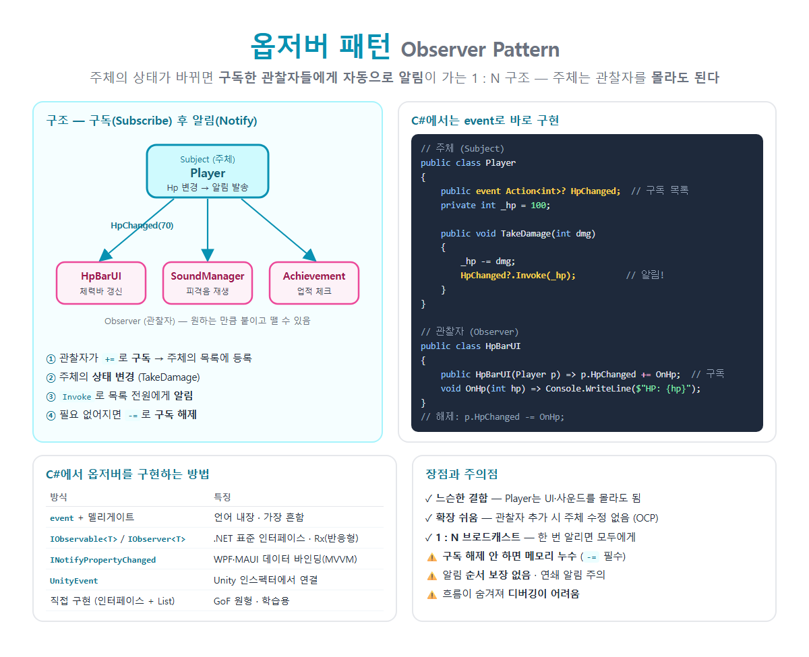

# [옵저버 패턴(Observer)](../KeywordsList.md)

</img>

| 항목 | 내용 |
| --- | --- |
| 분류 | GoF 행동 패턴 |
| 정의 | 주체의 상태가 바뀌면 구독한 관찰자들에게 자동으로 알리는 1 : N 구조 |
| 구성 | Subject(주체), Observer(관찰자) |
| 동작 | 구독(`+=`) → 상태 변경 → 알림(`Invoke`) → 해제(`-=`) |
| C# 구현 | `event`, `IObservable<T>`, `INotifyPropertyChanged`, `UnityEvent` |
| 장점 | 느슨한 결합, 확장 용이(OCP), 1 : N 브로드캐스트, 동적 구독 |
| 단점 | 구독 해제 누락 시 메모리 누수, 순서 보장 없음, 연쇄 알림, 디버깅 어려움 |
| 비슷한 개념 | 발행-구독(Pub/Sub), 이벤트 버스, 중재자 패턴 |

## 정의

- GoF 디자인 패턴 중 행동 패턴의 하나
- 한 객체의 상태가 바뀌면, 그 객체에 의존하는 다른 객체들에게 자동으로 알림이 가서 갱신되도록 하는 1 : N 의존 관계를 정의
- 주체(Subject) : 상태를 가지고 있고, 바뀌면 알리는 쪽. 발행자(Publisher)
- 관찰자(Observer) : 주체를 구독하고, 알림을 받으면 반응하는 쪽. 구독자(Subscriber)

핵심 : 주체는 누가 구독했는지, 그들이 무엇을 하는지 몰라도 됨. 그냥 "바뀌었다"고 알리기만 함.

## 필요한 이유

```csharp
// ❌ 옵저버 없이: Player가 모든 관련 객체를 직접 알고 호출
public class Player
{
    private HpBarUI _ui;
    private SoundManager _sound;
    private AchievementSystem _achievement;

    public void TakeDamage(int dmg)
    {
        _hp -= dmg;
        _ui.UpdateHp(_hp);              // Player가 UI를 앎
        _sound.PlayHit();               // Player가 사운드를 앎
        _achievement.CheckHp(_hp);      // 새 기능이 생길 때마다 Player 수정...
    }
}
```

- 문제점
    - `Player`가 UI, 사운드, 업적 시스템에 강하게 결합됨.
    - 새로운 반응(진동, 로그, 퀘스트)이 생길 때마다 `Player`를 수정해야 함 ⇒ OCP 위반
    - `Player`를 테스트하거나 다른 게임에서 재사용하기 어려움.
- 해결 : C#의 event로 구현
    - C#은 `event` 키워드로 옵저버 패턴을 언어 차원에서 지원
    
    ```csharp
    // 주체 (Subject)
    public class Player
    {
        public event Action<int>? HpChanged;          // 구독자 목록 역할
        public event Action? Died;
    
        private int _hp = 100;
    
        public void TakeDamage(int dmg)
        {
            _hp = Math.Max(0, _hp - dmg);
            HpChanged?.Invoke(_hp);                   // 구독자 전원에게 알림
            if (_hp == 0) Died?.Invoke();
        }
    }
    
    // 관찰자들 (Observers): Player는 이들의 존재를 모름
    public class HpBarUI
    {
        public HpBarUI(Player p) => p.HpChanged += OnHpChanged;     // 구독
        private void OnHpChanged(int hp) => Console.WriteLine($"[UI] HP: {hp}");
    }
    
    public class SoundManager
    {
        public SoundManager(Player p) => p.HpChanged += _ => Console.WriteLine("[Sound] 피격음");
    }
    
    // 사용
    var player = new Player();
    var ui = new HpBarUI(player);
    var sound = new SoundManager(player);
    player.TakeDamage(30);
    // [UI] HP: 70
    // [Sound] 피격음
    ```
    

## 구성 요소

| 구성 요소 | 역할 | C# event에서 |
| --- | --- | --- |
| **Subject (주체)** | 관찰자 목록 관리, 상태 변경 시 알림 | `event`를 선언한 클래스 |
| **Observer (관찰자)** | 알림을 받아 반응 | 이벤트 핸들러 메서드 |
| **구독 (Attach / Subscribe)** | 목록에 등록 | `+=` |
| **해제 (Detach / Unsubscribe)** | 목록에서 제거 | `-=` |
| **알림 (Notify)** | 모든 관찰자 호출 | `Invoke()` |

## 특징

- 1 : N 관계. 주체 하나에 관찰자는 몇 개든 붙을 수 있음.
- 느슨한 결합(Loose Coupling). 주체는 관찰자의 구체 타입을 모르고, 약속된 형태(델리게이트, 인터페이스)만 앎.
- 동적 구독. 실행 중에 언제든 구독하고 해제할 수 있음.
- 푸시(Push) vs 풀(Pull)
    - 푸시 방식: 알릴 때 데이터를 같이 보냄. 예: `HpChanged(70)`
    - 풀 방식: "바뀌었다"고만 알리고, 관찰자가 주체에게 직접 값을 물어봄.

## 기능

| 분야 | 예 |
| --- | --- |
| **게임** | 체력 변화 → UI·사운드·업적, 적 사망 → 점수·퀘스트·드롭 |
| **UI** | 버튼 클릭 이벤트, 입력 변경 이벤트 |
| **데이터 바인딩** | WPF·MAUI의 `INotifyPropertyChanged` → 값이 바뀌면 화면 자동 갱신 |
| **MVC / MVVM** | 모델이 바뀌면 뷰가 갱신 |
| **비즈니스** | 주문 완료 → 이메일·재고·포인트 처리 |
| **반응형 프로그래밍** | Rx(`IObservable<T>`), 실시간 데이터 스트림 |