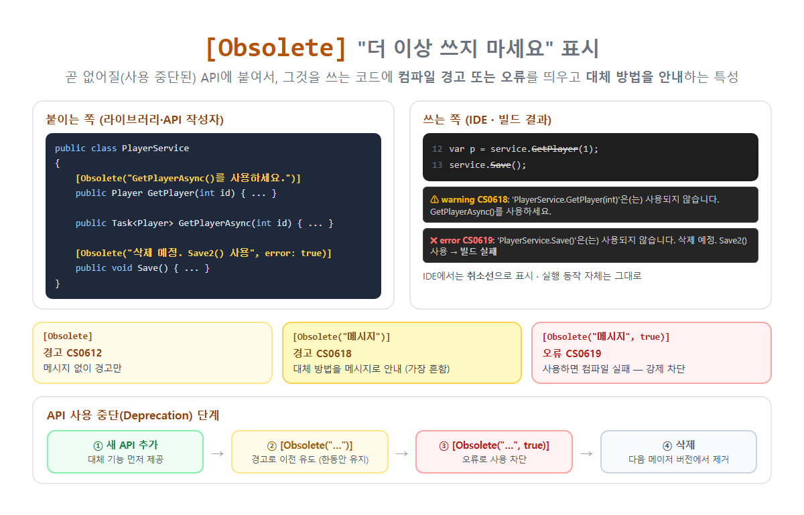

# [[Obsolete]](../KeywordsList.md)

</img>

| 항목 | 내용 |
| --- | --- |
| 정체 | `System.ObsoleteAttribute` |
| 의미 | 사용 중단된(곧 없어질) API 표시 |
| 형태 | `[Obsolete]`, `[Obsolete("메시지")]`, `[Obsolete("메시지", true)]` |
| 결과 | 경고 CS0612 / 경고 CS0618 / 오류 CS0619 |
| 작동 시점 | 컴파일 타임 (실행 동작은 그대로) |
| IDE 표시 | 취소선 |
| 대상 | 클래스, 구조체, 인터페이스, enum, 메서드, 생성자, 속성, 필드, 이벤트, 델리게이트 |
| .NET 5+ | `DiagnosticId`(경고 코드 지정), `UrlFormat`(문서 링크) |
| 대표 용도 | 점진적 API 교체, 대체 방법 안내, 위험한 API 차단 |

## 정의

- 클래스, 메서드, 속성 같은 코드 요소에 붙여서 "이것은 더 이상 쓰지 마세요(사용 중단됨)"라고 표시하는 특성(Attribute)
- 이 특성이 붙은 멤버를 다른 코드에서 사용하면, 컴파일러가 경고나 오류를 띄우고 대체 방법을 메시지로 안내
- 기존 코드를 바로 깨뜨리지 않으면서 새 API로 옮겨 가도록 유도할 때 사용

```csharp
public class PlayerService
{
    [Obsolete("GetPlayerAsync()를 사용하세요.")]
    public Player GetPlayer(int id) { ... }

    public Task<Player> GetPlayerAsync(int id) { ... }   // 새 API
}

// 사용하는 쪽
var p = service.GetPlayer(1);
// ⚠ warning CS0618: 'PlayerService.GetPlayer(int)'은(는) 사용되지 않습니다. GetPlayerAsync()를 사용하세요.
```

## 형태와 결과

| 형태 | 결과 | 오류 코드 |
| --- | --- | --- |
| `[Obsolete]` | 경고 (메시지 없음) | **CS0612** |
| `[Obsolete("메시지")]` | 경고 + 안내 메시지 ⭐ 가장 흔함 | **CS0618** |
| `[Obsolete("메시지", true)]` | 컴파일 오류 → 빌드 실패 | **CS0619** |

```csharp
[Obsolete]                                          // CS0612 경고
public void A() { }

[Obsolete("B2()를 사용하세요.")]                     // CS0618 경고
public void B() { }

[Obsolete("삭제 예정입니다. C2()를 사용하세요.", true)]  // CS0619 오류
public void C() { }
```

- 두 번째 인수 `error`가 `true`이면 사용 자체를 막음.

## 특징

- 컴파일 타임에만 작동. 특성 자체가 실행 동작을 바꾸지는 않음. 메서드는 여전히 정상적으로 실행됨(`error: true`면 빌드가 안 될 뿐).
- 사용하는 쪽에 경고. 정의한 곳에는 아무 경고도 없음.
- 붙일 수 있는 대상 : 클래스, 구조체, 인터페이스, enum(과 enum 값), 메서드, 생성자, 속성, 필드, 이벤트, 델리게이트
- Obsolete 멤버 안에서 다른 Obsolete 멤버를 쓰면 경고가 나지 않음. 함께 사라질 코드끼리는 서로 참조해도 괜찮다는 의미.
- .NET 5부터 `DiagnosticId`와 `UrlFormat` 속성을 쓸 수 있음. 경고 코드를 직접 지정하고, 안내 문서 링크를 연결할 수 있음.

```csharp
[Obsolete("새 Save 방식을 사용하세요.",
          DiagnosticId = "MYGAME001",
          UrlFormat = "https://docs.mygame.dev/obsolete/{0}")]
public void SaveLegacy() { }
// warning MYGAME001: ... (경고 코드와 문서 링크가 함께 표시됨)
```

## 기능

| 기능 | 설명 |
| --- | --- |
| **점진적 API 교체** | 기존 사용자를 바로 깨뜨리지 않고, 경고로 새 API로 옮기도록 유도 |
| **대체 방법 안내** | 메시지에 "무엇을 대신 쓰라"고 적어 이전 작업을 쉽게 함 |
| **실수 방지** | 위험하거나 버그가 있는 메서드를 `error: true`로 아예 차단 |
| **팀 내 리팩터링** | 곧 지울 코드를 표시해서 새 코드가 더 이상 의존하지 않게 함 |
| **버전 관리** | 라이브러리의 하위 호환성을 지키며 안전하게 변경 |

## API 사용 중단(Deprecation) 단계

- 라이브러리나 공용 코드를 바꿀 때 보통 이런 순서를 따름

| 단계 | 할 일 | 사용자 영향 |
| --- | --- | --- |
| ① 새 API 추가 | 대체할 기능을 먼저 만듦 | 없음 |
| ② `[Obsolete("…")]` | 옛 API에 경고 표시 + 안내 메시지 | 경고 (빌드는 성공) |
| ③ `[Obsolete("…", true)]` | 다음 버전에서 오류로 격상 | 빌드 실패 → 반드시 수정 |
| ④ 삭제 | 다음 메이저 버전에서 코드 제거 | 완전히 사라짐 |

```csharp
// v1.0
public void Load() { }

// v1.5 — 새 API 추가 + 경고
[Obsolete("LoadAsync()를 사용하세요. v3.0에서 제거됩니다.")]
public void Load() { }
public Task LoadAsync() { }

// v2.0 — 오류로 격상
[Obsolete("LoadAsync()를 사용하세요. v3.0에서 제거됩니다.", true)]
public void Load() { }

// v3.0 — 삭제
```