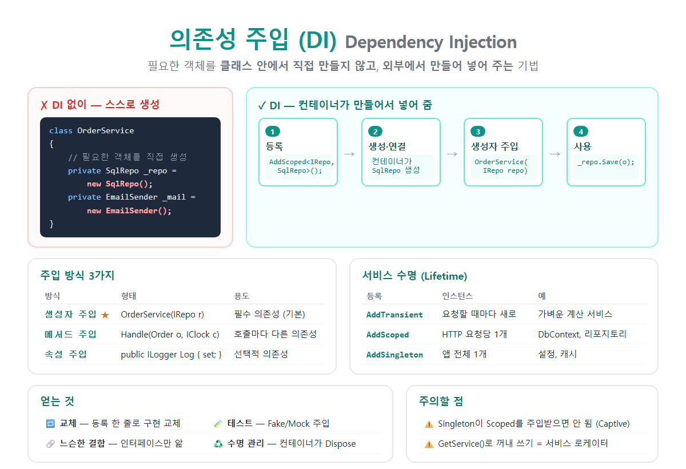

# [함수 파라미터(out)](../KeywordsList.md)

</img>

| 항목 | 내용 |
| --- | --- |
| 이름 | out 매개변수 (출력 매개변수) |
| 정의 | 메서드가 값을 채워서 돌려주는 참조 전달 매개변수 |
| 전달 방식 | 참조 전달 (복사 없음) |
| 호출 전 초기화 | 불필요 |
| 메서드 안 | 반환 전 반드시 할당, 할당 전 읽기 불가 |
| 호출 문법 | `Method(out int x)`, `out var x`, `out _` |
| 대표 패턴 | Try 패턴 (`TryParse`, `TryGetValue`) |
| 그 외 용도 | 여러 값 반환, `Deconstruct` |
| 사용 불가 | `async` 메서드, 반복기(`yield`), 속성 인수 |
| 관련 오류 | CS0177 (미할당), CS0269 (할당 전 읽기), CS0663 (ref/out만 다른 오버로딩) |

## 정의

- 매개변수 앞에 붙이는 한정자, 이 매개변수가 입력이 아니라 출력용이라는 뜻
- 메서드는 `out` 매개변수에 값을 채워서 호출한 쪽에 돌려줌.
- 값을 복사하지 않고 호출한 쪽 변수의 참조(위치)를 전달. 그래서 메서드 안에서 할당한 값이 그대로 원래 변수에 들어감.
- 반환값은 하나뿐이므로, 리턴 외에 결과를 더 내보내고 싶을 때 씀.

```csharp
bool ok = int.TryParse("123", out int n);   // 호출할 때도 out을 붙임

Console.WriteLine(ok);   // True  ← 리턴값: 성공 여부
Console.WriteLine(n);    // 123   ← out 값: 실제 결과
```

## 특징

- 호출하는 쪽: 변수를 초기화하지 않아도 됨.

```csharp
int result;                        // 값 없음
Divide(10, 3, out result);         // OK
```

- 메서드 안: 반환하기 전에 반드시 값을 할당해야 함.
    - 할당하지 않는 경로가 있으면 오류 CS0177이 발생.

```csharp
bool TryDivide(int a, int b, out int quotient)
{
    if (b == 0)
    {
        quotient = 0;      // 실패해도 반드시 할당!
        return false;
    }
    quotient = a / b;
    return true;
}
```

- 메서드 안: 할당하기 전에 읽을 수 없음.
    - 들어온 값은 없는 것으로 취급. 할당 전에 읽으면 오류 CS0269가 발생.

```csharp
void F(out int x)
{
    Console.WriteLine(x);   // ❌ CS0269
    x = 5;
}
```

- 호출할 때도 `out` 키워드를 붙여야 함.
    - `Divide(10, 3, result)`처럼 빼먹으면 오류가 남. 키워드를 강제하는 이유는, 호출부만 봐도 "이 변수의 값이 바뀐다"는 것을 알 수 있게 하기 위해서.
- 인수는 변수여야 함.
    - 리터럴(`5`)이나 속성(`obj.Prop`)은 `out` 인수로 넘길 수 없음. 값을 받을 저장 위치가 필요하기 때문.

## 기능

- Try 패턴 (가장 대표적인 용도)
    - **"**성공 여부"는 `bool`로 리턴하고, "실제 결과"는 `out`으로 돌려줌. 실패할 수 있는 작업을 예외 없이 처리할 수 있음.

```csharp
// 예외 방식: 실패하면 FormatException → try-catch 필요, 느림
int a =int.Parse("abc");

// Try 패턴: 예외 없이 bool로 확인
if(int.TryParse("abc",outint b))
    Console.WriteLine(b);
else
    Console.WriteLine("숫자가 아닙니다");
```

- .NET의 대표적인 Try 메서드
    - `int.TryParse`, `double.TryParse`, `DateTime.TryParse`, `Enum.TryParse`
    - `Dictionary.TryGetValue`
    - `ConcurrentQueue.TryDequeue`

```csharp
var ages =newDictionary<string,int>{["Kim"] =25};

if(ages.TryGetValue("Kim",outint age))// 키가 있는지 확인하면서 값까지 한 번에 꺼냄
    Console.WriteLine(age);// 25
```

- 여러 값 반환

```
voidGetMinMax(int[] arr,outint min,outint max)
{
    min = arr.Min();
    max = arr.Max();
}

GetMinMax(new[]{3,9,1},outint lo,outint hi);// lo = 1, hi = 9
```

- 분해(Deconstruct) 메서드
    - `var (x, y) = point;` 같은 분해 문법은 내부적으로 `out` 매개변수를 쓰는 `Deconstruct` 메서드를 호출.

```csharp
public class Point
{
    public int X { get; set; }
    public int Y { get; set; }
    public void Deconstruct(out int x, out int y) { x = X; y = Y; }
}

var (px, py) = new Point { X = 3, Y = 4 };   // px = 3, py = 4
```

## 편의 문법

- out 변수 인라인 선언 : 변수를 미리 선언할 필요가 없음.

```csharp
// C# 6 이전
int n;
int.TryParse(s, out n);

// C# 7+
int.TryParse(s, out int n);
int.TryParse(s, out var m);   // var도 가능 (타입 추론)
```

- 버리기 (Discard, _) : 필요 없는 out 값은 _로 무시

```csharp
bool isNumber = int.TryParse(s, out _);   // 성공 여부만 필요할 때
GetMinMax(arr, out _, out int max);        // max만 필요할 때
```

- 인라인 out 변수의 범위
    - 인라인으로 선언한 out 변수는 if문 바깥(같은 블록)에서도 쓸 수 있음.
    - 단, 실패한 경우에는 기본값(0, null)이 들어 있으니 주의

```csharp
if (!int.TryParse(input, out int value))
    return;
Console.WriteLine(value);   // ✅ if 밖에서도 사용 가능
```