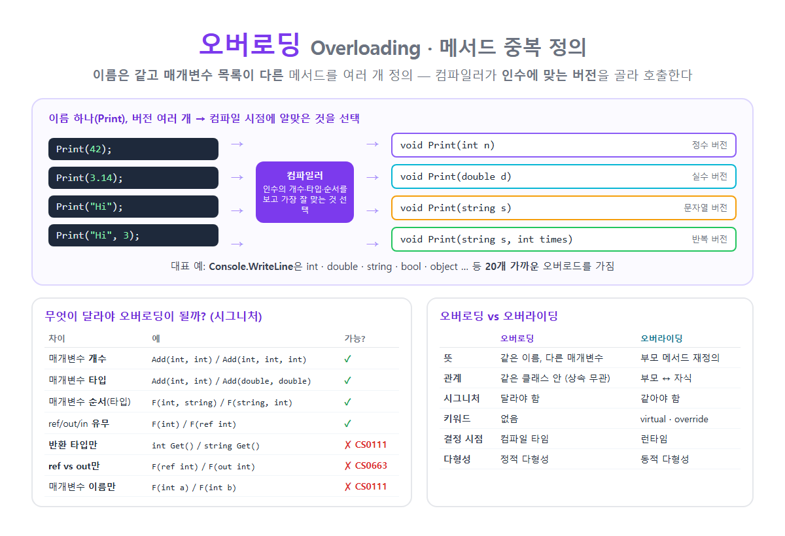

# [Overloading](../KeywordsList.md)

</img>

| 항목 | 내용 |
| --- | --- |
| 정의 | 같은 이름, 다른 매개변수 목록의 메서드를 여러 개 정의 |
| 구분 기준 | 매개변수의 개수, 타입, 순서, `ref`/`out`/`in` 유무 |
| 구분 불가 | 반환 타입만, 매개변수 이름만, `ref`와 `out`만 다른 경우 |
| 결정 시점 | 컴파일 타임 (정적 바인딩) |
| 다형성 종류 | 정적(컴파일 타임) 다형성 |
| 적용 대상 | 메서드, 생성자, 인덱서, 연산자 |
| 상속 필요 | ❌ (같은 클래스 안에서) |
| 대표 예 | `Console.WriteLine`, `Math.Max`, 생성자 여러 개 |
| 관련 오류 | CS0111 (중복 정의), CS0121 (모호한 호출), CS0663 (ref/out만 다름) |

## 정의

- 같은 이름의 메서드를 매개변수 목록만 다르게 해서 여러 개 정의하는 것
- 메서드를 호출하면 컴파일러가 넘긴 인수의 개수, 타입, 순서를 보고 가장 잘 맞는 버전을 골라 연결 ⇒오버로드 해석(Overload Resolution)

```csharp
public class Printer
{
    public void Print(int n)              => Console.WriteLine($"정수: {n}");
    public void Print(double d)           => Console.WriteLine($"실수: {d}");
    public void Print(string s)           => Console.WriteLine($"문자열: {s}");
    public void Print(string s, int times)
    {
        for (int i = 0; i < times; i++) Console.WriteLine(s);
    }
}

var p = new Printer();
p.Print(42);          // 정수: 42
p.Print(3.14);        // 실수: 3.14
p.Print("Hi");        // 문자열: Hi
p.Print("Hi", 3);     // Hi Hi Hi
```

- 이름을 `PrintInt`, `PrintDouble`, `PrintString`처럼 따로 짓지 않아도 됨. 그래서 사용하는 쪽은 하나의 이름만 기억하면 됨.

## 특징

- 오버로딩은 메서드 시그니처(이름 + 매개변수의 개수, 타입, 순서, 한정자)가 달라야 함.

| 차이 | 예 | 오버로딩 가능? |
| --- | --- | --- |
| 매개변수 개수 | `Add(int, int)` / `Add(int, int, int)` | ✅ |
| 매개변수 타입 | `Add(int, int)` / `Add(double, double)` | ✅ |
| 매개변수 타입의 순서 | `F(int, string)` / `F(string, int)` | ✅ |
| `ref`/`out`/`in` 유무 | `F(int)` / `F(ref int)` | ✅ |
| 제네릭 타입 매개변수 개수 | `F()` / `F<T>()` | ✅ |
| 반환 타입만 다름 | `int Get()` / `string Get()` | ❌ **CS0111** |
| `ref` vs `out`만 다름 | `F(ref int)` / `F(out int)` | ❌ **CS0663** |
| 매개변수 이름만 다름 | `F(int a)` / `F(int b)` | ❌ **CS0111** |
| `params` 유무만 다름 | `F(int[] a)` / `F(params int[] a)` | ❌ |
- 반환 타입만 다르면 안 되는 이유 : 호출하는 쪽에서 Get();처럼 반환값을 쓰지 않을 수도 있어서, 컴파일러가 어느 것을 부를지 결정할 수 없음.

## 기능

- 다양한 입력 타입 지원 : 같은 동작을 여러 타입에 제공

```csharp
Math.Max(3, 5);          // int 버전
Math.Max(3.5, 1.2);      // double 버전
Console.WriteLine(10);   // int 버전
Console.WriteLine("Hi"); // string 버전
```

- 선택적 정보 제공 : 간단한 버전과 자세한 버전을 함께 제공. 짧은 버전이 긴 버전을 호출하는 체이닝 패턴이 관례.

```csharp
public void Log(string msg)                          => Log(msg, LogLevel.Info);
public void Log(string msg, LogLevel level)          => Log(msg, level, DateTime.Now);
public void Log(string msg, LogLevel level, DateTime time) { /* 실제 구현은 여기 한 곳 */ }
```

- 생성자 오버로딩 : 객체를 여러 방식으로 만들 수 있게 함.

```csharp
public class Player
{
    public Player() : this("Unknown", 100) { }
    public Player(string name) : this(name, 100) { }
    public Player(string name, int hp) { Name = name; Hp = hp; }

    public string Name { get; }
    public int Hp { get; }
}
```

- 인덱서 오버로딩

```csharp
public Item this[int index] => _items[index];
public Item this[string name] => _items.First(i => i.Name == name);
```

## 오버로드 해석 규칙(컴파일러가 고르는 방법)

1. 이름과 개수가 맞는 후보를 모음.
2. 인수를 변환 없이 그대로 받는 버전이 가장 우선.
3. 정확히 맞는 것이 없으면 암시적 변환(예: `int` → `long` → `double`)이 가능한 버전 중 가장 "가까운" 변환을 고름.
4. 우열을 가릴 수 없으면 CS0121(모호한 호출) 오류 발생.

```csharp
void F(long x)   { }
void F(double x) { }

F(5);        // int → long이 int → double보다 더 가까움 → F(long) 호출
F(5.0f);     // float → double → F(double) 호출

void G(int x, double y) { }
void G(double x, int y) { }
G(1, 2);     // ❌ CS0121: 둘 다 똑같이 맞아서 모호함
```

- null을 넘길 때의 모호성

```csharp
void H(string s) { }
void H(int[] a)  { }
H(null);             // ❌ CS0121: 둘 다 null을 받을 수 있음
H((string)null);     // ✅ 캐스팅으로 명시
```