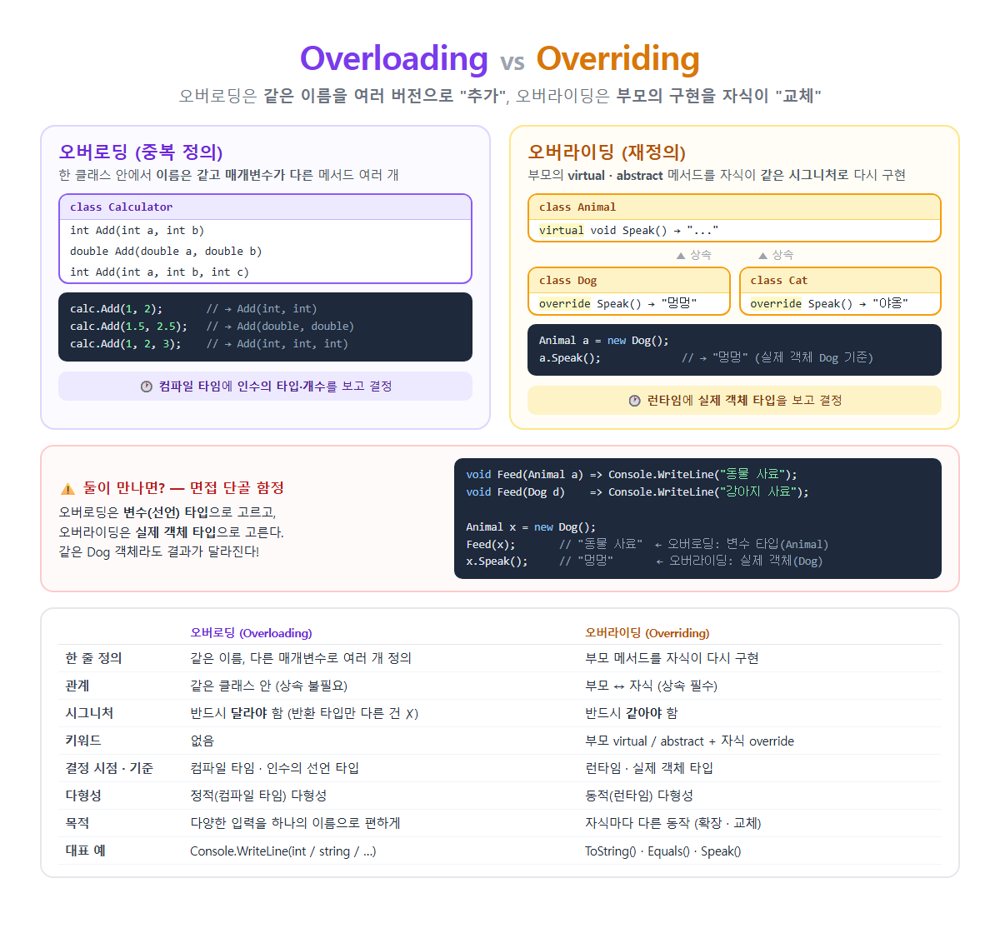

# [Overloading vs Overriding](../KeywordsList.md)

</img>

| 구분 | 오버로딩 (Overloading) | 오버라이딩 (Overriding) |
| --- | --- | --- |
| 한국어 | 중복 정의 | 재정의 |
| 한 줄 정의 | 같은 이름, 다른 매개변수로 여러 개 정의 | 부모 메서드를 자식이 다시 구현 |
| 관계 | 같은 클래스 안 (상속 불필요) | 부모 ↔ 자식 (상속 필수) |
| 시그니처 | 반드시 달라야 함 | 반드시 같아야 함 |
| 반환 타입 | 달라도 되지만, 반환 타입만 다르면 불가 | 같아야 함 (C# 9+: 공변 반환 허용) |
| 접근 한정자 | 자유롭게 지정 | 부모와 같아야 함 |
| 키워드 | 없음 | 부모 `virtual`/`abstract` + 자식 `override` |
| 결정 시점 | 컴파일 타임 | 런타임 |
| 결정 기준 | 인수의 선언 타입, 개수 | 실제 객체 타입 |
| 다형성 종류 | 정적 다형성 | 동적 다형성 |
| 바인딩 | 이른 바인딩 (Early Binding) | 늦은 바인딩 (Late Binding) |
| 내부 원리 | 컴파일러가 호출할 메서드를 확정 | 가상 메서드 테이블(vtable) 조회 |
| `static` 메서드 | ✅ 가능 | ❌ 불가 |
| 목적 | 다양한 입력을 하나의 이름으로 편하게 | 자식마다 다른 동작 (확장, 교체) |
| 대표 예 | `Console.WriteLine`, `Math.Max`, 생성자 여러 개 | `ToString()`, `Equals()`, `Speak()` |
| 대표 오류 | CS0111 (중복), CS0121 (모호한 호출) | CS0506 (virtual 아님), CS0507 (접근 수준 다름) |

## 오버로딩(Overloading, 중복 정의)

- 같은 클래스 안에서 이름이 같고 매개변수 목록(개수, 타입, 순서)이 다른 메서드를 여러 개 정의하는 것.
- 컴파일러가 넘긴 인수를 보고 맞는 버전을 고름

```csharp
public class Calculator
{
    public int    Add(int a, int b)           => a + b;
    public double Add(double a, double b)     => a + b;
    public int    Add(int a, int b, int c)    => a + b + c;
}

var calc = new Calculator();
calc.Add(1, 2);        // Add(int, int)
calc.Add(1.5, 2.5);    // Add(double, double)
calc.Add(1, 2, 3);     // Add(int, int, int)
```

- 쓰임 : 비슷한 동작을 다양한 입력으로 제공할 때 씀. 예: `Console.WriteLine(int/string/bool…)`, 생성자 여러 개
- 결정 시점 : 컴파일 타임

## 오버라이딩(Overriding, 재정의)

- 부모 클래스의 `virtual` 또는 `abstract` 메서드를 자식 클래스가 같은 시그니처로 다시 구현하는 것
- 부모 타입 변수로 호출해도 실제 객체(자식)의 구현이 실행됨

```csharp
public class Animal
{
    public virtual void Speak() => Console.WriteLine("...");
}

public class Dog : Animal
{
    public override void Speak() => Console.WriteLine("멍멍");
}

public class Cat : Animal
{
    public override void Speak() => Console.WriteLine("야옹");
}

Animal a = new Dog();
a.Speak();             // "멍멍" ← 변수 타입은 Animal이지만 실제 객체는 Dog
```

- 쓰임 : 자식 클래스마다 다른 동작을 하게 만들 때(다형성) 사용. 예: `ToString()`, `Equals()`, 게임 캐릭터별 공격
- 결정 시점 : 런타임

## 핵심 차이

1. 무엇을 기준으로 메서드를 고르나?
    1. 오버로딩 : 인수의 선언(컴파일 타임) 타입과 개수를 봄
    2. 오버라이딩 : 실제 객체의 타입을 봄
2. 둘이 만나면?
    
    ```csharp
    public class Animal { public virtual void Speak() => Console.WriteLine("..."); }
    public class Dog : Animal { public override void Speak() => Console.WriteLine("멍멍"); }
    
    void Feed(Animal a) => Console.WriteLine("동물 사료");    // 오버로드 1
    void Feed(Dog d)    => Console.WriteLine("강아지 사료");  // 오버로드 2
    
    Animal x = new Dog();     // 변수 타입: Animal / 실제 객체: Dog
    
    Feed(x);    // "동물 사료"  ← 오버로딩: 변수 타입(Animal)으로 컴파일 타임에 결정
    x.Speak();  // "멍멍"       ← 오버라이딩: 실제 객체(Dog)로 런타임에 결정
    ```
    
    1. 같은 Dog 객체인데 결과가 다름. 오버로딩은 컴파일러가 보이는 타입으로 미리 고르고, 오버라이딩은 실행할 때 “진짜 타입”을 확인하기 때문
    
    ```csharp
    Feed((Dog)x);     // "강아지 사료" ← 캐스팅하면 컴파일 타임 타입이 Dog가 됨
    ```
    
3. 시그니처 규칙이 정반대
    1. 오버로딩 : 시그니처가 반드시 달라야 함. 반환 타입만 다르면 안 됨.
    2. 오버라이딩 : 시그니처 반드시 같아야 함. 다르면 재정의할 대상을 찾지 못함.