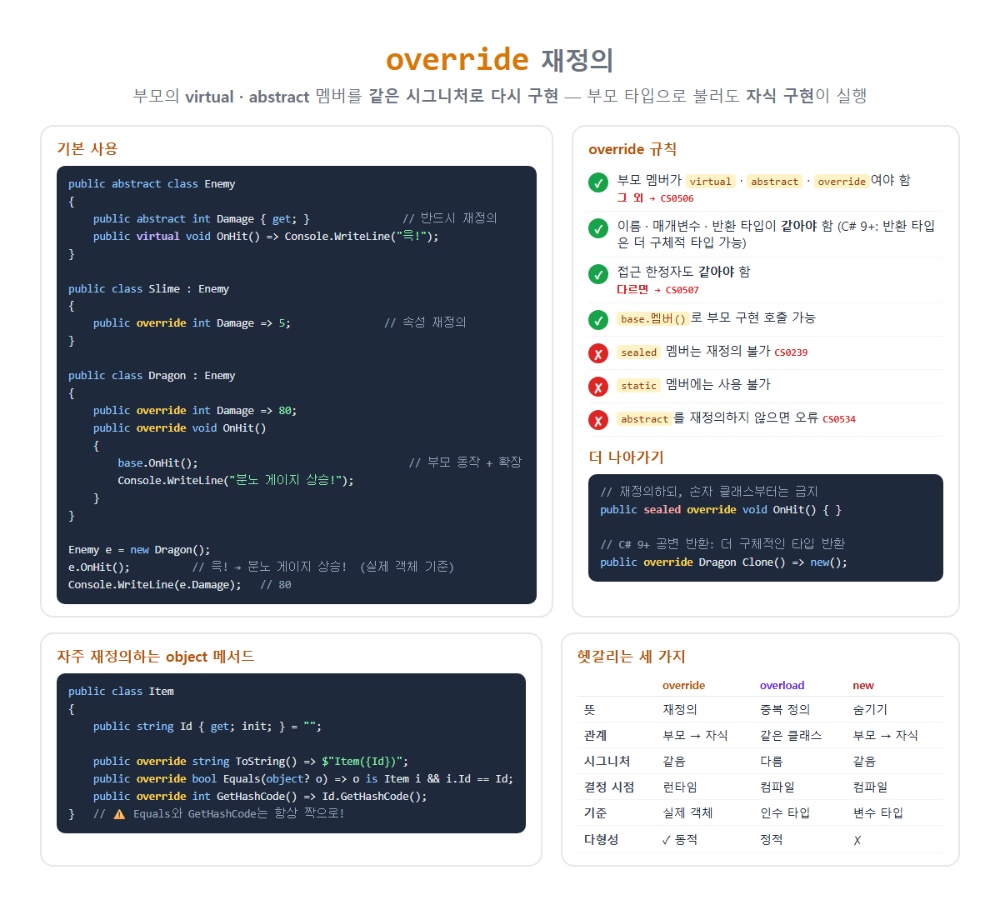

# [오버라이드(override)](../KeywordsList.md)

</img>

| 항목 | 내용 |
| --- | --- |
| 정의 | 부모의 virtual/abstract 멤버를 자식이 같은 시그니처로 재구현 |
| 짝꿍 | 부모의 `virtual`, `abstract` |
| 대상 | 메서드, 속성, 인덱서, 이벤트 |
| 호출 결정 | 런타임, 실제 객체 타입 기준 |
| 부모 구현 호출 | `base.멤버()` |
| 시그니처·접근 수준 | 부모와 같아야 함 (반환 타입은 C# 9+ 공변 허용) |
| 재정의 금지 | `sealed override` |
| 대표 재정의 | `ToString()`, `Equals()` + `GetHashCode()` |
| 관련 오류 | CS0506, CS0507, CS0115, CS0239, CS0534 |

## 정의

- 자식 클래스가 부모 클래스의 virtual 또는 abstract 멤버를 같은 시그니처로 다시 구현(재정의)할 때 붙이는 키워드
- 재정의하면 부모 타입의 변수로 호출해도 실제 객체(자식)의 구현이 실행됨. ⇒ 동적 다형성
- 부모의 virtual이 "바꿔도 된다"는 허락이라면, 자식의 override는 "내가 바꾸겠다"는 선언

## 특징

| 규칙 | 설명 | 어기면 |
| --- | --- | --- |
| **부모 멤버가 `virtual`, `abstract`, `override`여야 함** | 일반 메서드는 재정의할 수 없음 | **CS0506** |
| **시그니처가 같아야 함** | 이름, 매개변수(개수, 타입, 순서, ref/out) | CS0115 (재정의할 멤버 없음) |
| **반환 타입이 같아야 함** | C# 9부터는 더 구체적인 타입도 허용(공변 반환) | CS0508 |
| **접근 한정자가 같아야 함** | 부모가 `protected`면 자식도 `protected` | **CS0507** |
| **`sealed` 멤버는 재정의 불가** | 이미 봉인된 멤버 | **CS0239** |
| **`abstract` 멤버는 반드시 재정의** | 자식이 추상 클래스가 아니라면 | **CS0534** |
| **`static`에는 사용 불가** | 객체가 없으므로 다형성이 없음 |  |
- `override`가 붙은 멤버도 계속 virtual. 그래서 손자 클래스가 다시 재정의할 수 있음.
- `base.멤버`로 바로 위 부모의 구현을 호출할 수 있음.
- 메서드, 속성, 인덱서, 이벤트 모두 재정의할 수 있음

## 기능

| 기능 | 설명 |
| --- | --- |
| **다형성** | `List<Enemy>`에 여러 종류의 적을 담고 `e.OnHit()` 한 줄로 각자 다르게 반응 |
| **기본 동작 맞춤** | 부모의 기본 구현을 자식 상황에 맞게 변경 |
| **기능 확장** | `base.X()`를 호출한 뒤 추가 동작을 덧붙임 |
| **추상 멤버 구현** | `abstract`로 약속만 된 기능을 실제로 구현 |
| **프레임워크 확장** | `ToString()`, `Equals()`, `Dispose(bool)` 등 .NET이 제공하는 확장 지점에 내 동작을 연결 |