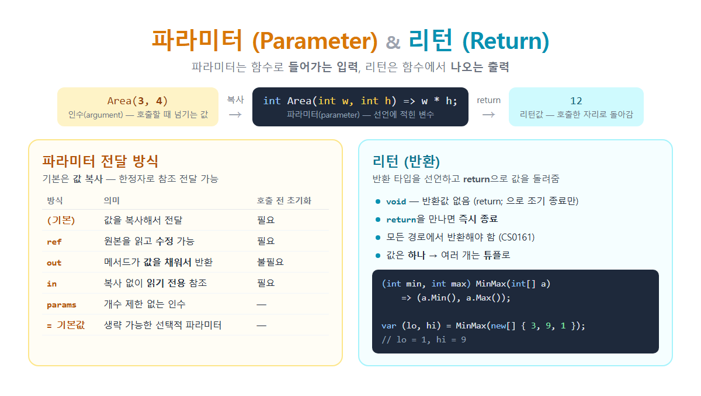

# [파라미터와 리턴](../KeywordsList.md)

</img>

| 구분 | 파라미터 (Parameter) | 리턴 (Return) |
| --- | --- | --- |
| 방향 | 함수로 들어감 (입력) | 함수에서 나옴 (출력) |
| 위치 | 선언의 `( )` 안 | 선언의 반환 타입 + 본문의 `return` 문 |
| 개수 | 0개 ~ 여러 개 | 0개(`void`) 또는 1개 (튜플로 묶어 여러 개 가능) |
| 없을 때 | `()` | `void` |
| 기본 동작 | 인수의 값을 복사해서 받음 | 값을 복사해서 돌려줌 |
| 참조 버전 | `ref`, `out`, `in` | `ref` 반환 |
| 생략 기능 | 기본값, `params` | 식 본문 `=>` (return 키워드 생략) |
| 관련 오류 | CS1501 (인수 개수 불일치), CS1503 (타입 불일치) | CS0161 (모든 경로 미반환), CS0029 (타입 불일치) |
| 시그니처 포함 | ✅ 포함 (오버로딩 기준) | ❌ 포함 안 됨 |

## 파라미터(Parameter, 매개변수)

### 정의

- 함수를 선언할 때 괄호 안에 적는 변수.
- 함수가 일하는 데 필요한 입력값을 받는 통로

### 파라미터 vs 인수(Argument)

- 파라미터 : 선언 쪽에 있는 변수 이름
- 인수 : 호출할 때 실제로 넘기는 값

### 특징

- 함수의 지역 변수처럼 동작. 함수 안에서만 쓸 수 있고, 함수가 끝나면 사라짐.
- 기본 전달 방식은 값 복사(Pass by Value). 인수의 값이 파라미터로 복사되어 들어감.
- 타입을 반드시 적어야 함. 넘기는 인수의 타입이 맞지 않으면 컴파일 오류 발생.
- 개수는 0개부터 여러 개 까지 가능하며 쉼표로 구분.

### 파라미터 전달 방식과 기능

| 방식 | 예 | 의미 | 호출 전 초기화 | 메서드 안에서 |
| --- | --- | --- | --- | --- |
| 값 (기본) | `void F(int x)` | 값을 복사해서 전달 | 필요 | 바꿔도 원본 영향 없음 |
| `ref` | `void F(ref int x)` | 원본 변수의 참조 전달 | 필요 | 읽기·수정 가능 → 원본이 바뀜 |
| `out` | `void F(out int x)` | 결과를 돌려받는 통로 | 불필요 | 반드시 값을 넣어야 함 |
| `in` | `void F(in BigStruct s)` | 복사 없이 읽기 전용 참조 | 필요 | 수정 불가 |
| `params` | `void F(params int[] a)` | 개수 제한 없는 인수 | — | 배열로 받음 |
| 선택적 (기본값) | `void F(int x = 10)` | 생략하면 기본값 사용 | — | — |

```csharp
// ref: 원본 수정
void Swap(ref int a, ref int b) => (a, b) = (b, a);
int x = 1, y = 2;
Swap(ref x, ref y);                  // x = 2, y = 1

// out: 성공 여부 + 결과값을 함께 받기
if (int.TryParse("123", out int num))
    Console.WriteLine(num);          // 123

// params
int Sum(params int[] nums) => nums.Sum();
Sum(1, 2, 3);                        // 6

// 기본값 + 명명 인수
void Log(string msg, string level = "INFO", bool time = true) { ... }
Log("시작");                          // level = "INFO", time = true
Log("오류", time: false);              // 중간 파라미터를 건너뛰고 이름으로 지정
```

### 규칙

- 기본값이 있는 파라미터는 맨 뒤에 와야 함.
- 기본값은 컴파일 타임 상수여야 함. `DateTime.Now`처럼 실행 중에 정해지는 값은 쓸 수 없음.
- `params`는 마지막 파라미터에 하나만 쓸 수 있음.
- `ref`와 `out`은 호출할 때도 키워드를 붙여야 함.

## 리턴(Return, 반환)

### 정의

- 함수가 작업을 마치고 호출한 쪽에 결과값을 돌려주는 것.
- 함수 선언에 반환 타입을 적고, 본문에서 return 문으로 값을 돌려줌

### 특징

- 반환 타입은 하나. `int`, `string`, `List<T>`, 클래스 등 어떤 타입이든 될 수 있음.
- `void`는 반환값이 없다는 뜻. 이때 `return;`은 값 없이 함수를 끝내는 용도로만 사용.
- `return`을 만나면 즉시 함수가 종료됨. 그 아래 코드는 실행되지 않음.
- 모든 실행 경로에서 값을 반환해야 함. 반환하지 않는 경로가 있으면 오류 CS0161이 발생.
- 반환값은 호출한 자리에 대입되거나 식으로 쓰임. 반환값을 쓰지 않고 버려도 컴파일 오류는 아님.

### 여러 값을 반환하는 방법

| 방법 | 예 | 추천 상황 |
| --- | --- | --- |
| **튜플** | `(int min, int max) MinMax(...)` | 간단하게 2~3개 값을 돌려줄 때 ⭐ |
| **`out` 파라미터** | `bool TryParse(string s, out int v)` | "성공 여부 + 결과" 패턴 (Try 패턴) |
| **record / class** | `record Stats(int Min, int Max, double Avg);` | 값이 많거나 의미 있는 묶음일 때 |
| **컬렉션** | `List<int>`, `IEnumerable<T>` | 같은 타입의 값이 여러 개일 때 |

```csharp
(int min, int max) MinMax(int[] a) => (a.Min(), a.Max());

var (lo, hi) = MinMax(new[] { 3, 9, 1 });   // 분해(deconstruction): lo = 1, hi = 9
```