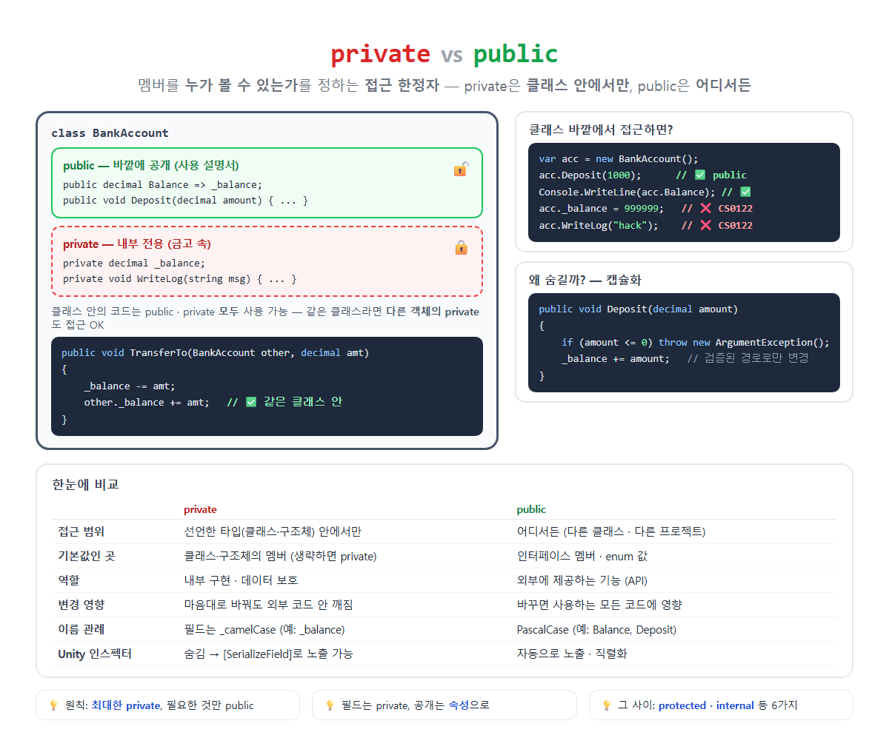

# [private, public](../KeywordsList.md)

</img>

| 구분 | private | public |
| --- | --- | --- |
| 접근 범위 | 선언한 타입 안에서만 | 어디서든 |
| 같은 클래스의 다른 객체 | ✅ 접근 가능 | ✅ |
| 자식 클래스 | ❌ (자식도 접근 불가) | ✅ |
| 다른 클래스 | ❌ | ✅ |
| 다른 프로젝트(어셈블리) | ❌ | ✅ |
| 기본값인 곳 | 클래스·구조체의 멤버 | 인터페이스 멤버, enum 값 |
| 역할 | 내부 구현, 데이터 보호 | 외부에 제공하는 기능(API) |
| 변경 영향 | 바꿔도 외부 코드가 깨지지 않음 | 바꾸면 사용하는 모든 코드에 영향 |
| 이름 관례 (필드) | `_camelCase` (`_balance`) | `PascalCase` (`Balance`) |
| Unity 인스펙터 | 숨김 (`[SerializeField]`로 노출 가능) | 자동 노출, 직렬화 |
| 오류 코드 | 바깥에서 접근하면 CS0122 | — |

## private

- 선언한 타입(클래스나 구조체) 안에서만 접근할 수 있게 함. 바깥에서는 그 멤버가 존재하는지조차 보이지 않음
- 쓰임
    - 객체 내부의 데이터(필드)
    - 내부에서만 쓰는 보조 메서드
    - 외부가 몰라도 되는 구현 세부 사항
- 특징 : 클래스와 구조체 멤버의 기본값. 아무것도 안 쓰면 private

```csharp
public class BankAccount
{
    private decimal _balance;                 // 내부 데이터
    private void WriteLog(string msg) { }     // 내부 보조 메서드
    int _count;                               // 한정자 생략 → private
}
```

## public

- 어디서든 접근 가능. 다른 클래스, 다른 프로젝터(어셈블리)에서도 쓸 수 있음.
- 쓰임 : 외부에서 제공하는 기능. 클래스의 사용 설명서(API)
- 특징 : 한 번 공개하면 많은 코드가 의존하게 되므로, 나중에 바꾸기 어려움.

```csharp
public class BankAccount
{
    public decimal Balance => _balance;                // 읽기 공개
    public void Deposit(decimal amount) { ... }        // 기능 공개
}
```

## 핵심 차이 : 바깥에서 접근할 때

```csharp
var acc = new BankAccount();

acc.Deposit(1000);               // ✅ public
Console.WriteLine(acc.Balance);  // ✅ public

acc._balance = 999999;           // ❌ CS0122: 보호 수준 때문에 접근할 수 없음
acc.WriteLog("hack");            // ❌ CS0122
```

### 캡슐화(Capsulation)

- 데이터를 private으로 숨기고 검증된 public 메서드로만 바꾸게 하면, 객체가 항상 올바른 상태를 유지

```csharp
public class BankAccount
{
    private decimal _balance;

    public decimal Balance => _balance;

    public void Deposit(decimal amount)
    {
        if (amount <= 0) throw new ArgumentException("금액은 양수여야 합니다");
        _balance += amount;              // 검증을 통과해야만 변경
    }

    public bool Withdraw(decimal amount)
    {
        if (amount > _balance) return false;   // 잔액 부족 방지
        _balance -= amount;
        return true;
    }
}
```

- `_balance`가 public 이었다면 누구나 `acc._balance = -1000000`을 넣을 수 있었을 것.