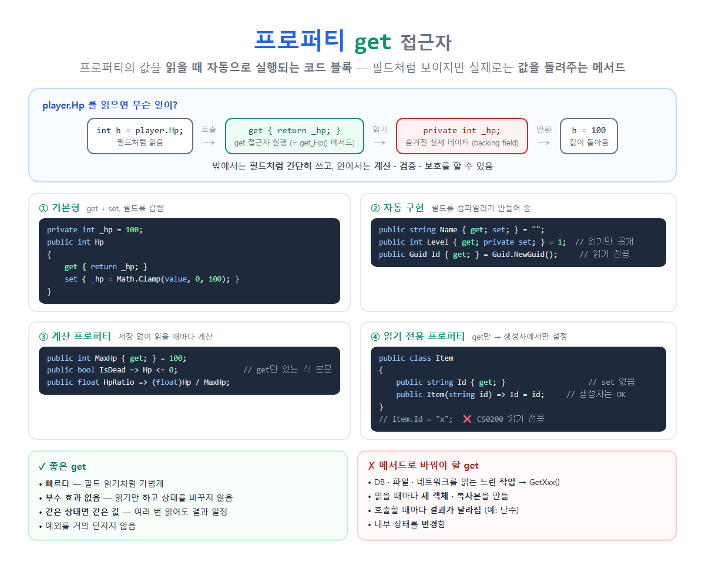

# [프로퍼티(get)](../KeywordsList.md)

</img>

| 항목 | 내용 |
| --- | --- |
| 정의 | 프로퍼티 값을 읽을 때 실행되는 접근자 |
| 반환 | 프로퍼티 타입의 값을 반드시 반환 |
| 컴파일 결과 | `get_프로퍼티명()` 메서드 |
| 형태 | `get { return …; }`, `get;`(자동), `=> 식`(식 본문), `get => field;`(C# 14) |
| get만 있으면 | 읽기 전용 프로퍼티 (생성자·초기값에서만 설정) |
| 접근 수준 | `{ get; private set; }`처럼 따로 지정 가능 |
| 대표 용도 | 캡슐화, 읽기 전용 공개, 계산된 값, 지연 초기화, 데이터 바인딩 |
| 관련 오류 | CS0200 (읽기 전용에 대입), CS0161 (반환 누락) |

## 정의

- 프로퍼티(속성)는 밖에서 보면 필드처럼 읽고 쓰지만, 실제로는 접근자(Accessor)라는 특별한 메서드로 동작하는 클래스 멤버
- get 접근자 : 프로퍼티의 값을 읽을 때 자동으로 실행되는 코드 블록. 값을 반환(return)
- set 접근자 : 값을 쓸 때 실행.

```csharp
public class Player
{
    private int _hp = 100;          // 실제 데이터 (backing field, 보통 private)

    public int Hp                   // 프로퍼티
    {
        get { return _hp; }         // 읽을 때 실행
        set { _hp = value; }        // 쓸 때 실행
    }
}

var p = new Player();
int h = p.Hp;      // ← get 접근자가 실행되어 _hp(100)를 반환
p.Hp = 80;         // ← set 접근자가 실행
```

- 컴파일러는 `get`을 `get_Hp()`라는 메서드로 만듦. 그래서 p.Hp는 사실 메서드 호출이지만, 코드에서는 필드처럼 간단하게 쓸 수 있음.

## 특징

- 반드시 프로퍼티 타입의 값을 반환해야 함. 모든 경로에서 `return`이 필요.
- 매개변수가 없음. 인덱서(`this[int i]`)의 get만 예외로 매개변수를 받음.
- get만 있으면 읽기 전용 프로퍼티가 됨. 외부에서 값을 대입하면 오류 CS0200 발생.
- 접근 수준을 따로 줄 수 있음. 예: `{ get; private set; }`
    - 보통 get은 공개하고 set은 제한.
    - get과 set 중 하나만 프로퍼티보다 좁은 접근 수준을 가질 수 있음.
- 식 본문(`=>`)으로 짧게 쓸 수 있음. `public bool IsDead => Hp <= 0;`은 get만 있는 프로퍼티.
- 인터페이스, `abstract`, `virtual`, `override`에도 쓸 수 있음

## get의 여러 형태

#### 기본형 : private 필드를 감싸기

```csharp
private int _hp = 100;
public int Hp
{
    get { return _hp; }
    set { _hp = Math.Clamp(value, 0, MaxHp); }   // 쓰기는 검증
}
```

#### 자동 구현 프로퍼티 : 필드를 컴파일러가 대신 만듦

```csharp
public string Name { get; set; } = "";
public int Level { get; private set; } = 1;     // 읽기는 공개, 쓰기는 클래스 안에서만
public Guid Id { get; } = Guid.NewGuid();       // 읽기 전용 (초기값 또는 생성자에서만 설정)
public DateTime CreatedAt { get; init; }        // 객체를 만들 때만 설정 가능 (C# 9+)
```

#### 계산 프로퍼티 : 저장하지 않고 읽을 때마다 계산

```csharp
public int MaxHp { get; } = 100;
public int Hp { get; private set; } = 100;

public bool IsDead => Hp <= 0;                         // 식 본문 get
public float HpRatio => (float)Hp / MaxHp;             // 체력바 비율
public string Display => $"{Name} Lv.{Level}";
```

#### 읽기 전용 프로퍼티 : get만 두고 생성자에서 설정

```csharp
public class Item
{
    public string Id { get; }                     // set이 없음
    public Item(string id) => Id = id;            // 생성자에서는 설정 가능
}

var item = new Item("sword01");
item.Id = "x";                                    // ❌ CS0200: 읽기 전용
```

#### 지연 초기화 (Lazy) : 처음 읽을 때 한 번만 생성

```csharp
private List<Item>? _items;
public List<Item> Items => _items ??= new List<Item>();   // 처음 읽을 때만 생성
```

#### `field` 키워드 (C# 14+) : 필드를 직접 선언하지 않고 접근

```csharp
public string Name
{
    get => field;                     // 컴파일러가 만든 숨은 필드
    set => field = value.Trim();      // set에만 로직 추가
} = "";
```

- 로직이 필요한 접근자가 한쪽뿐일 때, private 필드를 따로 선언하지 않아도 됨.

## 기능

| 기능 | 설명 |
| --- | --- |
| **캡슐화** | 데이터(필드)는 숨기고, 읽는 통로만 공개 |
| **읽기 전용 공개** | `{ get; private set; }`, `{ get; }`로 외부 수정을 막음 |
| **계산된 값 제공** | 저장하지 않고 다른 값으로부터 계산 (`IsDead`, `HpRatio`) |
| **변경에 강함** | 나중에 내부 구현(필드 → 계산 → 캐시)을 바꿔도 사용하는 쪽 코드는 그대로 |
| **지연 초기화** | 처음 필요할 때 생성해서 자원 절약 |
| **데이터 바인딩** | WPF, MAUI, Blazor 등은 필드가 아닌 프로퍼티에 바인딩 |
| **인터페이스 계약** | `interface IHasName { string Name { get; } }` |