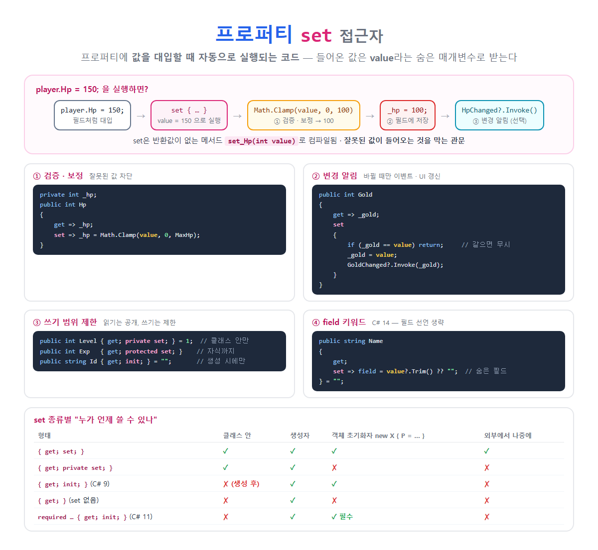

# [프로퍼티 - set](../KeywordsList.md)

</img>

| 항목 | 내용 |
| --- | --- |
| 정의 | 프로퍼티에 값을 대입할 때 실행되는 접근자 |
| 입력 | 숨은 매개변수 **`value`** (프로퍼티 타입) |
| 반환 | 없음 (void) |
| 컴파일 결과 | `set_프로퍼티명(value)` 메서드 |
| 형태 | `set { … }`, `set;`(자동), `set => …`(식 본문), `init`, `set => field = …`(C# 14) |
| 접근 제한 | `private set`, `protected set`, `internal set` |
| 생성 시에만 | `init` (C# 9), 필수 지정 `required` (C# 11) |
| 대표 용도 | 검증·보정, 변경 알림, 쓰기 권한 제어, 연관 값 갱신 |
| 관련 오류 | CS0200 (set 없음), CS0272 (set 접근 불가), CS8852 (init 전용), CS9035 (required 누락) |

## 정의

- 프로퍼티에 값을 대입할 때 자동으로 실행되는 코드 블록
- 대입된 값은 value라는 숨은 매개변수로 받음. value의 타입은 프로퍼티 타입과 같음.
- set은 반환값이 없음
- 컴파일러는 set을 set_프로퍼티명(타입 value)라는 void 메서드로 만듦.

```csharp
public class Player
{
    private int _hp;
    public int MaxHp { get; } = 100;

    public int Hp
    {
        get => _hp;
        set => _hp = Math.Clamp(value, 0, MaxHp);   // 대입된 값 = value
    }
}

var p = new Player();
p.Hp = 150;                 // set 실행: value = 150 → 보정 → _hp = 100
Console.WriteLine(p.Hp);    // 100
p.Hp = -20;                 // _hp = 0
```

- get이 값을 내보내는 출구라면, set은 값이 들어오는 입구이자 관문

## 특징

- `value`는 키워드. set 안에서만 쓸 수 있고, 따로 선언하지 않음.
- set만 따로 접근 수준을 좁힐 수 있음. 예: `{ get; private set; }`. 보통 읽기는 공개, 쓰기는 제한하는 데 사용.
- 복합 대입(`+=`, `++`)은 get과 set을 둘 다 호출. `p.Hp += 10`은 `p.Hp = p.Hp + 10`과 같음.
- `init` 접근자 (C# 9+)는 객체를 만들 때만 값을 설정할 수 있는 특별한 set.
- set이 없으면 외부에서 대입할 수 없음(CS0200). 생성자나 초기값에서만 설정할 수 있음.
- `ref`나 `out`으로 넘길 수 없음(CS0206). 프로퍼티는 저장 위치가 아니라 메서드이기 때문.

## set의 여러 형태

#### **검증 · 보정 : 잘못된 값 막기**

```csharp
private string _name = "";
public string Name
{
    get => _name;
    set
    {
        if (string.IsNullOrWhiteSpace(value))
            throw new ArgumentException("이름은 비어 있을 수 없습니다.", nameof(value));
        _name = value.Trim();
    }
}

public int Hp
{
    get => _hp;
    set => _hp = Math.Clamp(value, 0, MaxHp);   // 범위를 벗어나면 자동 보정
}
```

#### **변경 알림 : 값이 바뀔 때 이벤트 발생**

```csharp
public event Action<int>? GoldChanged;
private int _gold;

public int Gold
{
    get => _gold;
    set
    {
        if (_gold == value) return;     // 같은 값이면 알리지 않음 (불필요한 갱신 방지)
        _gold = value;
        GoldChanged?.Invoke(_gold);     // UI, 사운드 등에 알림 (옵저버 패턴)
    }
}
```

- WPF와 MAUI의 데이터 바인딩도 이 방식(`INotifyPropertyChanged`)으로 값이 바뀌면 화면을 자동 갱신.

#### **쓰기 범위 제한**

```csharp
public int Level { get; private set; } = 1;      // 외부: 읽기만 / 클래스 안: 쓰기 가능
public int Exp { get; protected set; }           // 자식 클래스까지 쓰기 가능
public string Id { get; init; } = "";            // 객체 생성 시에만 설정

public void LevelUp() => Level++;                // 클래스 안에서는 OK
// player.Level = 99;                            // ❌ CS0272: set 접근자에 접근할 수 없음
```

#### **`init` 접근자 (C# 9+) : 생성 시에만 설정**

```csharp
public class Item
{
    public string Id { get; init; } = "";
    public string Name { get; init; } = "";
}

var sword = new Item { Id = "sword01", Name = "검" };   // ✅ 객체 초기화자에서 설정
sword.Name = "도끼";                                     // ❌ CS8852: init 전용

var copy = sword with { Name = "강화된 검" };            // record라면 with 식도 가능
```

#### **`required` (C# 11+) : 반드시 설정하게 강제**

```csharp
public class User
{
    public required string Email { get; init; }
}

var u1 = new User { Email = "a@b.com" };   // ✅
var u2 = new User();                       // ❌ CS9035: required 멤버를 설정하지 않음
```

#### **`field` 키워드 (C# 14+): 숨은 필드 직접 사용**

```csharp
public string Name
{
    get;
    set => field = value?.Trim() ?? "";    // private 필드를 따로 선언하지 않아도 됨
} = "";
```

## 기능

| 능 | 설명 |
| --- | --- |
| **데이터 보호** | 범위 밖 값, null, 빈 문자열 등을 차단하거나 보정 |
| **불변 조건 유지** | 체력은 0~최대치, 레벨은 1 이상 같은 규칙을 항상 지킴 |
| **변경 알림** | 값이 바뀌면 이벤트 발생 → UI 갱신, 저장 표시(dirty flag) |
| **연관 값 갱신** | 하나를 바꾸면 관련된 값도 함께 갱신 |
| **쓰기 권한 제어** | `private set`, `protected set`, `init`으로 누가 언제 바꿀 수 있는지 결정 |
| **디버깅** | set에 중단점을 걸면 누가 값을 바꾸는지 바로 추적 가능 |

## set 종류별

| 형태 | 클래스 안 (메서드) | 생성자 | 객체 초기화자 `new X { P = … }` | 외부에서 나중에 |
| --- | --- | --- | --- | --- |
| `{ get; set; }` | ✅ | ✅ | ✅ | ✅ |
| `{ get; private set; }` | ✅ | ✅ | ❌ (외부에서) | ❌ |
| `{ get; protected set; }` | ✅ (자식 포함) | ✅ | ❌ (외부에서) | ❌ |
| `{ get; init; }` (C# 9) | ❌ (생성 후) | ✅ | ✅ | ❌ |
| `{ get; }` (set 없음) | ❌ | ✅ | ❌ | ❌ |
| `required … { get; init; }` (C# 11) | ❌ | ✅ | ✅ 필수 | ❌ |