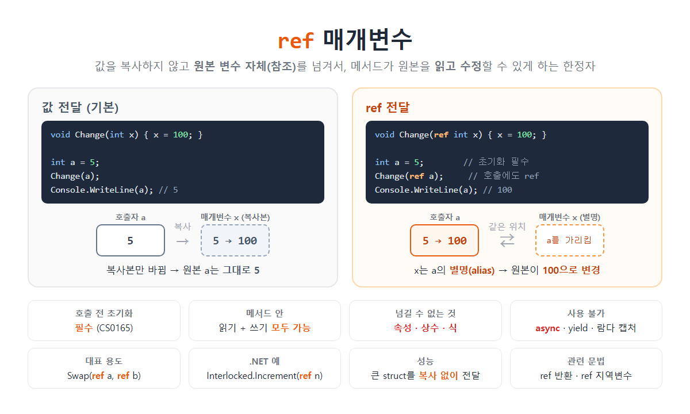

# [함수 파라미터(ref)](../KeywordsList.md)

</img>

| 항목 | 내용 |
| --- | --- |
| 이름 | ref 매개변수 (참조 매개변수) |
| 정의 | 변수의 참조를 넘겨서 원본을 읽고 수정할 수 있게 하는 한정자 |
| 동작 | 매개변수가 원본 변수의 별명이 됨 |
| 호출 전 초기화 | 필수 (CS0165) |
| 메서드 안 | 읽기와 쓰기 모두 가능, 할당 의무 없음 |
| 호출 문법 | `Method(ref variable)` |
| 넘길 수 없는 것 | 속성(CS0206), 상수, 식 |
| 사용 불가 | `async`, `yield`, 람다 캡처(CS1628) |
| 대표 용도 | Swap, 값 갱신, `Interlocked`, 큰 struct 전달 |
| 오버로딩 | 값 vs ref는 가능, ref vs out만 다른 것은 불가(CS0663) |

## 정의

- `ref`는 매개변수 앞에 붙이는 한정자로, 인수를 참조로 전달(Pass by Reference)
- 기본 방식처럼 값을 복사하지 않고, 호출한 쪽 변수 자체(메모리 위치)를 넘김.
- 그래서 메서드 안의 매개변수는 원본 변수의 별명(alias)이 됨.
- 메서드가 그 매개변수를 읽을 수도 있고, 수정하면 원본도 바로 바뀜

```csharp
void Change(ref int x)
{
    x = 100;            // 원본 변수를 직접 수정
}

int a = 5;
Change(ref a);          // 호출할 때도 ref 필수
Console.WriteLine(a);   // 100
```

비교: 값 전달(기본)

```csharp
void Change(int x) { x = 100; }   // 복사본만 바뀜

int a = 5;
Change(a);
Console.WriteLine(a);   // 5 (그대로)
```

## 특징

- 호출 전에 반드시 초기화해야 함.
    - 메서드가 값을 읽을 수도 있기 때문. 초기화하지 않고 넘기면 오류 CS0165 발생.

```csharp
int n;
Change(ref n);      // ❌ CS0165: 할당되지 않은 지역 변수 사용
```

- 메서드 안에서 읽기와 쓰기가 모두 가능.
    - `out`과 달리, 메서드 안에서 반드시 값을 할당할 의무는 없음.
- 호출할 때도 `ref`를 붙여야 함.
    - 호출부만 봐도 "이 변수가 바뀔 수 있다**"**는 것을 알 수 있게 하려는 의도.
- 넘길 수 있는 것은 "저장 위치"뿐

| 가능 ✅ | 불가 ❌ |
| --- | --- |
| 지역 변수: `ref a` | 상수, 리터럴: `ref 5` |
| 필드: `ref this.count` | 식: `ref (a + 1)` |
| 배열 요소: `ref arr[0]` | 속성: `ref obj.Count` → CS0206 |

속성은 실제로는 메서드(get/set)라서 고정된 위치가 없기 때문에 넘길 수 없음

- 사용할 수 없는 곳
    - 
    - `async` 메서드 : 오류 CS1988
    - 반복기(`yield`) 메서드
    - 람다나 로컬 함수 안에서 바깥 메서드의 ref 매개변수를 캡처하는 것 : 오류 CS1628

## 기능

- 두 변수의 값 교환 (Swap)

```csharp
void Swap<T>(ref T a, ref T b)
{
    (a, b) =(b, a);
}

int x =1, y =2;
Swap(ref x, ref y);    // x = 2, y = 1
```

- 원본 값을 누적하거나 갱신하기

```csharp
void AddScore(ref int score, int bonus) => score += bonus;

int myScore =100;
AddScore(ref myScore, 50);   // myScore = 150
```

- 스레드 안전한 원자적 연산 (.NET 표준 API)

```csharp
int counter =0;
Interlocked.Increment(ref counter);              // 여러 스레드가 동시에 호출해도 안전
Interlocked.CompareExchange(ref counter, 10, 1);
```

- 큰 구조체를 복사 없이 전달 (성능)

구조체는 값 형식이라 넘길 때마다 전체가 복사됨. 수십 바이트 이상인 큰 구조체라면 `ref`로 넘겨서 복사 비용을 줄일 수 있음.

```csharp
struct Matrix4x4 { /* float 16개 = 64바이트 */ }

void Transform(ref Matrix4x4 m) { ...}   // 64바이트 복사 대신 참조만 전달
```

- `Array.Resize`: 참조 형식 변수 자체를 바꾸기

```csharp
int[] arr ={ 1, 2, 3 };
Array.Resize(ref arr, 5);   // 새 배열을 만들어 arr 변수가 그것을 가리키게 함
```