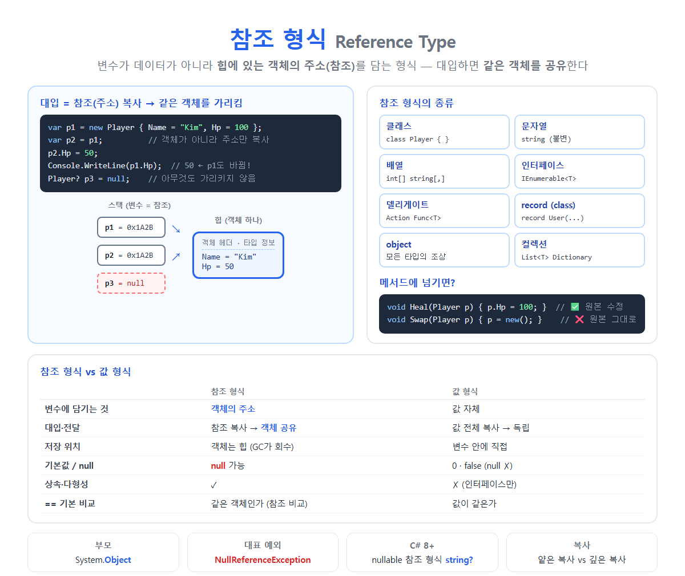

# [참조 형식](../KeywordsList.md)

</img>

| 항목 | 내용 |
| --- | --- |
| 정의 | 변수가 힙에 있는 객체의 주소(참조)를 담는 형식 |
| 부모 | `System.Object` |
| 종류 | 클래스, 문자열, 배열, 인터페이스, 델리게이트, record, object |
| 대입 | 참조 복사 → 같은 객체 공유 |
| 저장 | 객체는 힙, 변수에는 주소 |
| 기본값 | `null` |
| 메모리 관리 | 가비지 컬렉터(GC) |
| 비교 | 기본은 참조 비교 (`string`, `record`는 값 비교) |
| 대표 예외 | `NullReferenceException` |
| C# 8+ | nullable 참조 형식(`string?`)으로 null 안전성 강화 |

## 정의

- 변수가 데이터 자체가 아니라 힙(Heap)에 있는 객체의 주소(참조)를 담는 형식
- 변수에 다른 변수를 대입하면 객체가 복사되는 것이 아니라 주소만 복사
- 그래서 두 변수가 같은 객체를 공유
- 모든 참조 형식은 System.Object를 최상위 부모로 둠.

```csharp
class Player { public string Name = ""; public int Hp; }

var p1 = new Player { Name = "Kim", Hp = 100 };  // 힙에 객체 생성, p1에는 주소
var p2 = p1;                                      // 주소만 복사 → 같은 객체
p2.Hp = 50;

Console.WriteLine(p1.Hp);   // 50  ← p1도 바뀜 (같은 객체를 보고 있으므로)
```

## 종류

| 분류 | 예 |
| --- | --- |
| **클래스 (class)** | 사용자 정의 클래스, `List<T>`, `Dictionary<K,V>`, `StringBuilder` |
| **문자열** | `string` (불변이라 값처럼 동작하지만 참조 형식) |
| **배열** | `int[]`, `string[]`, `int[,]`, `int[][]` (요소가 값 형식이어도 배열 자체는 참조 형식) |
| **인터페이스** | `IEnumerable<T>`, `IDisposable` |
| **델리게이트** | `Action`, `Func<T>`, `EventHandler`, 람다 |
| **record (class)** | `record User(string Name, int Age);` |
| **object, dynamic** | 모든 타입의 최상위, 동적 타입 |

## 특징

- 대입하면 참조(주소)가 복사 → 객체 공유
    - 여러 변수가 같은 객체를 가리킬 수 있음. 한쪽에서 수정하면 다른 쪽에서도 보임.
- null이 될 수 있음
    - 필드와 배열 요소의 기본값이 null.
    - null인 변수의 멤버에 접근하면 `NullReferenceException`이 발생.

```csharp
Player? p = null;
Console.WriteLine(p.Name);    // 💥 NullReferenceException
Console.WriteLine(p?.Name);   // null (안전한 접근)
```

- 객체는 힙에 저장되고, GC가 회수.
    - `new`로 만든 객체는 관리되는 힙에 할당됨.
    - 더 이상 참조하는 곳이 없으면 가비지 컬렉터(GC)가 회수.
    - 객체마다 헤더(동기화 정보, 타입 정보)가 붙음. 64비트에서 최소 약 24바이트.
- 상속과 다형성을 지원.
    - 클래스는 다른 클래스를 상속할 수 있고, `virtual`/`override`로 다형성을 구현. 부모 타입 변수로 자식 객체를 가리킬 수 있음.

```csharp
Animal a = new Dog();   // 부모 타입 참조 → 자식 객체
a.Speak();              // Dog의 Speak() 실행 (다형성)
```

- 기본 비교는 "같은 객체인가" (참조 비교)
    
    ```csharp
    var a = new Player { Name = "Kim" };
    var b = new Player { Name = "Kim" };
    Console.WriteLine(a == b);        // False ← 내용은 같아도 다른 객체
    Console.WriteLine(a == a);        // True
    ```
    
    - `string`은 `==`를 오버로드해서 내용을 비교.
    - `record`는 값 기반 비교를 자동으로 생성.

## 기능

| 기능 | 설명 |
| --- | --- |
| **공유** | 큰 객체를 복사 없이 여러 곳에서 함께 사용 |
| **수명이 자유로움** | 메서드가 끝나도 참조가 남아 있으면 객체는 계속 살아 있음 |
| **크기 제한 없음** | 큰 데이터도 주소만 전달하므로 전달 비용이 일정함 (8바이트) |
| **상속·다형성** | 객체지향 설계의 기반 |
| **null 표현** | "없음" 상태를 자연스럽게 표현 |
| **순환·그래프 구조** | 노드가 서로를 참조하는 트리, 그래프, 연결 리스트 |