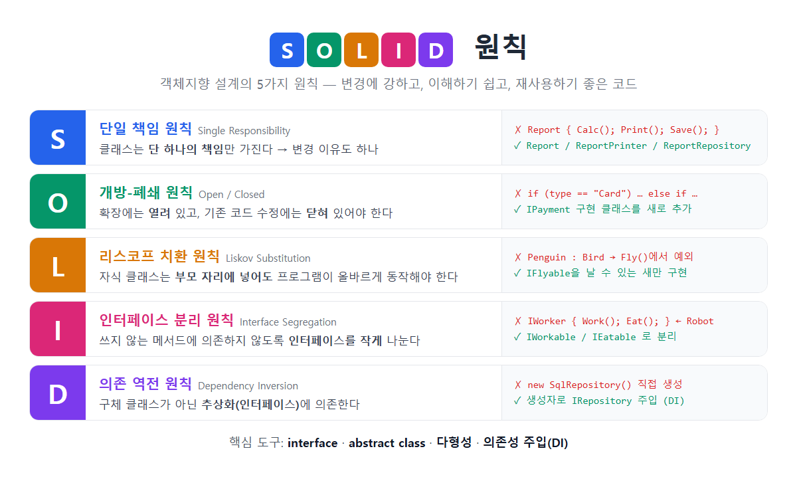

# [SOLID 원칙](../KeywordsList.md)

</img>

| 원칙 | 핵심 질문 | 위반 신호 | 해결 도구 |
| --- | --- | --- | --- |
| **S** 단일 책임 | 이 클래스를 바꿀 이유가 하나뿐인가? | 클래스가 거대함, `Manager`·`Util` 같은 만능 이름 | 클래스 분리 |
| **O** 개방-폐쇄 | 기능을 추가할 때 기존 코드를 고치는가? | 타입별 `if`/`switch`가 계속 늘어남 | 인터페이스, 다형성, 전략 패턴 |
| **L** 리스코프 치환 | 자식을 부모 자리에 넣어도 안전한가? | override에서 예외를 던짐, `is` 검사 | 상속 구조 재설계, 인터페이스로 능력 분리 |
| **I** 인터페이스 분리 | 안 쓰는 메서드를 억지로 구현하는가? | `NotImplementedException`, 빈 구현 | 작은 인터페이스 여러 개 |
| **D** 의존 역전 | `new`로 구체 클래스를 직접 만드는가? | 테스트 어려움, DB를 바꾸면 전부 수정 | 인터페이스 + 의존성 주입(DI) |

## 정의

- 객체지향 설계의 다섯 가지 핵심 원칙 앞 글자를 딴 말.
- 로버트 C. 마틴이 정리
- 목표는 바꾸기 쉽고, 이해하기 쉽고, 재사용하기 좋은 코드

| 글자 | 원칙 | 한 줄 요약 |
| --- | --- | --- |
| **S** | Single Responsibility (단일 책임) | 클래스는 하나의 책임만 |
| **O** | Open/Closed (개방-폐쇄) | 확장에는 열고, 수정에는 닫기 |
| **L** | Liskov Substitution (리스코프 치환) | 자식은 부모를 대체할 수 있어야 함 |
| **I** | Interface Segregation (인터페이스 분리) | 인터페이스는 작게 쪼개기 |
| **D** | Dependency Inversion (의존 역전) | 구체 클래스가 아니라 추상화에 의존 |

## 각 원칙 설명

### S : 단일 책임 원칙(SRP)

- 하나의 클래스는 하나의 책임만 가져야 함. 바꿔 말하면, 클래스를 수정할 이유가 하나뿐이어야 함.

```csharp
// ❌ 계산, 출력, 저장을 모두 담당 → 바뀔 이유가 3개
class Report
{
    public decimal Calculate() { ... }
    public void Print() { ... }
    public void SaveToDb() { ... }
}

// ✅ 책임별로 분리
class Report           { public decimal Calculate() { ... } }
class ReportPrinter    { public void Print(Report r) { ... } }
class ReportRepository { public void Save(Report r) { ... } }
```

- 효과 : 출력 형식을 바꿔도 계산 코드는 건드리지 않음. 클래스가 작아져서 테스트하기도 쉬워짐

### O : 개방-폐쇄 원칙(OCP)

- 소프트웨어는 확장에는 열려 있고(Open), 수정에는 닫혀 있어야(Closed) 함.
- 새 기능은 기존 코드를 고치지 않고 새 코드를 추가하는 방식으로 넣어야 함.

```csharp
// ❌ 결제 수단이 늘 때마다 이 메서드를 수정해야 함
void Pay(string type)
{
    if (type == "Card") { ... }
    else if (type == "Kakao") { ... }
}

// ✅ 새 결제 수단은 클래스만 추가
interface IPayment { void Pay(decimal amount); }
class CardPayment  : IPayment { public void Pay(decimal a) { ... } }
class KakaoPayment : IPayment { public void Pay(decimal a) { ... } }

void Checkout(IPayment payment, decimal amount) => payment.Pay(amount);  // 수정 불필요
```

- 도구: 인터페이스, 추상 클래스, 다형성(virtual/override), 전략 패턴

### L : 리스코프 치환 원칙(LSP)

- 자식 클래스의 객체를 부모 타입 자리에 넣어도 프로그램이 올바르게 동작해야 함. 자식 클래스가 부모가 약속한 동작을 깨면 안 됨.

```csharp
// ❌ 펭귄은 Bird지만 날 수 없음 → 부모의 약속(Fly)을 깸
class Bird    { public virtual void Fly() { ... } }
class Penguin : Bird
{
    public override void Fly() => throw new NotSupportedException();
}

// ✅ 능력을 따로 분리
class Bird { }
interface IFlyable { void Fly(); }
class Sparrow : Bird, IFlyable { public void Fly() { ... } }
class Penguin : Bird { }  // Fly 없음
```

- 위반 신호
    - override한 메서드에서 `NotSupportedException`을 던짐.
    - 자식 타입을 `is`로 검사해서 따로 처리하는 코드가 생김.
    - 자식이 부모보다 입력 조건을 더 까다롭게 요구

### I : 인터페이스 분리 원칙(ISP)

- 클라이언트는 자신이 쓰지 않는 메서드에 의존하면 안됨. 큰 인터페이스 하나보다 작고 구체적인 인터페이스 여러 개가 나음.

```csharp
// ❌ 로봇은 Eat()이 필요 없는데 억지로 구현해야 함
interface IWorker { void Work(); void Eat(); }
class Robot : IWorker
{
    public void Work() { ... }
    public void Eat() => throw new NotImplementedException();
}

// ✅ 역할별로 분리
interface IWorkable { void Work(); }
interface IEatable  { void Eat(); }
class Human : IWorkable, IEatable { ... }
class Robot : IWorkable { ... }
```

- .NET 예시 : `IEnumerable<T>`(읽기만) → `ICollection<T>`(추가, 삭제) → `IList<T>`(인덱스 접근)처럼 기능을 단계별로 나눠 둔 것이 좋은 예

### D : 의존 역전 원칙(DIP)

- 상위 모듈(비즈니스 로직)이 하위 모듈(DB, 파일, 외부 API)에 직접 의존하면 안됨.
- 둘 다 추상화(인터페이스)에 의존해야 함.

```csharp
// ❌ OrderService가 SqlRepository에 직접 묶임 → DB를 바꾸거나 테스트하기 어려움
class OrderService
{
    private readonly SqlRepository _repo = new SqlRepository();
}

// ✅ 인터페이스에 의존하고, 생성자로 주입받음 (의존성 주입, DI)
interface IOrderRepository { void Save(Order o); }

class OrderService
{
    private readonly IOrderRepository _repo;
    public OrderService(IOrderRepository repo) => _repo = repo;
}
```

- **ASP.NET Core 예시**: 아래처럼 등록해 두면, 프레임워크가 `OrderService`를 만들 때 `IOrderRepository` 자리에 `SqlOrderRepository`를 자동으로 넣어 줌.

```csharp
builder.Services.AddScoped<IOrderRepository, SqlOrderRepository>();
```

- 효과
    - DB를 교체할 때 구현 클래스만 바꾸면 됨.
    - 단위 테스트에서 가짜 구현(Mock)을 넣기 쉬워짐.