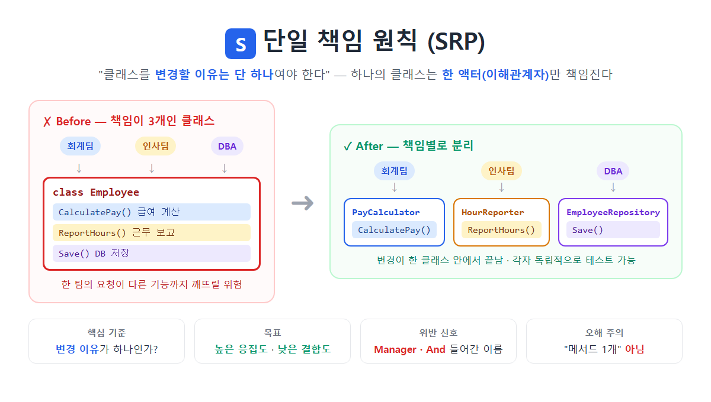

# [단일 책임 원칙(Single Responsibility Principle)](../KeywordsList.md)

</img>

| 항목 | 내용 |
| --- | --- |
| 이름 | 단일 책임 원칙 (Single Responsibility Principle) |
| 위치 | SOLID의 **S** |
| 정의 | 클래스를 변경할 이유는 하나뿐이어야 함 = 한 액터만 책임짐 |
| 판단 기준 | "이 코드의 변경을 요청하는 사람(액터)이 누구인가?" |
| 목표 | 높은 응집도, 낮은 결합도 |
| 위반 신호 | 거대 클래스, `Manager`·`And`가 들어간 이름, 과도한 의존성, 잦은 수정 |
| 해결 방법 | 클래스 추출(Extract Class), 책임별 분리, 퍼사드(Facade)로 묶기 |
| 적용 범위 | 메서드 → 클래스 → 모듈 → 계층(아키텍처) |
| 흔한 오해 | "메서드를 하나만 가져야 한다" ❌ |

## 정의

- SOLID의 첫 번째 원칙
- 하나의 모듈은 오직 하나의 액터(actor)에 대해서만 책임져야 한다
    - 여기서 액터란 그 코드의 변경을 요청하는 사람이나 집단
- 단순히 기능을 하나만 하라는 의미가 아닌 서로 다른 이해 관계자의 요구를 한 클래스에 섞지 마라는 의미

## 특징

- 판단 기준은 "변경 이유" : 메서드 개수나 코드 줄 수가 기준이 아님. "이 클래스를 고쳐 달라고 요청할 사람이 누구인가?"로 판단.
- 높은 응집도(Cohesion) : 클래스 안의 멤버들이 하나의 목적을 위해 긴밀하게 모여 있게 됨.
- 낮은 결합도(Coupling) : 한 책임이 바뀌어도 다른 책임에 영향이 퍼지지 않음.
- 모든 단위에 적용됨 : 클래스뿐 아니라 메서드(한 메서드는 한 가지 일), 모듈과 프로젝트(계층 분리) 수준에서도 같은 원리를 씀.

## 기능(얻는 효과)

| 효과 | 설명 |
| --- | --- |
| **변경 범위 축소** | 수정이 한 클래스 안에서 끝나서 다른 기능이 깨질 위험이 줄어듦 |
| **테스트 용이** | 작은 클래스는 단위 테스트를 작성하기 쉬움 |
| **가독성 향상** | 클래스 이름만 봐도 하는 일을 알 수 있음 |
| **재사용성** | `EmployeeRepository`를 다른 곳에서도 그대로 쓸 수 있음 |
| **협업 충돌 감소** | 회계 담당 개발자와 DB 담당 개발자가 같은 파일을 동시에 고치는 일이 줄어듦 (Git 충돌 감소) |

## 위반 신호(Code Smell)

- 클래스 이름에 `Manager`, `Processor`, `Helper`, `Util`, `And`가 들어감. 예: `UserManager`, `ValidateAndSave()`
- 클래스가 수백~수천 줄인 거대 클래스(God Class).
- 생성자로 주입받는 의존성이 너무 많음.
- 필드를 나눠 쓰는 메서드 그룹이 있음. 어떤 메서드들은 A, B 필드만, 다른 메서드들은 C, D 필드만 쓴다면 사실상 두 클래스가 한 클래스에 들어 있는 것.
- 클래스를 설명할 때 "그리고"가 들어감. 예: "주문을 처리하고, 이메일도 보내고, 로그도 남긴다"
- 같은 클래스가 여러 이유로 자주 수정됨.